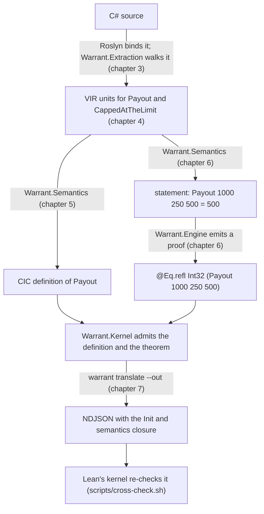

# M4: from C# methods to checked definitions

> Status: **milestone 4 is implemented as these chapters describe.** They were written before the implementation and updated after it; where the code differs from a simpler first sketch, the chapter says so.
> The plan that schedules this work is [docs/plans/2026-11-02-1245-feat-m4-pure-subset-plan.md](../plans/2026-11-02-1245-feat-m4-pure-subset-plan.md).
> Its Key Technical Decisions (`KTD1`, `KTD2`, …) own the decisions; these chapters explain them and cite them by ID.
> Code in these chapters shows the shape of the design and is not compiled. Lean terms are written in Lean notation for reading; command output is copied from real runs.

M4 is the first milestone in which Warrant reads C#.
At the end of it, a `[Verified]` method written in a small pure subset of C# becomes a CIC definition that Warrant's kernel accepts, a parameterless `[Theorem]` about it is proved or reported as false, and Lean's own kernel re-checks the result.
Nothing in M4 runs during a normal build: the MSBuild task and `warrant verify` arrive in M5a.
M4 runs through the test suite and a developer verb, `warrant translate`.

## Reading order

The chapters follow one method from source text to a checked theorem.
Each chapter introduces only what the next one needs.

| Chapter | Covers |
|---|---|
| [1. The semantics library](01-semantics-library.md) | Which Lean definitions model C# `int`, `long` and `bool`, why they are Init's own types, and how the library is built, exported and committed. |
| [2. The user package and the corpus](02-surface-and-corpus.md) | The attributes and calls a developer writes, and the fixed corpus of C# files that M4 must translate or reject. |
| [3. Extraction](03-extraction.md) | How Roslyn's `IOperation` tree becomes VIR, what the subset checker rejects, and how `[Closed]` types are recognised. |
| [4. VIR](04-vir.md) | The verification IR: its units and nodes, its canonical encoding and its two hashes. |
| [5. Translation](05-translation.md) | How VIR becomes CIC: names, types, expressions, conditions, control flow, equality and `switch`. |
| [6. Theorems](06-theorems.md) | How a `[Theorem]` becomes a proposition, and the `rfl` and `decide` proof terms the engine emits. |
| [7. Checking, testing and export](07-checking-and-testing.md) | The engine, differential tests, CLR-agreement tests, the `warrant translate` verb, the assumption report and the cross-check step. |

## The running example

Every chapter uses this code from the [tutorial](../proving/tutorial.md):

```csharp
namespace Payouts;

public static class PayoutRules
{
    [Verified]
    public static int Payout(int loss, int deductible, int limit)
    {
        if (loss <= deductible) return 0;
        var covered = loss - deductible;
        return covered > limit ? limit : covered;
    }
}

static class PayoutTheorems
{
    [Theorem]
    static Proof CappedAtTheLimit() =>
        Prove.That(PayoutRules.Payout(loss: 1000, deductible: 250, limit: 500) == 500);
}
```

Here is where it goes, one stage per chapter.



After translation, `Payout` is this definition, written here in Lean notation for reading.
Warrant never writes this text; it builds the term directly (design §4).
Its Lean name is `Cs.Payouts.PayoutRules.Payout(System.Int32,System.Int32,System.Int32)` (chapter 5); messages and reports show it as `Payouts.PayoutRules.Payout(int, int, int)`.

```lean
fun (loss deductible limit : Int32) =>
  if loss ≤ deductible then 0
  else
    let covered := loss - deductible
    if limit < covered then limit else covered
```

The theorem's statement is `Payout 1000 250 500 = 500`, and its proof is `@Eq.refl Int32 (Payout 1000 250 500)`.
The kernel accepts that proof only if `Payout 1000 250 500` reduces to `500`, which it does by computing `Int32` arithmetic on `BitVec 32` values.

## What M4 deliberately leaves out

- Tactics, quantified theorems and `Prove.That(...).By(...)` (M5a).
- Recursion, which needs termination proofs (M5a).
- `/`, `%`, `checked` arithmetic, exceptions, `null` as a value and contracts (M6).
- Loops, mutable objects, strings and `decimal` (M7).
- Integer bitwise operators and shifts. Init models `&`, `|`, `^`, `~`, `<<` and `>>` like C#, but C#'s `>>>` on a signed type is a logical shift where Lean's is arithmetic, and nothing in M4 needs any of them (plan, Scope Boundaries).

## Glossary

| Term | Meaning here |
|---|---|
| CIC | The Calculus of Inductive Constructions: Lean's core language, and what Warrant's kernel checks. |
| Init | Lean's core library, shipped with every Lean toolchain. Warrant reuses its `Int32`, `Int64`, `Bool` and `Decidable`. |
| Semantics library | The Lean project in `lean/` that pins down which definitions model C# (design D10). |
| Bundle | A committed, gzipped lean4export NDJSON file holding the semantics library and the part of Init it needs. |
| VIR | The verification IR between Roslyn and CIC (design §4.1). |
| Unit | One VIR unit: a `[Verified]` method or property, a `[Theorem]`, or a record, enum or closed type. |
| Engine | `Warrant.Engine`, the untrusted pipeline that admits translated declarations, emits proofs and writes reports. |
| Open enum | A C# enum without `[Closed]`: any value of the underlying type is allowed (design D12). |
| Closed type | A `[Closed]` enum, or a `[Closed]` class with the closed-set shape (design D13). |
