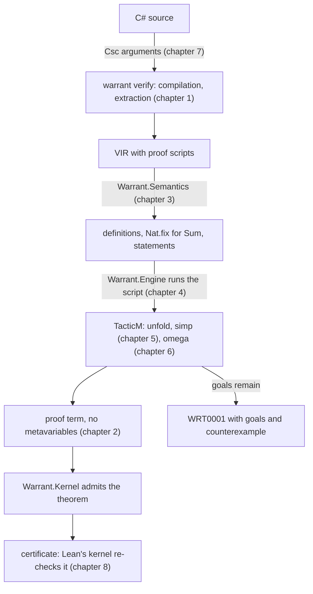

# M5a: proofs about every input, in the build

> Status: **planned.** These chapters were written with the plan, before the implementation; U21 updates them to match the code.
> The plan that schedules this work is [docs/plans/2026-11-03-0838-feat-m5a-meta-tactics-plan.md](../plans/2026-11-03-0838-feat-m5a-meta-tactics-plan.md).
> Its Key Technical Decisions (`KTD1`, `KTD2`, …) own the decisions; these chapters explain them and cite them by ID.
> Code in these chapters shows the shape of the design and is not compiled. Lean terms are written in Lean notation for reading. Results marked *ran* come from running Lean 4.35.0 or Warrant's kernel during planning.

M4 proves claims about fixed inputs by computation.
M5a proves claims about every input by search: untrusted tactics, ported from Lean, build a proof term, and the kernel checks it.
It is also the first milestone that runs in a normal build: `dotnet build` and Visual Studio's MSBuild verify the project after compiling it and fail when a theorem is not proved.

## Reading order

| Chapter | Covers |
|---|---|
| [1. The surface and the corpus](01-surface-and-corpus.md) | What a developer writes: theorems with parameters, `Spec.ForAll`, `Spec.Decreases`, `.By(...)` and the `Tactic` calls; the VIR that carries them; the M5a corpus. |
| [2. Metavariables and the Meta layer](02-metavariables-and-meta.md) | How a proof with holes is represented, why the kernel must never see one, and the Meta layer that reduces and unifies terms with holes. |
| [3. Statements and recursion](03-statements-and-recursion.md) | How a quantified claim becomes a proposition, and how a recursive method becomes a well-founded definition with decrease theorems and an equation lemma. |
| [4. Tactics and goals](04-tactics-and-goals.md) | The tactic loop, the basic tactics, `cases` and `induction`, how goals are printed, and what a failure reports. |
| [5. The attribute sidecar and simp](05-sidecar-and-simp.md) | What Lean knows about its lemmas that the NDJSON bundle does not carry, and the simplifier that uses it. |
| [6. Bridging and omega](06-bridging-and-omega.md) | How claims about `int` arithmetic, which wraps, become linear arithmetic over `Int`, and the decision procedure that finishes them. |
| [7. `warrant verify` and the build task](07-verify-and-build.md) | The CLI verb, the MSBuild task that runs it, the compiler's arguments, diagnostics and budgets. |
| [8. Testing and cross-checks](08-testing-and-cross-checks.md) | Property-based differential tests, tests for recursive units, kernel property tests, and the comparison with other kernels. |

## The running examples

Three theorems follow the chapters, one false and two true:

```csharp
public static class Increments
{
    [Verified]
    public static int Increment(int x) => x + 1;

    [Theorem]
    static Proof AlwaysLarger(int x) =>
        Prove.That(Increment(x) > x)
             .By(Tactic.Unfold(nameof(Increment)), Tactic.Omega());
}

public static class Payments
{
    [Verified]
    public static PaymentResult Validate(Payment p)
    {
        if (p.Amount <= 0) return PaymentResult.InvalidAmount;
        if (p.Status != PaymentStatus.Pending) return PaymentResult.InvalidStatus;
        return PaymentResult.Valid;
    }

    [Theorem]
    static Proof ValidImpliesPositive(Payment p) =>
        Prove.That(Spec.Implies(Validate(p) == PaymentResult.Valid, p.Amount > 0))
             .By(Tactic.Unfold(nameof(Validate)), Tactic.Simp());
}

public static class Sums
{
    [Verified]
    public static int Sum(int n)
    {
        Spec.Decreases(n);
        if (n <= 0) return 0;
        return n + Sum(n - 1);
    }
}
```

`AlwaysLarger` is false: `Increment(int.MaxValue)` wraps to `int.MinValue`.
The build fails at the tactic that could not finish, showing the goal it was given:

```text
Increments.cs(9,52): error WRT0001: Theorem 'Increments.AlwaysLarger(int)' could not be proved: Tactic `omega` failed: omega could not prove the goal. Counterexample: x = 2147483647.
  x : Int32
  ⊢ x + 1 > x
```

`ValidImpliesPositive` is true, and `Sum` is a recursive method whose termination is proved by `omega` from the guard `n <= 0`.



## What M5a deliberately leaves out

- The server, cache, store, `explain` and analyzers (M5b).
- Contracts, exceptions, `null`, `/`, `%`, `decimal` and strings (M6 and M7).
- `decide` over finite domains, `split` and `grind`.
- Structural recursion, which M5a's types cannot reach (chapter 3), and mutual recursion.
- Theorems about recursive methods by induction on the measure.

## Glossary

| Term | Meaning here |
|---|---|
| Metavariable (mvar) | A hole in a term, written `?m`, to be filled by a tactic. Goals are metavariables. |
| Goal | A metavariable whose type is a proposition still to be proved, shown with its hypotheses. |
| Tactic | An untrusted procedure that fills or splits goals. Ported from Lean. |
| Transparency | How eagerly Meta unfolds definitions: `reducible` unfolds only abbreviations, `default` unfolds everything except irreducible ones and theorems. |
| Sidecar | The attribute file next to the bundle: reducibility, instances, simp lemmas, matchers. |
| Simp set | The lemmas `simp` rewrites with. |
| Bridging lemma | A lemma that moves a fact about `Int32` or `Int64` to `Int`, where `omega` works. |
| Decrease obligation | The theorem that a recursive call's measure is smaller than the caller's. |
| Equation lemma | `f.$eq_def : ∀ p, f p = body`, the theorem that unfolds a recursive definition. |
| Certificate | The NDJSON export of a proved theorem with its dependencies, for other kernels to re-check. |
