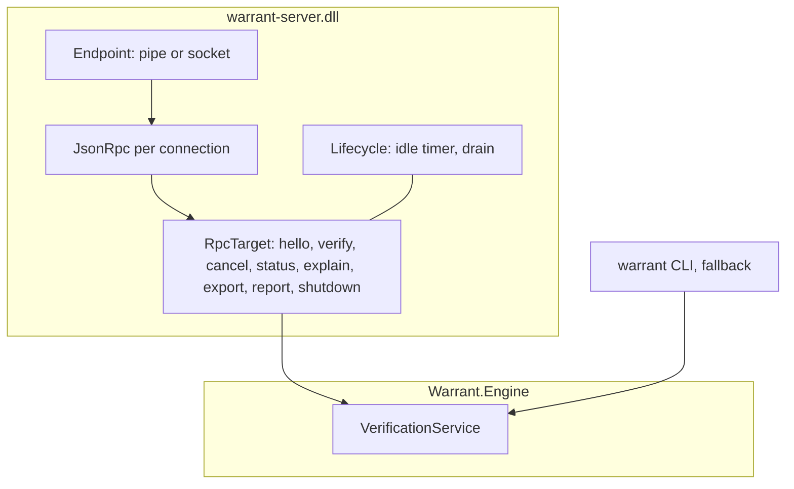
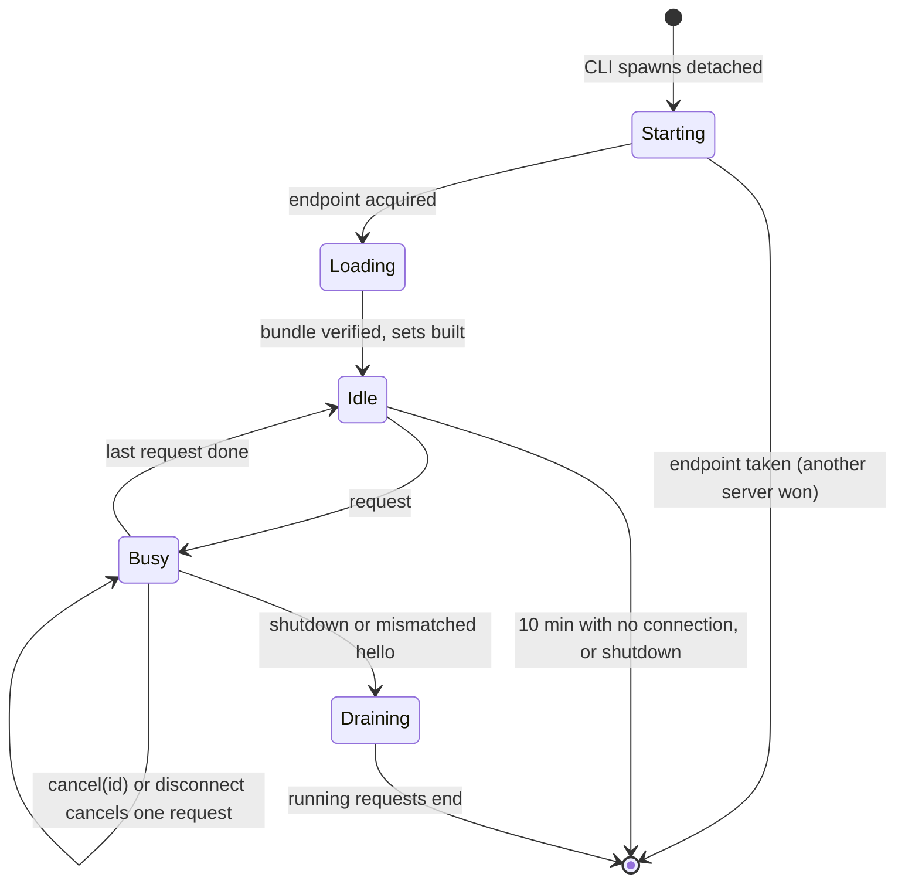

# 1. The server and its protocol

> Part of the [M5b design](README.md). Decisions: KTD1 to KTD4, KTD6, KTD12 and KTD26.

The server exists so that work done once stays done: the checked semantics bundle, the attribute sidecar, the simp sets and the cache's recent entries live in one process that outlives any single build (design §3.1).
It verifies; it does not compile.
This chapter covers what the process is, how a client finds it, how it starts and stops, and what it answers.

## One process, two hosts of the same service

The verification itself is a class, `VerificationService`, in `Warrant.Engine` (KTD1).
The server is a thin host around it: an endpoint, a JSON-RPC listener, a lifecycle and a log.
The CLI hosts the same class in-process when no server is available (chapter 2).



Keeping the service in the engine is what makes the two paths produce the same bytes (R3): there is no second implementation to drift.
The server project references the engine, Meta, the kernel, Semantics, Vir and Lean4Export, and never Roslyn, so its input is always canonical VIR (design §3.2).
It ships as `warrant-server.dll` next to `warrant.dll` in the `Warrant.Build` package's `tools/net10.0/any/`.
The CLI does not run it from there: it copies the server's files once into a per-user directory named by the toolchain identity and starts that copy, so a running server never holds files a package restore or a rebuild must replace (KTD4).

## Finding the server

A client computes the server's endpoint name; it never asks anyone where the server is (KTD3).

```csharp
// Shape only.
static string EndpointName(Toolchain toolchain) =>
    Base64Url(Sha256($"{Environment.UserName}|{IsElevated()}|{ServerDirectory}|{toolchain.Identity}"))[..24];
```

Each input separates servers that must not be shared:

| Input | Why it is in the name |
|---|---|
| User | One user's server never serves another's builds. |
| Elevation | An elevated Visual Studio and a normal terminal get different servers, as `CurrentUserOnly` requires on Windows. |
| Server directory | Two installed versions of the package get two servers. |
| Toolchain identity | A rebuilt Warrant with the same version number (repository development, a local package) still gets its own server (chapter 4 defines the identity). |

On Windows the endpoint is a named pipe opened with `PipeOptions.CurrentUserOnly` and `FirstPipeInstance`, so a second server cannot open the same name.
On Linux and macOS it is a Unix domain socket in a directory only the user can enter: `$XDG_RUNTIME_DIR/warrant/` when that is set, otherwise `/tmp/warrant-<uid>/` created with mode 0700.
.NET 10's named pipes on Unix are sockets too, but they leave the socket file's mode alone and let a second server unlink the first one's socket, so the raw socket in a private directory replaces them there; a lock file next to the socket keeps a single server per name.
The hashed name keeps the socket path well under macOS's 104-byte limit.

The name is predictable, so another user on the same machine could create it first and answer every request with "proved".
The client therefore checks who it is talking to, as Roslyn's compiler client does (KTD3): on Windows it opens the pipe with `CurrentUserOnly` too; on Unix the client and the server both check that the socket directory is a real directory, owned by the user, with mode 0700, and the client checks the peer's user ID after connecting.
A failed check means "no server": the build verifies in-process and logs why.

## Starting and stopping

The CLI starts the server when it cannot connect, and the server must outlive that CLI (KTD4).
Two traps decide how it is started:

- If the server inherits the CLI's standard output, MSBuild keeps waiting for that handle after the CLI exits, and the build hangs (msbuild#2981).
- If the server is in the CLI's process group, console or job object, cancelling a build (Ctrl+C, Visual Studio's cancel, MSBuild killing the tool's process tree) kills the server too.

So on Windows the CLI calls `CreateProcess` directly with `CREATE_NO_WINDOW`, `DETACHED_PROCESS`, `CREATE_NEW_PROCESS_GROUP` and `CREATE_BREAKAWAY_FROM_JOB`, and no inherited handles, retrying without breakaway when the job forbids it; on Unix it calls `posix_spawn` with `POSIX_SPAWN_SETSID` and the standard streams on `/dev/null`.
.NET 11 adds a managed way to do this; .NET 10 does not have one.



Two clients that both find no server may both start one; the endpoint decides the race and the loser exits.
The server leaves 10 minutes after its last connection closes and no work is running, the value Roslyn's compiler server uses; `WARRANT_SERVER_IDLE_SECONDS` changes it.
It writes a size-capped log in the user's local application data, because a detached process has nowhere else to say why it stopped.
The SDK's `dotnet build-server shutdown` knows only MSBuild, Razor and the compiler server and has no extension point, so `warrant server shutdown` does that job (chapter 7).

## The protocol

Transport is StreamJsonRpc 2.26.150 with its System.Text.Json formatter (KTD2).
JSON makes the wire readable in logs and in tests, and both ends are Warrant's own net10.0 binaries.
StreamJsonRpc stays out of the netstandard2.0 build task: the task runs inside .NET Framework MSBuild in Visual Studio, where StreamJsonRpc's dependencies would compete with Visual Studio's own copies.

Each connection gets its own `JsonRpc`.
Two settings matter:

- `SynchronizationContext = null`, so requests on one connection are not serialized behind each other.
- `CancelLocallyInvokedMethodsWhenConnectionIsClosed = true`, so a client that goes away cancels its work.

| Method | Purpose |
|---|---|
| `hello(protocol)` | First call on every connection. A mismatched protocol version is an error, and the server drains and exits so the next client starts a matching one. |
| `verify(request)` | Verify a request's units (chapter 2 shows the request). Returns outcomes, cache flags and timings. |
| `cancel(id)` | Cancel the request with that client-chosen id, from any connection. |
| `status()` | Process id, endpoint, toolchain identity, uptime, bundle hash, GC heap, working set, cache counters and active requests. |
| `explain(request)` | Verify one unit with a tactic trace (chapter 7). |
| `export(units)` | The certificate NDJSON for units (chapter 7). |
| `report(project)` | The JSON assumption report of a project's last verify. |
| `shutdown()` | Finish running requests, then exit. |

`verify`'s `priority` field from design §8.1 is in the request and is ignored until an IDE client gives it a second value.

## Cancellation reaches the kernel

A request's work runs under one cancellation token, linked to three sources: StreamJsonRpc's `$/cancelRequest` from the same client, the connection closing, and `cancel(id)` from any client (KTD12).
The token reaches the kernel and Meta, which check it every 1,024 steps (chapter 3).
Without that, cancelling would only stop the server from starting new units; a theorem stuck in `decide` would run to its 30-second limit.
