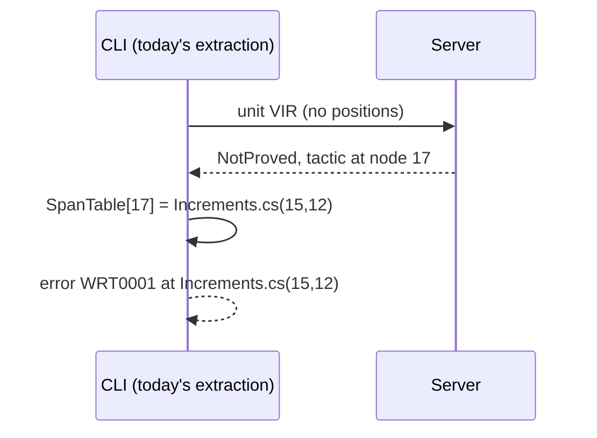

# 2. The client, the fallback and the build

> Part of the [M5b design](README.md). Decisions: KTD5 to KTD7 and KTD27.

M5a's build task runs `warrant verify --csc-args` as a child process, and that child compiles the project with Roslyn, runs its source generators and extracts VIR ([M5a chapter 7](../m5a/07-verify-and-build.md)).
M5b keeps all of that.
The child gains one job: hand the units to the server, or verify them itself when there is no server.

## Where the line falls

Design §3 drew the build task extracting VIR and sending it to the server.
M5a moved extraction into the CLI child because the task cannot load a Roslyn new enough for C# 14 (M5a KTD21), and the owner kept it there for M5b (Key Decisions).
So the line between client and server falls after extraction:

| In the CLI child (client) | In the server |
|---|---|
| Parse Csc's arguments, build the compilation, run generators | Read VIR |
| Extract VIR and the `SpanTable` (node ID → source span) | Translate with `Warrant.Semantics` |
| Report extraction diagnostics | Admit, run tactics, check with the kernel |
| Map node IDs to spans, render messages and reports | Cache results |

The renderer needs the Roslyn compilation (for member names) and the source files (for claim and value text), so rendering stays with the client.
That is why outcomes must not carry spans (below).

## What crosses the wire

A verify request is a record in `Warrant.Engine.Service`, serialized with a source-generated System.Text.Json context (KTD6).

```csharp
// Abridged from src/Warrant.Engine/Service/Contracts.cs (XML documentation removed).
public sealed record VerifyRequest(
    int ProtocolVersion,
    string RequestId,          // chosen by the client, used by cancel(id)
    string ProjectDirectory,   // names the project for report(project)
    string? CacheDirectory,    // $(WarrantCacheDir); null for no cache
    VerifyBudgets Budgets,     // kernel fuel, numeral size limit, tactic fuel, time limit
    bool Recheck,
    int Priority,              // unused until an IDE client exists
    ImmutableArray<RequestUnit> Units)
{
    public VerifyReport? Report { get; init; }   // claims and settings for report(project), chapter 7
}

public sealed record RequestUnit(string Key, VirUnitKind Kind, string? DisplayName, ReadOnlyMemory<byte> Vir);   // VirWriter's encoding

public sealed record VerifyResponse(
    int ProtocolVersion, string RequestId,
    ImmutableArray<UnitResult> Units,   // in request order
    VerifyCounters Counters,            // hits, misses, tactic runs, rechecked
    TimeSpan Elapsed);

public sealed record UnitResult(OutcomeDto Outcome, bool FromCache, bool Rechecked, TimeSpan Elapsed);
```

The VIR bytes are the canonical encoding the closure hash is computed over, so the server needs no Roslyn to read them and computes the same hashes the cache uses (chapter 4).

## Node IDs, not spans

In M5a an outcome that points into the source, such as the tactic that failed or a recursive call whose measure does not decrease, stored a `VirSpan`: file, line and column (`Outcomes.cs`).
A cached outcome must not, because the cache key leaves positions out on purpose: adding a blank line above a method changes no closure hash.
So outcomes carry the node's ID, its index in the unit's pre-order walk, and the client maps it through the current extraction's `SpanTable` (KTD7).
`OutcomeDto`, the outcome on the wire and in a cache entry, has a `Node` for the failing tactic or a failed unit's diagnostic, a decrease failure that names its call by node, and a node ID for each side of a false comparison.



docs/m4 already described results this way; until M5b only a false comparison's sides worked so, and the engine resolved the other spans itself.
`SpanTable` gained an enumeration, `Entries`, so the renderer and tests can walk it.

## When there is no server

Any failure on the server path makes the CLI verify the request in-process with the same `VerificationService` (KTD5):

- the server cannot be started, or does not answer within 20 seconds of being started (5 seconds when it was already running);
- `hello` reports another protocol, or the server runs another toolchain or loaded another bundle or sidecar;
- the connection drops before the response arrives;
- the server stops answering: while it works on the request, the CLI asks for its `status` every 15 seconds, and a server that does not answer within 30 seconds is abandoned (`status` takes no lock a verification holds, so a busy server answers at once).

A server that failed to start leaves a record beside its copy (`<copy>.start-failed`, with the reason), and for 5 minutes after it the CLI verifies in-process at once instead of waiting 20 seconds for a start that will fail again.
A build that reaches the server deletes the record.
Each start also deletes the copies no build has used for 14 days (every upgrade or rebuild of Warrant adds one), temporary copies a CLI left over an hour ago, and old records; nothing else under the copy root is touched.

The server answers a request all at once, so a dropped or abandoned request leaves the CLI no unit's result, and it verifies the whole request again; units the server finished before it stopped answering have their cache entries written, so they come back as hits.
The CLI logs one message saying why, at normal importance; a warning would break builds that treat warnings as errors, and the result is correct either way, as with Roslyn's compiler server.

```text
Warrant: verification server unavailable (connecting to the server timed out after 5 s); verifying in-process.
```

A Ctrl+C is not a failure: the first one cancels the request on the server (or in-process), and the units that had not finished come back cancelled and unreported; a second one ends the process.

## The build's new knobs

| Property | Default | CLI option | Effect |
|---|---|---|---|
| `WarrantUseServer` | `true`; `false` when `ContinuousIntegrationBuild` is `true` | `--server auto` or `--server off` | Use the server, or always verify in-process. |
| `WarrantRecheck` | `false` | `--recheck` | Re-check every cached proof with the kernel (chapter 4). |
| `WarrantCacheDir` | `$(BaseIntermediateOutputPath)warrant/cache/` | `--cache-dir` | Where the project's cache lives. |
| `WarrantUseCache` | `true` | `--cache-dir` left out | `false` verifies without the cache: nothing is read or written. |

The server is off in CI by default because CI agents are thrown away after a job: a server would only add a process that outlives it (KTD5).
The cache directory sits under `BaseIntermediateOutputPath` (normally `obj/`, and still defined with `UseArtifactsOutput`), so configurations and target frameworks share one cache; that is safe because every input that matters is in the key.
`dotnet clean` and Rebuild delete it, and only it: the cache marks its directory with a `WARRANT-CACHE` file, and the clean deletes only a marked directory's entries (files named by their 64-hex-digit key, their temporary files and the marker), then the directory if that leaves it empty.
A `WarrantCacheDir` that names a source or home directory by mistake loses nothing to a clean.

The summary line names the cached count, the rechecked count when there is one, and, when the build asked for the server, the path taken: `[server]`, or `[in-process]` after a fallback.
With `WarrantUseServer=false` the line is M5a's, with the cached count added.
The M5a accepted sample, verified three times through the server, the third with `--recheck` (*ran*):

```text
Warrant: 20 verified units, 7 theorems proved, 0 not proved. [server]
Warrant: 20 verified units, 7 theorems proved (10 from cache), 0 not proved. [server]
Warrant: 20 verified units, 7 theorems proved (10 from cache, 10 rechecked), 0 not proved. [server]
```

The cached count is units, not theorems: the seven theorems and the three recursive methods, whose decrease proofs are cached too (chapter 4).

Everything else about the task is M5a's: the WRT1 records, the exit codes and the error for a CLI crash.
