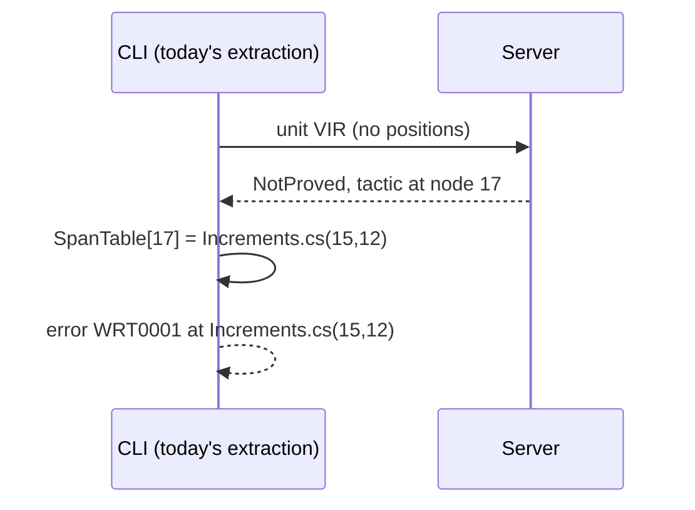

# 2. The client, the fallback and the build

> Part of the [M5b design](README.md). Decisions: KTD5 to KTD7 and KTD27.

M5a's build task runs `warrant verify --csc-args` as a child process, and that child compiles the project with Roslyn, runs its source generators and extracts VIR ([M5a chapter 7](../m5a/07-verify-and-build.md)).
M5b keeps all of that.
The child gains one job: hand the units to the server, or verify them itself when there is no server.

## Where the line falls

Design §3 drew the build task extracting VIR and sending it to the server.
M5a moved extraction into the CLI child because the task cannot load a Roslyn new enough for C# 14 (M5a KTD21), and the owner kept it there for M5b (Key Decisions).
So the line between client and server falls after extraction:

| In the CLI child (client) | In the server |
|---|---|
| Parse Csc's arguments, build the compilation, run generators | Read VIR |
| Extract VIR and the `SpanTable` (node ID → source span) | Translate with `Warrant.Semantics` |
| Report extraction diagnostics | Admit, run tactics, check with the kernel |
| Map node IDs to spans, render messages and reports | Cache results |

The renderer needs the Roslyn compilation (for member names) and the source files (for claim and value text), so rendering stays with the client.
That is why outcomes must not carry spans (below).

## What crosses the wire

A verify request is a record in `Warrant.Engine.Service`, serialized with a source-generated System.Text.Json context (KTD6).

```csharp
// Shape only.
record VerifyRequest(
    int Protocol,
    string RequestId,          // chosen by the client, used by cancel(id)
    string ProjectDirectory,   // names the project for report(project)
    string CacheDirectory,     // $(WarrantCacheDir)
    Budgets Budgets,           // kernel fuel, tactic fuel, seconds
    bool Recheck,
    int Priority,              // build; unused until an IDE client exists
    ImmutableArray<WireUnit> Units);

record WireUnit(byte[] Vir, string DisplayName);   // Vir is VirWriter's canonical encoding

record VerifyResponse(
    ImmutableArray<UnitResult> Units,               // in request order
    Counters Counters);                              // hits, misses, tactic runs

record UnitResult(string Key, OutcomeDto Outcome, bool FromCache, bool Rechecked, TimeSpan Elapsed);
```

The VIR bytes are the canonical encoding the closure hash is computed over, so the server needs no Roslyn to read them and computes the same hashes the cache uses (chapter 4).

## Node IDs, not spans

Today an outcome that points into the source, such as the tactic that failed or a recursive call whose measure does not decrease, stores a `VirSpan`: file, line and column (`Outcomes.cs`).
A cached outcome must not, because the cache key leaves positions out on purpose: adding a blank line above a method changes no closure hash.
So outcomes carry the node's ID, its index in the unit's pre-order walk, and the client maps it through the current extraction's `SpanTable` (KTD7).



docs/m4 already described results this way; the code resolved spans inside the engine.
`SpanTable` gains an enumeration so the renderer and tests can walk it.

## When there is no server

Any failure on the server path makes the CLI verify the remaining units in-process with the same `VerificationService` (KTD5):

- the server cannot be started, or does not answer within 20 seconds of being started (5 seconds when it was already running);
- `hello` reports another protocol;
- the connection drops before the response arrives.

In the last case the CLI re-verifies only the units it has no result for.
It logs one message saying why, at normal importance; a warning would break builds that treat warnings as errors, and the result is correct either way, as with Roslyn's compiler server.

```text
Warrant: verification server unavailable (connect timed out after 5 s); verifying in-process.
```

## The build's new knobs

| Property | Default | CLI option | Effect |
|---|---|---|---|
| `WarrantUseServer` | `true`; `false` when `ContinuousIntegrationBuild` is `true` | `--server auto` or `--server off` | Use the server, or always verify in-process. |
| `WarrantRecheck` | `false` | `--recheck` | Re-check every cached proof with the kernel (chapter 4). |
| `WarrantCacheDir` | `$(BaseIntermediateOutputPath)warrant/cache/` | `--cache-dir` | Where the project's cache lives. |

The server is off in CI by default because CI agents are thrown away after a job: a server would only add a process that outlives it (KTD5).
The cache directory sits under `BaseIntermediateOutputPath` (normally `obj/`, and still defined with `UseArtifactsOutput`), so configurations and target frameworks share one cache; that is safe because every input that matters is in the key.
`dotnet clean` and Rebuild delete it.

The summary line names the cached count and the path taken:

```text
Warrant: 20 verified units, 7 theorems proved (5 from cache), 0 not proved. [server]
```

Everything else about the task is M5a's: the WRT1 records, the exit codes and the error for a CLI crash.
