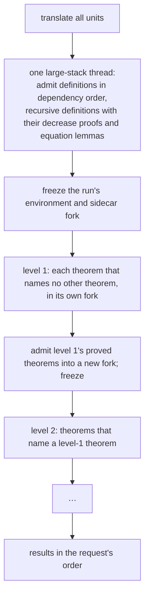

# 3. Parallel theorems, budgets and cancellation

> Part of the [M5b design](README.md). Decisions: KTD8, KTD10 to KTD12, KTD32 and KTD33.

M5a's `Pipeline.Run` does one compilation's work in order on one thread: it translates every unit, forks the bundle's environment once, and admits each unit into that fork, running each theorem's script as it comes (`Pipeline.cs`).
That is correct and simple, and it wastes every core but one.
M5b keeps the order where it matters and runs the rest in parallel.

## Stages and levels



Definitions stay sequential because later units need earlier ones: a caller's definition refers to its callee's constant, and a recursive definition is only usable after its decrease theorems are admitted.

Theorems are mostly independent.
A theorem cannot be called from code (WRT0003), but a proof script can use another theorem as a lemma: `Tactic.Exact(nameof(Lemma))`, `Tactic.Apply(nameof(Lemma))` or a `Tactic.Simp` that names it.
`nameof` makes `Lemma` a dependency, so it is admitted first, and if it is not proved its users are skipped (`Walker.Scripts.cs`, `Pipeline.Skip`).
So theorems run in levels (KTD8).
A theorem that names no other theorem is in level 1, and most theorems are.
A theorem that names one is one level above the deepest theorem it names.
Each theorem of a level runs in its own fork of the frozen run environment and sidecar; when the level ends, its proved theorems are admitted into a new fork, which is frozen and becomes the base of the next level.
Forks of frozen forks already work (`KernelEnvironment.Fork`), and the frozen bundle is already shared by parallel tests through `SemanticsBundleFixture`.

The workers are long-lived threads with a 512 MB stack, like the one `KernelThread.Run` creates per call, because the kernel and Meta recurse deeply.
A server has `min(ProcessorCount − 1, 8)` of them, at least one, shared by every request it serves; the in-process fallback uses the same pool size.
A theorem's 30-second clock starts when a worker picks it up, not when its request arrives, so a busy server never spends a theorem's budget on queueing.
The run's outcome map and admitted list stay in the run's `RunState`; each theorem works in a scope of its own, whose outcome is merged into it when its level ends.

Results come back in the request's unit order, the order extraction produced them in, whatever order the workers finish in, which is what lets R7 promise the same diagnostics as a sequential run.

## Same answer, every run

Parallel runs, partial runs (chapter 4) and the in-process fallback must give the answer a cold sequential run gives.
Two things in M5a's engine depend on more than the unit's inputs, and M5b removes both.

**The counterexample search reads the clock.**
When a theorem fails, M5a searches boundary values for a counterexample for up to two seconds (M5a KTD25, `Counterexample.cs`).
Under load, two seconds covers fewer combinations, so a busy server could report no counterexample where the in-process path finds `x = 2147483647`, and a cached not-proved entry would keep whichever answer one run found.
The search keeps its fuel per combination (1,000,000 kernel steps) and gets caps instead of the clock (KTD32): at most 512 combinations, which covers every combination of up to three `int` parameters (7³ = 343), and 2,000,000 kernel steps in all, so its worst case stays near two seconds (`Counterexample.cs`).
Its kernel limits carry the request's cancellation token, so a cancel stops it too.

**`Lean.Const` can reach constants it does not depend on.**
A script may name any Lean constant with `Lean.Const("…")`, and that adds no dependency.
In a cold sequential run every earlier unit's constants are in the environment, so `Lean.Const("Increments.Increment.eq_1")` resolves; in a fork that holds only a theorem's closure it does not.
A `Lean.Const` that names a constant some other translated unit admitted, when that unit is not a dependency, is now WRT0004 with a hint to use `nameof` (KTD33).
Lean library constants are unaffected.

## State loaded once

`VerificationService` loads the bundle, verifying it as `SemanticsBundle.Load` does, and the sidecar, once per process (KTD10).
Two caches need a change to benefit: `DefaultSimpSet.Theorems` and `Omega.Prep.Theorems` are keyed on the sidecar object they are given, which in M5a was each run's fork, so they were rebuilt for every run.
With a fork per theorem they would be rebuilt for every theorem.
Their lemmas are bundle constants, so M5b keys them on the frozen base sidecar and builds them over the frozen bundle environment, once.
Building them over whichever theorem's fork asked first would let one theorem's constants leak into a set every later theorem uses.

## A budget for every unit

M5a gave each theorem a budget scope: kernel fuel, tactic fuel and a deadline, with exhaustion reported as WRT0006.
Definitions, equation lemmas and decrease proofs got kernel fuel only, no deadline, and their exhaustion is caught as a general `KernelException` and reported as WRT0010, an internal error (`Pipeline.cs`, `Admit`).
M5b runs every unit in a budget scope and reports every exhaustion as WRT0006 naming the budget and what was running when it ran out (KTD11).
The exit tests run a definition, a recursive method and a theorem each over a small budget, and get (*ran*, from `M5bExitTests`):

```text
error WRT0006: Member 'S.Inc(int)' was not verified: kernel fuel ran out (1 steps) while the kernel checked the definition.
error WRT0006: Member 'S.Sum(int)' was not verified: tactic fuel ran out (1 steps) while proving the decrease of recursive call 1 of S.Sum(int).
error WRT0006: Theorem 'S.Slow()' was not decided: the time limit of 1 s was reached while …
```

## Cancellation

.NET cannot abort a thread, so stopping a kernel check from outside needs the check's cooperation.
The kernel already looks at the clock every 1,024 steps when it has a deadline (`TypeChecker.Tick`, M5a KTD2).
M5b adds a cancellation token to `KernelLimits` and `MetaLimits` and polls it at the same place, whether or not there is a deadline (KTD12):

```csharp
// From src/Warrant.Kernel/TypeChecker.cs; _checksClock is set when there is a deadline or the token can be cancelled.
private void Tick()
{
    if (--_fuel < 0)
    {
        throw new KernelResourceException($"kernel fuel exhausted ({_limits.Fuel:N0} steps)");
    }
    if (_checksClock && --_ticksUntilClockCheck < 0)
    {
        _ticksUntilClockCheck = ClockCheckInterval - 1;   // 1,024 steps
        if (_limits.CancellationToken.IsCancellationRequested)
        {
            throw new KernelResourceException("kernel check cancelled");
        }
        if (Stopwatch.GetTimestamp() >= _deadlineTimestamp)
        {
            throw new KernelResourceException($"kernel deadline passed ({_limits.Deadline:O})");
        }
    }
    RuntimeHelpers.EnsureSufficientExecutionStack();
}
```

This is a change to trusted code, so it is held to M5a's rule for the deadline: the only thing it can do is throw a resource exception, which the kernel reports as "not admitted", never as acceptance.
A test checks exactly that: a declaration the kernel would accept, checked with a token already cancelled, is a resource limit.

The exception must also survive the way up.
Meta runs the kernel's type checker inside `Check` and wraps any `KernelException` it throws in a plain `MetaException` (`Reduce/Check.cs`); `first`, `try` and the unifier treat that as an ordinary failure and try something else, and `Pipeline.Compute` moves on to its next method after a `KernelException`.
A cancellation or a deadline there could therefore end as "not proved", which chapter 4 would then cache.
`Check` rethrows a kernel resource exception as a `MetaResourceException` and gives its type checker the run's limits, and the engine treats any resource exception as one.

The engine turns a cancellation into a `CancelledOutcome`.
It is not a diagnostic (the user cancelled; the build is not reporting a fault), and it is never cached.
Units that finished before the cancel keep their results, and their cache entries are already written (chapter 4).
