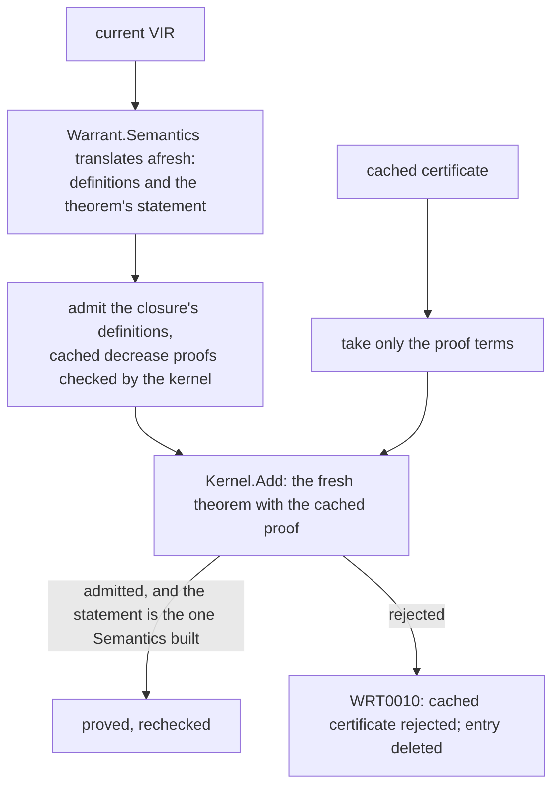

# 4. The cache and recheck

> Part of the [M5b design](README.md). Decisions: KTD9, KTD13 to KTD16; Key Decisions on cache trust and location.

A unit's result is a function of a short list of inputs.
If none of them changed since the last build, the result has not changed either, and the build can report it without running anything.
This chapter names those inputs, shows how a result is stored, and says exactly what a cached result is trusted for.

## What a result depends on

| Input | Covered by |
|---|---|
| The unit's own VIR: body, statement, proof script, facts (overflow setting, language version, extractor and Roslyn versions), per-theorem budgets | The unit hash, SHA-256 of its canonical VIR (design §4.1) |
| Every unit it calls or mentions, transitively | The closure hash: the unit hash followed by its dependencies' closure hashes (`VirHash.Closures`) |
| The semantics bundle | The bundle file's SHA-256, the same value the sidecar header is bound to |
| The attribute sidecar | The sidecar file's SHA-256 |
| Warrant's translation, tactics and kernel | The toolchain identity |
| The closure's display names, which cached goal text and messages print | Hashed into the key |
| The project's budgets and every kernel limit, including the numeral size limit read-back values use, for outcomes that depend on them | Stored in the entry and compared |

The closure hash matters because a theorem proved by computation depends on its callees' bodies, not only their statements: editing `Increment` can make a proved theorem false without changing the theorem's text (design §8.2).
`VirHash.Closures` already exists and is tested; until M5b nothing in `src/` called it.

### The toolchain identity

A hand-kept version string changes when someone remembers to change it.
`Extractor.Version` is `"0.1.0"` today and stays that while the engine changes underneath it in development.
The toolchain identity is a SHA-256 over the module version IDs of `Warrant.Cic`, `Warrant.Kernel`, `Warrant.Semantics`, `Warrant.Meta`, `Warrant.Engine`, `Warrant.Vir` and `Warrant.Lean4Export` (KTD9).
The repository builds deterministically (`<Deterministic>true</Deterministic>`), so a module version ID changes exactly when the assembly's content does.
The same identity names the server's endpoint (chapter 1), so a client never talks to a server built from other code.

### The key

```csharp
// Shape only.
string Key(Unit u) => Sha256Hex(
    CacheFormat.Version, Toolchain.Identity, BundleSha256, SidecarSha256,
    closureHash[u.Key], DisplayNames(closure[u.Key]));
```

Budgets are not in the key, because most outcomes do not depend on them: a proof found with 10,000 tactic steps is still a proof with 20,000.
The reverse is not true, so a proved entry records what its proof needed (the kernel fuel and numeral size limit it ran with, the tactic fuel it used and the time it took) and hits only when every current budget is at least that; a project that lowers its budgets sees the failure a cold CI build would.
An outcome that depends on the exact budgets ("not proved", "ran out of kernel fuel", and "false", whose read-back values use the kernel's limits) stores the budgets it ran with, and the entry hits only when the current budgets are the same (KTD13).

## What is stored

One JSON file per entry, named by its key, under `$(BaseIntermediateOutputPath)warrant/cache/` (KTD14).
The file is `{"sha256": …, "body": …}`, where the hash is the SHA-256 of the body's text exactly as it stands in the file.
The entry for the M5a accepted sample's `Sum` (*ran*; hashes shortened, the outcome's empty fields and most of the certificate left out):

```json
{
  "sha256": "8344f464…",
  "body": {
    "format": 1,
    "toolchain": "8a1f35d2…",
    "key": "4eea5469…",
    "inputs": {
      "closure": "cd0f01f5…",
      "bundle": "cc74b3a2…",
      "sidecar": "7d4ebef2…",
      "names": [ { "key": "M:Corpus.Recursion.Sum(System.Int32)", "displayName": "Corpus.Recursion.Sum(int)" } ]
    },
    "match": "AtLeast",
    "budgets": { "kernelFuel": 100000000, "kernelMaxNatBytes": 134217728, "tacticFuel": 16896, "timeout": "00:00:00.0630442" },
    "outcome": { "kind": "Translated", "key": "M:Corpus.Recursion.Sum(System.Int32)", "unitKind": "Function", "displayName": "Corpus.Recursion.Sum(int)", "assumptions": [], … },
    "certificate": "{\"meta\":{\"exporter\":{\"name\":\"Warrant\",\"version\":\"1.0.0\"},…"
  }
}
```

`match` says how `budgets` decide a hit: `AtLeast` for a proof (here the decrease proof's 16,896 tactic steps and 63 ms), `Exact` for an outcome that depends on the budgets.
The outcome is the wire form of chapter 2, so its positions are node IDs and it carries the unit's assumptions, which is what the assumption report needs.

The certificate is the lean4export NDJSON of exactly the declarations the unit admitted: its definition or theorem, and for a recursive method its definition, decrease theorems and equation lemma (about 109 KB for `Sum`). Since entry format 2 (#236), a proved theorem's certificate also holds its statement's well-definedness theorems `T.$wd_k`, before the theorem; a reused theorem has each admitted again with its cached proof.
Recursive methods get entries like theorems do: their decrease proofs run `omega`, so a second build that must run no tactics needs them, and a decrease proof that failed is a cached not-proved outcome.
It refers to bundle and callee constants by name without including them, so it holds only the unit's own declarations.
`verify --out` does not read it: it verifies without the cache and writes everything the run admitted (chapter 7).

An entry is written as soon as its unit finishes, but only if the request was not cancelled and the unit's deadline had not passed when it finished, so a result produced while being interrupted is never stored.
Files are written to a temporary name and renamed into place.
Entries are immutable and named by content, so two builds writing the same key at once both write the same bytes, and a crash leaves at most a stray temporary file.
A reader checks the body's hash, the format, the toolchain identity and the key; a file that fails any check is deleted and counts as a miss.

| Outcome | Cached? | Why |
|---|---|---|
| Proved | yes | The certificate was admitted by the kernel. |
| False, with read-back values | yes, with budgets | Decided by computation; the read-back values depend on the kernel's limits. |
| Not proved | yes, with budgets | Deterministic for the same inputs and budgets; the second build must not run `omega` again just to fail again. |
| Out of kernel or tactic fuel | yes, with budgets | Fuel is deterministic. |
| Out of time | no | Wall-clock outcomes depend on the machine and its load. |
| Internal error, failed unit | no | A Warrant bug should be retried, not remembered. |
| Cancelled | no | Not an outcome. |

The server keeps the most recent 4,096 entries in memory in front of the disk, keyed by cache directory as well as key, and computes any one key at most once at a time, so two builds asking for the same unit share the work.
A memory entry counts only while its file is still on disk unchanged (same length and last-write time), so `dotnet clean`, a deleted bad entry and a hand edit all take effect on the next build through a running server, and recheck always reads from disk.
The in-process path reads and writes the same files, so a CI build with the server off still has a cache to recheck when it restores `obj/`.

## What a hit trusts

The owner chose local trust with an opt-in recheck (Key Decisions).
A hit reports the cached outcome and runs nothing for that unit (KTD15).
What makes that safe enough for a developer's machine:

- An entry is written only after the kernel admitted the unit's declarations in a run whose inputs produced exactly this key.
- The body's hash turns accidental damage (a truncated write, a bad disk sector, a hand edit that forgets the hash) into a miss.
- The toolchain identity turns an entry from any other build of Warrant into a miss.

It does not defend against someone who edits `obj/warrant/` on purpose and recomputes the hash.
That person can already edit the build itself; the defence for builds whose results others rely on is recheck.

### A miss next to hits

When one unit misses, the units it depends on may all be hits, and the miss still needs their constants in the environment (KTD15).
The service always translates the whole request, so name collisions and translation errors are still reported when everything hits.
It then admits the miss's closure without tactics:

- definitions, with a recursive callee's decrease theorems taken from its cached certificate;
- lemma theorems the miss names with `nameof` (chapter 3), with their cached proofs.

The kernel checks each of these as it is admitted; if it rejects one, that unit becomes a miss too.
A lemma whose cached outcome is not proved skips its users, as a cold run would.
So nothing admitted in a run is unchecked by that run's kernel, and the only tactics that run are the misses'.

## Recheck

`WarrantRecheck=true` (`--recheck`) is for builds that must trust only the kernel, as design §8.2 intended for CI (KTD16).
For every unit with a proved entry, after any lemma theorems it names have been rechecked the same way:



Checking the cached NDJSON on its own would not be enough: a certificate whose statement was edited along with its proof is consistent with itself and proves nothing about the current code.
Only the proof terms come from the cache; the statements come from the trusted translator, run on today's VIR.

A rejected certificate is an error naming the unit, and the unit is not re-proved in that run, so the rejection stays visible; the entry is deleted, and the next build proves the unit afresh.
Cached false and not-proved outcomes are reported as they are under recheck: they cannot make anything count as proved.
No tactic runs for a unit that has an entry, so a recheck build of an unchanged project is kernel time only.

In CI the cache is usually empty, and recheck changes nothing; it matters when a CI job restores `obj/` from an earlier job, or when a developer wants to confirm a local cache.
