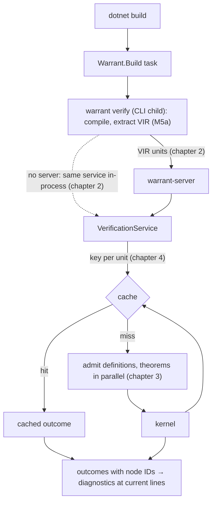

# M5b: a server, a cache and a store

> Status: **built.** These chapters were written with the plan and brought up to date with the code when M5b was finished (U18); the exit criterion holds as design §11 records.
> The plan that schedules this work is [docs/plans/2026-11-05-1640-feat-m5b-server-cache-store-plan.md](../plans/2026-11-05-1640-feat-m5b-server-cache-store-plan.md).
> Its Key Technical Decisions (`KTD1`, `KTD2`, …) own the decisions; these chapters explain them and cite them by ID.
> Code in these chapters shows the shape of the design and is not compiled. Output in `text` blocks is illustrative unless marked *ran*.

M5a proves claims about every input and runs in the normal build, but it does all of the work on every build: it starts a process, re-checks the semantics bundle, and runs every tactic again.
M5b keeps that work once it is done.
A per-user server holds the checked bundle between builds, a cache keeps each unit's result and proof certificate, and a second build with no change runs no tactics at all.
CI can still insist on trusting only the kernel: `WarrantRecheck=true` replays every cached proof through the kernel against the current code.

M5b also adds what the long-lived process makes possible or what the design scheduled with it: cancelling a running verification, explaining a failed proof step by step, a store for imported Lean libraries that loads lazily, and analyzers that show unsupported code while the developer types.

## Reading order

| Chapter | Covers |
|---|---|
| [1. The server and its protocol](01-server-and-protocol.md) | The `warrant-server` process: how it is found, started and stopped, what it holds, and the JSON-RPC methods. |
| [2. The client, the fallback and the build](02-client-and-build.md) | How the CLI child that the build already runs becomes the server's client, what crosses the wire, and what happens when there is no server. |
| [3. Parallel theorems, budgets and cancellation](03-engine.md) | The engine restructured into a sequential stage and a parallel one, budgets for every unit, and stopping the kernel on request. |
| [4. The cache and recheck](04-cache-and-recheck.md) | What a unit's result depends on, how it is keyed and stored, what a hit trusts, and what `WarrantRecheck` re-checks. |
| [5. Store v1](05-store.md) | An on-disk, memory-mapped home for imported Lean libraries, trusted and verified import, and the kernel's lazy base. |
| [6. Analyzers](06-analyzers.md) | Extraction's diagnostics in the IDE, determinism, and why builds leave them to the CLI. |
| [7. `explain`, `export`, `report` and the CLI verbs](07-explain-and-cli.md) | The tactic trace, the remaining protocol methods, and `warrant server`, `import` and `check-store`. |
| [8. Testing and baselines](08-testing-and-baselines.md) | Parity between the two paths, the exit criterion as tests, and the latency and memory figures M9 starts from. |

## The running example

M5a's three theorems carry through, now built twice.
`Increment` and `AlwaysLarger` are in `Increments.cs`; `Validate` and `ValidImpliesPositive` in `Payments.cs`; `Sum`, a recursive method whose decrease proof needs `omega`, in `Sums.cs` (see [the M5a README](../m5a/README.md#the-running-examples)).

The first `dotnet build` starts the server and proves everything it can; `AlwaysLarger` fails with its counterexample, as in M5a.
The second build, with nothing changed, prints the same diagnostics, and its summary says where they came from.
On the M5a corpus's refuted sample, verified twice through the server as the build does (*ran*, `warrant verify tests/corpus/m5a/refuted --server auto --cache-dir …`, abridged):

```text
m5a/refuted/Increment.cs(14,52): error WRT0001: Theorem 'Increments.AlwaysLarger(int)' could not be proved: omega could not prove the goal. Counterexample: x = 2147483647.
  …
m5a/refuted/Recursion.cs(12,16): error WRT0001: The recursive call 'Bad(n - 1)' could not be shown to decrease 'n': omega could not prove the goal.
  …
Warrant: 3 verified units, 0 theorems proved (2 from cache), 1 not proved. [server]
```

The two not-proved results came from the cache: their inputs and budgets are unchanged, so running `omega` again would fail the same way.
The cached count counts units, theorems and recursive methods alike; on the accepted sample a second build reports `7 theorems proved (10 from cache)`, the three recursive methods' decrease proofs included.
Editing `Validate` invalidates `ValidImpliesPositive` and nothing else; editing `Sum`'s body invalidates `Sum` and any theorem about it.



## What M5b deliberately leaves out

- `grind` and typed Mathlib handles (M8).
- Live proof feedback in the IDE and a language server (M9).
- Using the store as the verification environment: the bundle stays the environment until M6 needs more of Lean's library (chapter 5).
- A cache shared across projects, signed cache entries, and eviction beyond `dotnet clean` (chapter 4).
- Hardening the server against the same user's processes at another elevation level (GitHub issue #43, chapter 1).

## Glossary

| Term | Meaning here |
|---|---|
| Server | `warrant-server`, one per user, toolchain and elevation, started by the CLI and stopped when idle. |
| Client | The `warrant verify` CLI child the build runs; it compiles, extracts, talks to the server and renders. |
| In-process fallback | The same verification service run inside the CLI when no server is available. |
| Toolchain identity | A hash of the module version IDs of Warrant's verification assemblies; it changes whenever their code does. |
| Closure hash | A unit's VIR hash combined with the closure hashes of everything it calls (design §4.1). |
| Cache entry | One unit's outcome, assumption-report data and certificate, stored under its key. |
| Certificate | The lean4export NDJSON of the declarations one unit admitted. |
| Recheck | Checking a cached proof with the kernel against a statement rebuilt from the current code, without tactics. |
| Store | A directory of immutable, memory-mapped versions holding imported Lean declarations. |
| Trusted / verified import | Storing declarations as Lean checked them, or after Warrant's kernel re-checks each one. |
