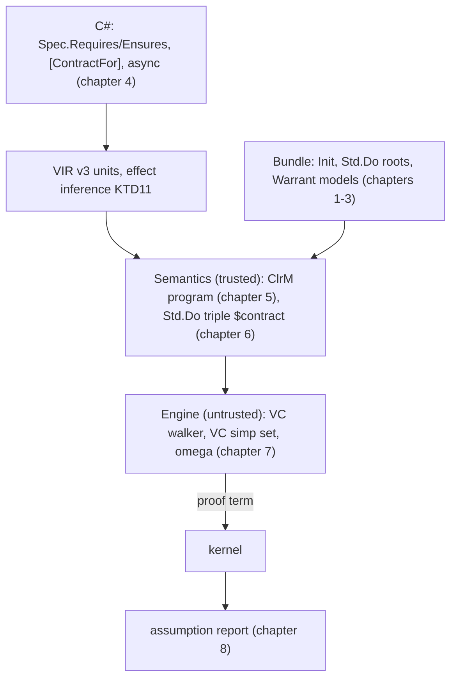

# M6: contracts and effects

> Status: **built.** These chapters were written from the code after every M6 unit had landed on `feat/m6` (U15);
> design §11's M6 row records the exit evidence.
> The plan that schedules this work is [docs/plans/2026-11-08-1445-feat-m6-contracts-effects-plan.md](../plans/2026-11-08-1445-feat-m6-contracts-effects-plan.md).
> Its Key Technical Decisions (`KTD1`, `KTD2`, …) own the decisions; these chapters explain them and cite them by ID.
> Where the code and the plan differ, the code wins, and the chapter says so.
> Code in these chapters shows the shape of the design and is not compiled unless it names a corpus file or a test.
> Output in `text` blocks is illustrative unless marked *ran*.

After M5b, Warrant proved pure methods over `int`, `long`, `bool`, records, enums and closed sets.
Most business methods are not pure in that sense: they throw on bad input, divide, read nullable values, use `decimal`,
and call a repository or a service.
M6 accepts those methods.

A method states what it assumes and promises with `Spec.Requires` and `Spec.Ensures` at the top of its body.
A `[ContractFor(typeof(I))]` class states what a dependency's members are assumed to do.
Code that can raise becomes a program in an effect monad over Lean's `Std.Do` (KTD4), its contract becomes a `Std.Do`
triple stated by trusted translation (KTD12), and an untrusted VC walker proves the triple, followed by a separate simp
set and `omega` (KTD13, KTD14).
A dependency is a parameter of the theorem and its contract a hypothesis, never an axiom (design D9, KTD9).
The assumption report lists every contract a proof used and every exception it allows (KTD20).

## Reading order

| Chapter | Covers |
|---|---|
| [1. The Std closure and the sidecar](01-std-closure-and-sidecar.md) | Which `Std.Do` constants enter the bundle, the `@[spec]` kind of the attribute sidecar, omega's division bridges, and server start time against KTD3's threshold. |
| [2. The effect monad and the models](02-effect-monad-and-models.md) | `ClrExn`, `ClrM`, the raising integer models, nullable values, `Math`, their `@[spec]` lemmas, and U3's go/no-go checkpoint. |
| [3. `decimal`](03-decimal.md) | The minimal `decimal` model, its trusted definitions and proved lemmas, and how translation uses it. |
| [4. Extraction](04-extraction.md) | VIR version 3, effect inference, the new constructs, contracts, `[ProofFor]`, dependencies, contract classes and `async`. |
| [5. The monadic translation](05-monadic-translation.md) | Which units become `ClrM` programs, and how each construct translates. |
| [6. Contract obligations](06-contract-obligations.md) | The triple a method must prove, the D9 shape with dependencies, well-definedness and vacuity checks, and what the engine does with them. |
| [7. VC generation](07-vc-generation.md) | The walker's rules, the VC simp set, failures at their source line, and `Tactic.VcGen()`. |
| [8. Reports and testing](08-reports-and-testing.md) | The four new assumption kinds, the differential and contract-statement tests, the corpus, the cross-check rows, the exit tests and the baselines. |

## The running example

Design §5.2's payment example is in the M6 corpus, `tests/corpus/m6/accepted/Payments.cs`:

```csharp
public sealed record Payment(int Id, decimal Amount, PaymentStatus Status);

public interface IPaymentStore
{
    Task<Payment?> GetPayment(int id);
    Task SavePayment(Payment p);
}

[ContractFor(typeof(IPaymentStore))]
file abstract class PaymentStoreContract : IPaymentStore
{
    public Task<Payment?> GetPayment(int id)
    {
        Spec.Ensures<Payment?>(r => r is null || r.Id == id);
        return default!;
    }

    public Task SavePayment(Payment p) => default!;   // no guarantees assumed
}

public sealed class PaymentService(IPaymentStore store)
{
    [Verified]
    public static PaymentResult Validate(Payment payment) =>
        payment.Amount > 0m ? PaymentResult.Valid : PaymentResult.Invalid;

    [Verified]
    public async Task<Result> ProcessPayment(int paymentId)
    {
        Spec.Ensures<Result>(r => r != Result.Success || paymentId > 0);

        if (paymentId <= 0) return Result.InvalidId;

        var payment = await store.GetPayment(paymentId);
        if (payment is null) return Result.NotFound;

        if (Validate(payment) != PaymentResult.Valid) return Result.Invalid;

        await store.SavePayment(payment with { Status = PaymentStatus.Processed });
        return Result.Success;
    }
}
```

`Validate` compares a `decimal` (chapter 3) and stays pure.
`ProcessPayment` awaits two dependency calls (chapter 4), so it is a `ClrM` program over two bound operations
(chapter 5), and its obligation takes each member's contract as a hypothesis (chapter 6).
The default procedure proves it with no script: the walker applies `GetPayment`'s contract at the call, follows the null
test, proves that `payment` is not null where `Validate` and `with` read it, and leaves goals that the VC simp set and
`omega` close (chapter 7).
Verifying the accepted corpus (*ran*, `warrant verify tests/corpus/m6/accepted --server off`, abridged):

```text
  Corpus.M6.Payments.PaymentService.Validate(Corpus.M6.Payments.Payment)    translated
  Corpus.M6.Payments.PaymentService.ProcessPayment(int)                     translated
Warrant: 53 verified units, 0 theorems proved, 0 not proved.
```

A method's line says `translated` when its definition and its contract obligation are admitted: the CLI's words for
proof outcomes name theorems only, and the summary's proved and not-proved figures count theorems; a method whose
contract fails is counted after them, as `; n other units not verified` (#225, chapter 8).
The report says what the proof rests on (`tests/corpus/m6/ProcessPayment.report.txt`, chapter 8):

```text
Corpus.M6.Payments.PaymentService.ProcessPayment(int)                     TRANSLATED   (…)
  Assumed (parameters):
    - store is not null
    - store.GetPayment() is not null
    - store.SavePayment() is not null
  Assumed (contracts):
    - Every implementation of Corpus.M6.Payments.IPaymentStore.GetPayment(int) keeps its contract: Spec.Ensures<Payment?>(r => r is null || r.Id == id)
    - Every implementation of Corpus.M6.Payments.IPaymentStore.SavePayment(Corpus.M6.Payments.Payment) keeps its contract, which states nothing: a call may return any value or throw
  Assumed (exceptions):
    - … may throw an exception from Corpus.M6.Payments.IPaymentStore.GetPayment(int) (the call at accepted/Payments.cs:48); …
    - … may throw an exception from Corpus.M6.Payments.IPaymentStore.SavePayment(…) (the call at accepted/Payments.cs:53); …
```



## What M6 deliberately leaves out

These are the plan's Scope Boundaries as built; each is a named rejection, never a silent pass.

- `try`/`catch` and `finally` (`try`, WRT0002): matching a catch against modelled, thrown and external exceptions needs
  the CLR's exception hierarchy in the trusted translator. No milestone schedules it.
- Recursion with effects and contracts on recursive methods (KTD11): decrease obligations don't see through `bind`.
  Revisit with M7's loops and invariants.
- Lifted arithmetic and comparisons on nullable values (`a + b`, `x > 0` with `int?` operands).
- A trace of external calls (design Q5): two calls are related only by their contracts.
- Spec sidecar files (design Q19), collections, `Guid` and strings (Q14, Q18, Q20), a standard logging contract (Q20).
- Heap, field access beyond dependencies, loops, full `decimal` and strings (M7); `grind` and typed Mathlib handles (M8).
- A non-exhaustive switch over an open enum, a default proof pipeline for `Prove.That`, and the store as the proof
  environment: the proving guide used to date these to M6. M6 did not build them, and none is scheduled.
- `#47` (a `[Closed]` class whose construction throws) and `#48` (checking a closed class's own `Equals`).

## Known gaps and open decisions

Gaps found while building M6, each a ticket. All of them make a true claim fail or a method be rejected; none lets a
false one pass.

| Ticket | Gap |
|---|---|
| #215 | A `CancellationToken` parameter and a bare `return;` have no VIR form and are rejected (chapter 4). |
| #216 | Theorems over `decimal` `Math.Max`/`Min` with parameters do not prove: nothing splits the `if` (chapter 3). |
| #217 | `simp` does not compute a `decimal` literal's `units`, so `omega` cannot use it (chapter 3). |
| #218 | A record with a nullable field fails translation (chapter 5). |
| #220 | `warrant translate` passes no attribute sidecar, so it cannot prove contracts (chapter 7). |
| #225 | The CLI summary counts only theorems as "not proved" (chapter 8). Fixed after M6: other units not verified are counted. |

Decided after M6's exit (owner, 2026-11-11):

- #180: overtaken; U9 already built the pure `Math` and constant-divisor forms.
- #181: a property relating two calls of a method that can raise is stated as the `Spec.Ensures` of a verified method that makes both calls ([proofs that work](../proving/proofs-that-work.md)).
- #182: `Spec.NoThrow()` proves that no explicit `throw` is reachable under the `Spec.Requires` (chapter 6).
- #183: arithmetic in a `Spec` expression must not overflow; specs keep `int` and `long` and get no unbounded integer (chapter 6).

Decisions that are the owner's, still open:

| Ticket | Question |
|---|---|
| #213 | `Spec.Implies` inside `Spec.Requires` and `Spec.Ensures` (still WRT0004 there; chapter 4). |
| #219 | A caller of a method whose contract is not proved is skipped, even when it needs only the definition (chapter 6). |
| #221 | After a failed `Spec.Assert`, later VCs are proved from the asserted fact (chapter 7). |
| #224 | A `[ProofFor]` script aimed at a false `Ensures` fails where the script fails, not at the `Ensures` line (chapter 7). |

Design Q14 (collections) and Q19 (spec sidecars) are open too; design §12 records where they stand.

## Glossary

| Term | Meaning here |
|---|---|
| Raising unit | A unit that can raise an exception, or calls one that can, or calls a method with `Spec.Requires` (KTD11). It translates into `ClrM`. |
| `ClrM σ α` | `ExceptT ClrExn (StateM σ) α`: a C# computation that may raise, over an opaque world `σ` (KTD4). |
| World | The state `σ` every obligation quantifies over. Model operations leave it alone; dependency calls may change it. |
| Contract obligation | `f.$contract`, the `Std.Do` triple a verified method must prove (KTD12). |
| Contract unit | One VIR unit per interface member a verified method calls, holding its contract class member's `Spec` calls. |
| Operation | A bound variable of a dependency method's obligation that stands for one (dependency, member) pair (KTD9). |
| VC | A verification condition: a goal the walker leaves, reported at the VIR node that produced it (KTD18). |
| Default procedure | The VC walker, then the VC simp set, then `omega` (KTD13, KTD14). |
| Allowed exception | An explicit `throw` (`ClrExn.thrown`) or one propagated from a dependency (`ClrExn.external`) (KTD12); under `Spec.NoThrow`, only the latter (#182). |
| Spec lemma | A Lean theorem marked `@[spec]` that states a model operation's triple; the sidecar carries the attribute (KTD15). |
