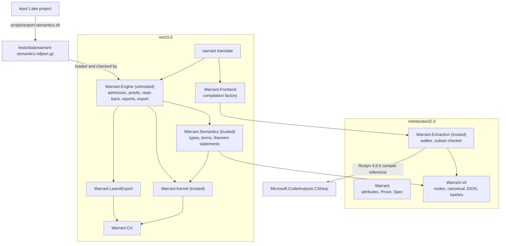
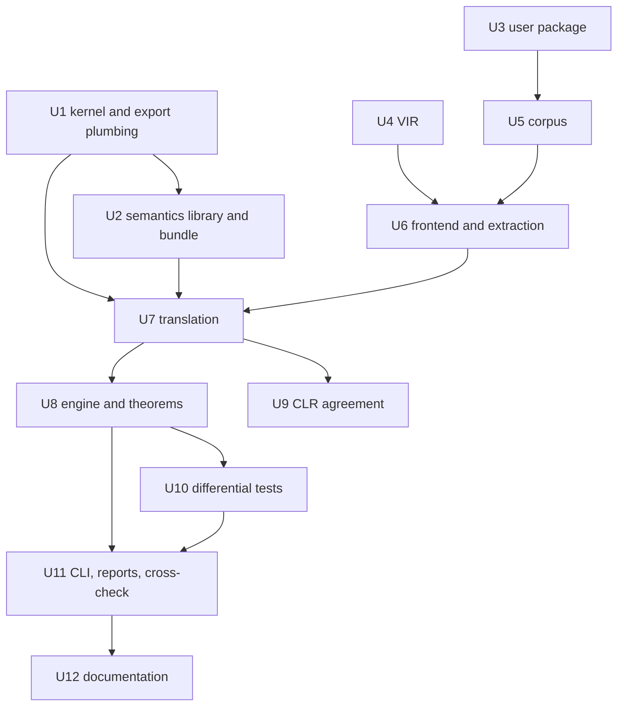

# M4 Pure Subset - Plan

The design is explained chapter by chapter, literate-programming style, in [docs/m4/](../m4/README.md).
This plan owns the decisions (KTD1 to KTD22) and the work units (U1 to U12); the chapters explain them and cite them by ID.

---

## Goal Capsule

- **Objective:** A developer can mark a pure C# method `[Verified]`, state facts about concrete calls to it as `[Theorem]`s, and get back either proofs that both Warrant's kernel and Lean's kernel accept, or a diagnostic naming the unsupported construct or the false claim, with the translation tested against the real CLR.
- **Means:** Roslyn's `IOperation` tree becomes VIR, and VIR becomes CIC over Lean Init's own `Int32`, `Int64` and `Bool` (KTD1, KTD4, KTD5).
- **Authority:** this plan's Requirements win on behaviour and its KTDs on mechanism; the `docs/m4/` chapters explain and never override; `docs/design.md` governs anything this plan does not decide, except where U12 amends it.
- **Stop conditions:** stop and ask before continuing if a session-settled decision below proves unworkable (for example, the kernel cannot check corpus theorems within `KernelLimits.Corpus` fuel), or if implementation needs a construct the Scope Boundaries exclude.
- **Execution profile:** units in dependency order; the corpus (U5) is written before the extractor (U6) so that every rule has a failing test first.
- **Finishing:** an implementer (`ce-work` or a person) builds the units; the repository owner reviews and merges.

---

## Product Contract

### Summary

Build milestone M4 as defined in `docs/design.md` §11: VIR, extraction of the pure C# subset, the semantics library v0, translation to CIC, `rfl`/`decide` proofs for parameterless theorems, differential and CLR-agreement tests, a developer verb `warrant translate`, and a cross-check step in which Lean's kernel re-checks the translated corpus.
Nothing runs inside `dotnet build` yet; that is M5a.

### Problem Frame

Warrant can check Lean's entire Init library with its own kernel, and Lean's kernel agrees with every verdict (M1 to M3), but it cannot read a line of C#.
Every later milestone (tactics in M5a, the server and cache in M5b, contracts in M6, loops and the heap in M7) builds on four things M4 fixes: the Lean definitions that model C#, the VIR that is the wire format between the build and the server, the naming of generated declarations, and the shape of translated terms that tactics will have to work with.
Getting those wrong is expensive later, because VIR is hashed and cached (design §8.2), names appear in exported certificates, and translated terms are what M5a's simp lemmas must match.
M4 is also where the faithfulness gap (design §2) first opens, so its tests against the CLR are as much the deliverable as the translator.

### Requirements

**Pipeline**

- R1. A `[Verified]` static method, or a `[Verified]` instance member of a sealed record, written in the M4 subset, translates to a CIC definition that Warrant's kernel admits.
- R2. Every construct outside the M4 subset is rejected with a diagnostic that names the construct, and the corpus has a member exercising each rejected construct on its own.
- R3. A parameterless `[Theorem]` returning `Prove.That(bool)` is proved by an emitted `rfl` or `decide` term, or reported as false (WRT0001) or undecided (WRT0006).
- R4. Translation is deterministic: the same compilation gives byte-identical VIR and byte-identical NDJSON on every machine.

**Faithfulness**

- R5. Translated definitions agree with the compiled .NET methods on generated inputs, including every integer boundary value and unnamed values of open enums.
- R6. Every operation the translator can emit agrees with the CLR on boundary and random operands.
- R7. Every record and closed-class value a unit receives, directly or through record fields, is recorded as assumed non-null; for a record parameter the method reads, passing `null` makes the .NET method throw.
- R8. Enums are open unless marked `[Closed]`; `[Closed]` enums and closed-shape classes are modelled as exactly their named members, recorded as assumptions; integer casts to a `[Closed]` enum anywhere in the compilation produce WRT0008; a `[Closed]` class without the closed shape is an error.

**Trust and export**

- R9. The semantics library is written and proved in Lean 4.35.0 and committed as an NDJSON bundle with provenance, so the test suite runs without a Lean toolchain.
- R10. The translated corpus, exported with its Init and semantics closure, is accepted by Lean's kernel in `scripts/cross-check.sh`.

**Surface and documentation**

- R11. The `Warrant` package (netstandard2.0) provides `[Verified]`, `[Theorem]`, `[Closed]`, `Proof`, `Prove.That` and `Spec.Implies`.
- R12. The developer guide and design document describe M4 as built, including the corrections this plan makes to them.

### Key Decisions

- **Enums are open by default; `[Closed]` is opt-in and recognised by shape for classes.** Governs R8. (session-settled: user-approved — chosen over closed-by-default enums and over requiring a known base class for closed sets: open is the CLR's semantics, and shape works for any library's closed-set pattern.)
- **`int` wraps like the CLR (D7), and the model is a Lean library proved in real Lean (D10).** Governs R6, R9. (session-settled: user-approved — chosen over leaving D7 and D10 as proposals: M4 is built on both.)
- **M4 runs through the test suite and a CLI verb, not the build.** Governs R10. (session-settled: user-approved — chosen over pulling the MSBuild task forward from M5a: the task depends on `warrant verify`, which is M5a.)
- **Lean is pinned to 4.35.0.** Governs R9. (session-settled: user-directed — chosen over staying on 4.33.1: the kernel diff between the two only removes native reduction, which Warrant never supported, and both kernels agree on 4.35.0's full Init.)
- **The M4 design is written as literate chapters whose code illustrates rather than compiles.** Governs R12. (session-settled: user-approved — chosen over tangle-able literate source: the real code is written during implementation.)

### Success Criteria

- The M4 exit criterion in `docs/design.md` §11 holds in full: the corpus translates; every rejected construct is rejected with its diagnostic; differential tests pass, including the null-record checks; CLR-agreement tests pass for every modelled operation; parameterless theorems are closed by emitted `rfl`/`decide` terms; and the translated corpus passes the new cross-check step.
- A reader new to the project can follow `Payout` from C# source to a theorem Lean's kernel accepts by reading `docs/m4/` in order.

### Scope Boundaries

Not in M4 (each is owned by a later milestone in `docs/design.md` §11):

- Tactics, quantified theorems, `Prove.That(...).By(...)`, recursion, the MSBuild task and `warrant verify` (M5a).
- The server, cache, store and analyzers (M5b).
- `/`, `%`, `checked` arithmetic, exceptions, `null` values, nullable parameters and contracts (M6).
- Loops, mutable objects, strings and `decimal` (M7).

Considered and not built:

- **Integer bitwise operators and shifts.** Init models `&`, `|`, `^`, `~`, `<<` and `>>` like C#, but C#'s `>>>` on signed types is a logical shift where Lean's is arithmetic, and no M4 corpus method needs any of them. They are rejected (KTD15). Evidence that would change this: a motivating M4-era example that needs them.
- **`DecidableEq` instances for records and closed types.** Nothing in M4 needs `r = s` as a proposition, and `$eq` is what C# `==` computes (KTD10). Evidence that would change this: an M5a tactic that needs `r = s` decidable.
- **Lean-style named matchers (`f.match_N`).** Lean shares and renames them, and no M4 consumer reads matcher metadata; `switch` uses the recursor (KTD9). Evidence that would change this: M5a's `split` tactic needing `MatcherInfo`.
- **A binary VIR encoding.** Nothing transmits VIR until M5b's server (KTD5).
- **A Lean pretty-printer for goals.** WRT0001 messages quote the C# claim and read back values (KTD12). Design §7.4 already lists a human-readable Lean rendering as a separate debugging feature.

#### Deferred to Follow-Up Work

- Decide whether `Warrant.Meta` adds a metavariable kind to `Warrant.Cic.Expr` or keeps its own representation. Design §7.1 says this is decided at M4, but nothing in M4 uses metavariables; U12 moves the decision to the start of M5a.
- Confirm the Roslyn floor for `Warrant.Extraction` when M5b packages the analyzer (KTD4).
- Extend the attribute sidecar that M5a plans for Init and the library to translated declarations (reducibility, later simp and spec attributes), so M5a's tactics see open-enum types as reducible (KTD9).
- Update the README status line to "milestone 4 of 8" once M4's exit criterion holds.

### Dependencies

- Lean 4.35.0 and lean4export `5a9a355` (`scripts/lib/lean-toolchain.sh`), needed only to regenerate the bundle and to run `scripts/cross-check.sh`.
- From NuGet: `Microsoft.CodeAnalysis.CSharp` (4.8.0 as the compile reference for `Warrant.Extraction`, 5.0.0 for the net10.0 host projects) and `Basic.Reference.Assemblies.Net100` 1.8.14.

### Outstanding Questions

None block implementation.
The fuel and time cost of differential tests is unmeasured; U10 measures it and sizes input counts to keep the suite fast (Risks).

---

## Planning Contract

### Key Technical Decisions

**The model**

- KTD1. **C# `int`, `long` and `bool` are Init's `Int32`, `Int64` and `Bool`; the M4 library adds no new types or operations.** Init's operations already match CLR unchecked semantics for everything M4 accepts (checked in Lean 4.35.0), and reusing them keeps Init's lemmas (about 340 `Int32.*` theorems in `Init.Data.SInt.Lemmas`, 445 across Init) usable by M5a, which adds the ones it needs as bundle roots. The library records CLR facts as Lean theorems and fixes the emitted constant set (docs/m4/01).
- KTD2. **The bundle is a selective lean4export of the library plus the constants in `lean/bundle-roots.txt`, with their full dependency closure, committed gzipped as `tests/data/warrant-semantics.ndjson.gz`; the export script fails on any lean4export panic.** A selective export loads into an empty environment and stays small (2,362 constants in the research run), where a whole-module export includes all of Init (about 6.46 million lines). lean4export exits 0 even when a root is missing (it prints `PANIC` and skips it), so the script runs it with `LEAN_ABORT_ON_PANIC=1` and also rejects any `PANIC` on stderr. Each later change to the roots changes the bundle's hash, which is part of design §8.2's cache key.

**Projects and boundaries**

- KTD3. **Projects:**
  - netstandard2.0: `Warrant` (user API), `Warrant.Extraction` (walker, subset checker).
  - netstandard2.0 and net10.0: `Warrant.Vir` (model, canonical writer and hashes in both; the reader on net10.0 only).
  - net10.0: `Warrant.Frontend` (compilation factory), `Warrant.Semantics` (trusted translation), `Warrant.Engine` (untrusted orchestration, proofs, reports), and the CLI.

  `Warrant.Semantics` and `Warrant.Engine` never reference Roslyn. This keeps design §3.2's rule that the server sees only VIR, and gives M5b's server a ready engine to host instead of logic buried in the CLI.
- KTD4. **Extraction reads the `IOperation` tree of a `CSharpCompilation`; the compilation factory lives in `Warrant.Frontend`, not in `Warrant.Extraction`.**
  - **Factory settings:** Roslyn 5.0.0, `Basic.Reference.Assemblies.Net100` 1.8.14 and nullable analysis on. C# 14 is pinned for the corpus only; M5a takes `LangVersion` and references from `Csc`.
  - **The `Warrant` package reference** is the package's compiled image, embedded in `Warrant.Frontend` and loaded from memory. A copied `Warrant.dll` would land next to the CLI's own `warrant.dll`, and assembly names compare case-insensitively, so the two would collide.
  - **Roslyn floor:** `Warrant.Extraction` is compiled against Roslyn 4.8.0, provisionally its floor, so that the M5b analyzer can load in Visual Studio 2022 and .NET 8 SDK hosts. A netstandard2.0 assembly built against a newer Roslyn than its host's is refused (warning CS8032), and the factory's tens of megabytes of reference assemblies have no place in an analyzer.
  - **Why the operation tree:** it is already structured for M4 (docs/m4/03).
- KTD5. **VIR contains only the nodes M4 needs; existing node encodings are frozen and VIR grows only by adding kinds and fields; every unit carries a VIR schema version that is part of its hash.**
  - **Why not declare later nodes now:** a new node kind never changes the encoding of existing units, while declaring M6 and M7 nodes now would freeze shapes for questions design §12 still has open (Q4 region syntax, Q6 heap model).
  - **Canonical form:** the JSON encoding is specified independently of `System.Text.Json` (fixed field order, exact escaping, integers as decimal strings) and written by hand, so the netstandard2.0 writer and a net10.0 writer cannot hash the same unit differently.
  - **Spans:** they live in a side table keyed by node ID, outside the hash, so comment edits do not change hashes (docs/m4/04).
- KTD21. **Types are VIR units of their own, and each unit has a closure hash over its own hash and the closure hashes of the units it calls or mentions.**
  - **Why:** under a shallow embedding, a theorem proved by computation depends on its callees' bodies, not only their statements, so the unit hash alone cannot key a cache (design §8.2 assumed statements suffice).
  - **Type units:** a record or closed type is translated once, from its own unit.
  - **Facts:** `facts` records the extractor and Roslyn versions next to the language version and the overflow setting.
- KTD17. **`KernelEnvironment` gains a public frozen base with overlay forks, and the conversion from admitted kernel declarations to export declarations moves from the kernel tests into `src/Warrant.Kernel`, finding recursors by their generated names.**
  - **Why an overlay:** the existing internal `Fork` is already an O(1) parent overlay. A base that is never mutated after checking can be shared by parallel forks, which M5b needs. Copying the constant table would cost O(environment) per unit, and that environment is all of Init or Mathlib later.
  - **Why look recursors up by name:** the test-only conversion scans the whole environment once per inductive.
- KTD22. **The trusted base is drawn by assembly:**
  - **Trusted:** `Warrant.Extraction`, `Warrant.Frontend`'s compilation options, `Warrant.Vir` (model, writer and reader), `Warrant.Semantics`, the kernel, and the library's definitions.
  - **Untrusted:** `Warrant.Engine` (proof emission, outcome classification, read-back, reports, export), whose output the kernel checks.

  `Warrant.Semantics` builds every declaration whole, including each theorem's name and type; the engine supplies only proof values. A theorem counts as proved only when the kernel admits that exact declaration. A wrong statement proves the wrong claim, so statement translation is trusted; with the type fixed by trusted code, proof emission can only fail a true claim, never pass a false one.

**Translation**

- KTD6. **A Lean name is a pure function of the symbol alone, derived from its documentation-comment ID.**
  - **Shape:** `Cs.`, then the namespace and type path (a generic type carries its arity, ``Result`1``), then the member. A member with parameters carries its fully qualified parameter list in the member component: `Payout(System.Int32,System.Int32,System.Int32)`.
  - **Generated names** use `$`, which cannot appear in a C# identifier. Members of records and closed types named after Lean's auxiliary constructions (`rec`, `recOn`, `casesOn`, `noConfusion`, `noConfusionType`, `below`, `brecOn`, `ctorIdx`, `injEq`) are rejected, so M5a can generate those auxiliaries without renaming anything.
  - **Display:** messages and reports show C# display names, not Lean names.
  - **Why always the full parameter list:** adding an overload renames nothing, and short type names cannot collide (`Fee(A.Status)` against `Fee(B.Status)`). Names appear in certificates and cache keys, so they must not change when siblings do (docs/m4/05).
- KTD7. **Pure statements translate in continuation-passing style with five placement rules, and shared fall-through uses a `let`-bound join point instead of copying the rest of the block.** Term size stays linear in source size, which copying does not. The two shortcut rules (a `let` of an `ite`, and dropping an `if` that changes nothing the rest reads) apply only when neither branch contains a `return`. The rules cover pure units only; M6's effectful units need a monadic translation (docs/m4/05).
- KTD8. **Conditions become a proposition plus a fixed `Decidable` instance and use `ite`; Boolean values use `decide`, `Bool.and`, `Bool.or`, `Bool.not` and `Bool.xor`; operators come from one table.** These are the shapes Lean 4.35.0 elaborates for the same source, so M5a's simp lemmas will match (docs/m4/05).
- KTD9. **Records are single-constructor inductives read by primitive projection.**
  - **Open enums** are `abbrev` definitions of their underlying type, `int` or `long`. A wrapper structure lost because it would put a constructor and a projection into every goal, need its own instances, and make casts cost a term, where the `abbrev` reuses Init's instances directly.
  - **Closed types** are inductives with one nullary constructor per member. A `[Closed]` enum's members carry their values in VIR, every constant of a closed enum type maps to its member by value, and a closed enum whose members do not all have distinct values is rejected, because two constructors would be provably different while the CLR says they are equal.
  - **`switch` over a `[Closed]` enum** is its recursor with a constant motive. C# cannot pattern-match on a closed class's instances (they are not constants), so closed classes are compared with `==` only. Relational patterns over closed types are rejected.

  The kernel generates only `.rec`, so translation generates nothing it does not need (docs/m4/05).
- KTD10. **C# `==` on records is a generated field-by-field `$eq : R → R → Bool`, and on closed types a comparison of generated `$index` values; in propositions it is `… = true`.**
  - **Why not `DecidableEq`:** `$eq` is what the compiler-generated `Equals` computes. That differs from structural equality once M6 adds `decimal`, whose `==` is numeric (`1.0m == 1.00m`) while the model keeps mantissa and scale.
  - **For M5a:** a bridge lemma `R.$eq r s = true ↔ r = s` holds only for records whose fields all have lawful equality, so M5a may generate it only for those.
  - **Records with other instance state** (instance fields, or properties with a backing field, beyond the positional ones) are rejected, because `$eq` and `with` would ignore that state while the real `Equals` compares it. Computed properties are allowed.
- KTD11. **A closed class is modelled by identity even when it has its own equality; the agreement is recorded as an assumption, and differential tests check it.** On every pair of static instances, `==`, `Equals(object)` and `EqualityComparer<T>.Default.Equals` must each be true exactly for identical instances (a record's generated `Equals` compares fields through the last), and reading each instance property twice must give the same object. Rejecting classes with their own equality would exclude the closed-set libraries D13 was decided for.
- KTD13. **A node of type `int`, `long` or `bool` with a Roslyn constant value is lowered to that constant before any other rule; a constant of enum type becomes the member it names.** The IL contains the folded constant, so the model matches what runs. For an open enum, a constant that names no member (`(PaymentStatus)7`) is a literal of the enum type. For a closed enum, the cast, unboxing and `default` checks run on the original node first, and a constant that names no member is rejected.
- KTD15. **M4 rejects, with WRT0002:**
  - **Constructs that need M5a:** recursion, `.By(...)`, theorems with parameters.
  - **Arithmetic that needs M6 or a new definition:** `/`, `%`, checked arithmetic that can overflow (not checked widening), integer bitwise operators and shifts.
  - **Constructs that need exceptions (M6):** `throw`, `try`, switch expressions over open enums without `_`.
  - **Null and types beyond M4:** `null`, nullable parameters, strings, `decimal`, floating point.
  - **Shapes the model does not cover:** integer casts, `default` and unboxing to `[Closed]` enums; `[Closed]` enums whose members share a value; relational patterns and comparisons, and `and`/`not` patterns, over closed types; reading a closed class's fields; a `switch` section that mixes `default` with `case` labels (translation places the default branch last, which a shared section cannot express); unsealed records, record structs, records with their own equality and records with other instance state; cyclic record types; reserved member names (KTD6); instance members of other classes.
  - **Other:** loops, local functions, unreachable code.

  Each needs a later milestone's machinery or would make the model differ from the CLR (docs/m4/03).
- KTD18. **WRT0009 is a new error for a `[Closed]` class without the closed shape. WRT0008 warns, anywhere in the compilation, about every way an unnamed value can reach a `[Closed]` enum: integer casts, unboxing, and a closed enum with no member valued 0 (whose `default` is unnamed).** Until M5b's analyzer shares the code, extraction itself raises WRT0002 to WRT0005, WRT0008 and WRT0009, because M4 has no analyzer. The shape is checked in docs/m4/03's five steps, and WRT0009 names the step that failed. Step 3 accepts a static instance only as an initialised get-only auto-property or `static readonly` field whose initialiser is a `new` of the class itself: `B { get; } = A` would otherwise make two constructors for one object (design D13).
- KTD20. **`Prove.That` and `Spec.Implies` are not `[Conditional]`, because C# allows that attribute only on `void` methods.** `Prove.That` throws and `Spec.Implies` computes the implication. Both are valid only in theorem statements (WRT0004). This corrects `docs/proving/reference.md`.

**Proofs, tests and output**

- KTD12. **Theorems try `@Eq.refl T a` (the left side) for equations, then `@of_decide_eq_true P D (@Eq.refl Bool true)`. If both fail, reducing `decide P D` tells false (WRT0001, with read-back values) from undecided (WRT0006).** These are the terms Lean's own `rfl` and `decide` produce, and they were checked to depend on no axioms (docs/m4/06).
- KTD14. **Differential tests emit the same compilation that extraction read, and admit each input as the theorem `f args = r` proved by `Eq.refl`, where `r` is the literal .NET result; read-back is for messages only.** No second evaluator enters the trusted base, and each passing input is a theorem Lean could re-check (docs/m4/07). (session-settled: user-approved — chosen over evaluating in Lean: Warrant's kernel needs no Lean toolchain at test time.)
- KTD16. **`warrant translate <directory>` is the M4 entry point: it prints per-member outcomes and diagnostics, and optionally writes NDJSON and the assumption report.** The cross-check step needs a command, and `translate` collides with neither `export` nor M5a's `verify`.
- KTD19. **The CLR-agreement tests check every operator-table row against unchecked C#, check each literal independently of the literal encoder, and pin .NET's current behaviour for the rejected `/`, `%` and shift cases.** The table is the trusted claim, so each row needs its own test. A shared encoder would shift both sides of a comparison together, so literals are also checked by reducing them to their bit pattern. The `/`, `%` and shift checks run on the CLR side only, as active tests, so a runtime or architecture change fails now; their model half waits for the milestone that admits them.

### High-Level Technical Design

The components, and which depends on which:



M5b's server replaces the CLI as the host of `Warrant.Engine`; the build task then replaces `Warrant.Frontend`'s factory inputs with `Csc`'s.

The order of the work (each arrow is "must exist first"):



The data flow for one unit is the running example in [docs/m4/README.md](../m4/README.md).

### Output Structure

```text
lean/                                  semantics library (U2)
scripts/export-semantics.sh            bundle export (U2)
src/Warrant/                           user package (U3)
src/Warrant.Vir/                       VIR (U4)
src/Warrant.Extraction/                extraction (U6)
src/Warrant.Frontend/                  compilation factory (U6)
src/Warrant.Semantics/                 translation (U7)
src/Warrant.Engine/                    admission, proofs, read-back, reports, export (U8, U11)
tests/corpus/m4/                       corpus and expected.json (U5)
tests/data/warrant-semantics.ndjson.gz bundle (U2)
tests/Warrant.TestSupport/             shared test helpers, the bundle fixture and generators (U1, U2, U9)
tests/Warrant.Vir.Tests/               (U4)
tests/Warrant.Extraction.Tests/        (U3, U6)
tests/Warrant.Semantics.Tests/         (U2, U7, U9)
tests/Warrant.Engine.Tests/            (U8, U10, U11)
```

### Alternative Approaches Considered

- **Generate Lean source and let Lean elaborate it.** Rejected by the design (§4, D6): it would test Lean's elaborator rather than Warrant's translation, and require Lean at verification time.
- **Translate from Roslyn's control-flow graph.** Rejected for M4 (KTD4): recovering structure from basic blocks is the step prior verifiers describe as heuristic, and the operation tree is already structured. The graph may return in M7 for loops.
- **Copy the rest of the block into each branch.** Rejected (KTD7): simplest, but exponential in a chain of `if`s; hax and early Aeneas both moved away from it.
- **A separate evaluator for differential tests.** Rejected (KTD14): it would be a second trusted model of the definitions; the kernel's definitional-equality check is the one the proofs rely on.
- **Orchestrate in the CLI.** Rejected (KTD3): M5b's server would have to duplicate the pipeline or pull it out of `Program.cs`.

### Risks

| Risk | Mitigation |
|---|---|
| Differential tests are slow: each input is a definitional-equality check by a kernel built for correctness, not speed. | U10 measures fuel and time per check, then sizes the random-input count; boundary combinations are always kept. |
| An Init constant is renamed or reshaped by a future Lean upgrade (4.35.0 already reshaped `Decidable`). | The bundle-roots test fails when an emitted constant is missing, and the `Warrant.Clr` theorems fail if behaviour changes. |
| Roslyn 4.8.0's API lacks something extraction needs. | U6 finds out on the first build; raising the floor is cheap until M5b ships the analyzer, and KTD4 records why it matters. |
| netstandard2.0 projects under `TreatWarningsAsErrors` and `AnalysisLevel latest-recommended` need polyfills and suppressions. | U3 and U4 set `TargetFramework`, `ImplicitUsings` and polyfills explicitly; the user package avoids records and `init` so it needs none. |
| A closed class's `Equals` disagrees with identity. | Recorded as an assumption, and checked on every pair of instances by U10 (KTD11). |
| Collectible assembly contexts leak through cached delegates. | Harmless for correctness; U10 unloads per test class and does not cache delegates across contexts. |

---

## Implementation Units

| U-ID | Title | Files touched (primary) | Depends on |
|---|---|---|---|
| U1 | Kernel and export plumbing | `src/Warrant.Kernel/KernelEnvironment.cs`, `src/Warrant.Kernel/AdmittedDeclarations.cs`, `tests/Warrant.TestSupport/` | none |
| U2 | Semantics library and bundle | `lean/`, `scripts/export-semantics.sh`, `tests/data/warrant-semantics.ndjson.gz` | U1 |
| U3 | User package | `src/Warrant/` | none |
| U4 | VIR | `src/Warrant.Vir/`, `tests/Warrant.Vir.Tests/` | none |
| U5 | Corpus | `tests/corpus/m4/` | U3 |
| U6 | Frontend and extraction | `src/Warrant.Frontend/`, `src/Warrant.Extraction/`, `tests/Warrant.Extraction.Tests/` | U3, U4, U5 |
| U7 | Translation | `src/Warrant.Semantics/` | U1, U2, U4, U6 |
| U8 | Engine and theorems | `src/Warrant.Engine/` | U7 |
| U9 | CLR-agreement tests | `tests/Warrant.Semantics.Tests/ClrAgreementTests.cs` | U2, U7 |
| U10 | Differential tests | `tests/Warrant.Engine.Tests/Differential/` | U7, U8 |
| U11 | CLI verb, reports and cross-check | `src/Warrant.Cli/`, `src/Warrant.Engine/Reports/`, `scripts/cross-check.sh` | U8, U10 |
| U12 | Documentation | `docs/design.md`, `docs/proving/`, `REPRODUCING.md` | U11 |

### U1. Kernel and export plumbing

- **Goal:** Translation, the engine and the CLI can fork a checked environment and write admitted declarations, without reaching into kernel internals.
- **Requirements:** R1, R10 (KTD17).
- **Dependencies:** none.
- **Files:**
  - `src/Warrant.Kernel/KernelEnvironment.cs` (public frozen base and overlay fork)
  - `src/Warrant.Kernel/AdmittedDeclarations.cs` (new; moved from `tests/Warrant.Kernel.Tests/CrossCheckFixtures.cs`)
  - `tests/Warrant.TestSupport/` (new project: `FactRequiringEnvAttribute`, corpus paths)
  - `tests/Warrant.Kernel.Tests/CrossCheckFixtures.cs`, `tests/Warrant.Kernel.Tests/Corpus.cs` (use the moved code)
  - `tests/Warrant.Kernel.Tests/KernelEnvironmentTests.cs` (new)
  - `Warrant.slnx`
- **Approach:**
  1. Make the existing parent-overlay fork public for a frozen base: freezing forbids further additions to the base, so forks can be shared safely. The kernel's acceptance rules do not change.
  2. Move the admitted-form conversion into `src`, finding each inductive's recursors by their generated names (`T.rec`, `T.rec_N`) rather than by scanning the environment.
  3. Move the opt-in test attribute and corpus helpers into a shared test project.
- **Patterns to follow:** `KernelEnvironment.Fork` and `CrossCheckTests.cs`.
- **Test scenarios:**
  - A declaration added to a fork is absent from the frozen base.
  - Adding to a frozen base fails.
  - Two forks of one base admit different declarations without seeing each other's.
  - A fork of the init-medium environment admits the arena fixtures exactly as the original does.
  - `CrossCheckTests` produce the same NDJSON before and after the move.
- **Verification:** the existing kernel test suite passes unchanged in outcome.

### U2. Semantics library and bundle

- **Goal:** The tests load one committed bundle containing the semantics library and every Init constant the translator emits.
- **Requirements:** R6, R9 (KTD1, KTD2).
- **Dependencies:** U1.
- **Files:**
  - `lean/lean-toolchain`, `lean/lakefile.toml`, `lean/Warrant.lean`, `lean/Warrant/Clr/Int32.lean`, `lean/Warrant/Clr/Int64.lean`, `lean/Warrant/Clr/Bool.lean`, `lean/bundle-roots.txt`
  - `scripts/export-semantics.sh` (new)
  - `tests/data/warrant-semantics.ndjson.gz`, `tests/data/README.md`
  - `tests/Warrant.TestSupport/SemanticsBundleFixture.cs` (new: loads and checks the bundle once, then hands out forks)
  - `tests/Warrant.Semantics.Tests/BundleTests.cs` (new)
  - `.gitignore` (`lean/.lake/`)
- **Approach:**
  1. Write the `Warrant.Clr` theorems from docs/m4/01, proved in Lean; no declaration may depend on `sorryAx`.
  2. Seed `bundle-roots.txt` from the operator and instance tables in docs/m4/05, quoting any name with a non-identifier character with `«»`.
  3. Write the export script by analogy with `scripts/export-lean-library.sh`: run lean4export from `lean/` with the roots after `--` and `LEAN_ABORT_ON_PANIC=1`; fail on any `PANIC` on stderr or any `sorryAx` in the output; gzip without timestamps.
  4. Record Lean version, lean4export commit, root count and record counts in `tests/data/README.md`.
- **Patterns to follow:** `scripts/export-lean-library.sh` (Windows `.exe` path handling), the `tests/data/README.md` provenance table, `tools/lean-replay/lakefile.toml`, `InitMediumFixture` in `tests/Warrant.Kernel.Tests/Corpus.cs`.
- **Test scenarios:**
  - The bundle loads into an empty `KernelEnvironment` with every declaration accepted.
  - Every name in `bundle-roots.txt` is present in the bundle.
  - Every `Warrant.Clr` theorem is present and admitted.
  - The bundle contains no `sorryAx`.
  - The export script, given a misspelled root, exits non-zero. This test needs Lean, so it is opt-in through `FactRequiringEnvAttribute`, like the kernel's Lean-dependent tests.
- **Verification:** running the export script twice gives byte-identical output, and `scripts/count-export.py` matches the README.

### U3. User package

- **Goal:** Corpus files and users can reference the M4 attributes and calls.
- **Requirements:** R11 (KTD3, KTD20).
- **Dependencies:** none.
- **Files:** `src/Warrant/Warrant.csproj`, `src/Warrant/Attributes.cs`, `src/Warrant/Prove.cs`, `src/Warrant/Spec.cs`; `tests/Warrant.Extraction.Tests/` (created here, referencing only the `Warrant` package, with `SurfaceTests.cs`); `Warrant.slnx`.
- **Approach:** the types in docs/m4/02, with `TargetFramework` overridden to netstandard2.0, XML docs on every public member (`src/Directory.Build.props` requires them), and no records or `init` so no polyfills are needed.
- **Test scenarios:**
  - `Prove.That(true)` throws `InvalidOperationException`.
  - `Spec.Implies` returns the implication for all four input pairs.
- **Verification:** the package builds for netstandard2.0 with no warnings.

### U4. VIR

- **Goal:** VIR exists as a typed model with one canonical encoding, a unit hash and a closure hash.
- **Requirements:** R4 (KTD5, KTD21).
- **Dependencies:** none.
- **Files:** `src/Warrant.Vir/` (units including type units, types, expressions, patterns, statements, span table, canonical writer, hashes; a reader built only for the net10.0 target); `tests/Warrant.Vir.Tests/`; `Warrant.slnx`.
- **Approach:** the node set and encoding in docs/m4/04. Multi-target netstandard2.0 and net10.0: the hand-written canonical writer and the hashes are in both, and the reader, which only the engine and later the server need, uses the in-box `System.Text.Json` on net10.0 only. Node IDs are pre-order, and the span table is keyed by node ID and not hashed.
- **Test scenarios:**
  - Writing then reading a unit gives an equal unit, for every node kind.
  - Two units differing only in spans have equal hashes; differing in one literal, different hashes.
  - Changing a callee's body changes the caller's closure hash but not its unit hash.
  - Strings that need escaping (non-ASCII identifiers, `+`, `<`, quotes) encode identically from the netstandard2.0 and net10.0 builds.
  - The encoding of the `Payout` unit matches a committed golden file.
  - 64-bit literals survive the round trip at `long.MinValue` and `long.MaxValue`.
- **Verification:** the hash of the golden unit is stable across runs, machines and target frameworks.

### U5. Corpus

- **Goal:** The exit criterion exists as files: accepted members, rejected members and their expected outcomes.
- **Requirements:** R2, R3, R5, R7, R8 (KTD15, KTD18).
- **Dependencies:** U3.
- **Files:** `tests/corpus/m4/README.md`, `tests/corpus/m4/expected.json`, `tests/corpus/m4/accepted/*.cs`, `tests/corpus/m4/refuted/*.cs`, `tests/corpus/m4/rejected/*.cs`, `.gitattributes`.
- **Approach:** the layout and examples in docs/m4/02; one rejected member per construct in KTD15 and per diagnostic in KTD18; LF line endings; members keyed by documentation-comment ID. The accepted side includes a method whose branches both fall through and one of which contains a nested `return`, the shape KTD7's shortcut rules must not touch, and a method of the shape `o == A ? 1 : o == B ? 2 : 3` over a closed class, where `null` is the value the model omits. `accepted/` holds only members that translate and theorems that prove; theorems expected to be false or undecided go in `refuted/`, so the cross-check can require a clean run over `accepted/`.
- **Test expectation:** none -- this unit is data; U6, U7, U8 and U10 run tests over it.
- **Verification:** every KTD15 construct and KTD18 diagnostic has at least one rejected member; U6 then checks that every accepted and refuted file compiles.

### U6. Frontend and extraction

- **Goal:** Any compilation becomes VIR units plus diagnostics, with the M4 subset enforced.
- **Requirements:** R1, R2, R4, R7, R8 (KTD4, KTD11, KTD13, KTD15, KTD18, KTD21).
- **Dependencies:** U3, U4, U5.
- **Files:**
  - `src/Warrant.Frontend/` (compilation factory)
  - `src/Warrant.Extraction/` (unit finder and call graph, operation walker, record and closed-shape checks, reserved names, type units, assumptions, diagnostics)
  - `tests/Warrant.Extraction.Tests/` (corpus outcome tests, shape tests, determinism tests)
  - `Warrant.slnx`
- **Approach:** docs/m4/03, in this order:
  1. The compilation factory.
  2. Unit discovery, type units, the call graph and its cycle checks.
  3. The allow-list walker.
  4. The record and closed-shape checks.
  5. Assumptions.
  6. The compilation-wide WRT0008 scan.
- **Execution note:** drive each rule from a failing corpus outcome in `expected.json`.
- **Test scenarios:**
  - Every rejected corpus member gets its expected code and construct name, and nothing else.
  - Every accepted corpus member produces a unit and no diagnostic.
  - A compilation with errors produces no units and reports the compiler errors.
  - Mutual recursion between two verified methods is WRT0002 "recursion".
  - With overflow checking on, `a + b` is rejected and `(long)a` is not.
  - `unchecked(int.MinValue / -1)` as a constant becomes the literal `int.MinValue`.
  - A closed class failing each of the five shape steps gets WRT0009 naming that step, including a static property written `=> new(...)`, which returns a new instance on every read.
  - A `[Closed]` enum with two members of the same value is WRT0002; `(ClaimStatus)5` and `default(ClaimStatus)` written as constants are WRT0002.
  - `ClaimStatus.Open` becomes a `member` node, not an integer literal; `(PaymentStatus)7` becomes a literal of the open enum's type.
  - A compile with `[Closed]` on a method fails, because the attribute's targets are enums and classes only.
  - Every accepted and refuted corpus file compiles with the factory, which references the `Warrant` package from its embedded image.
  - A closed class whose base overrides `Equals` is accepted with an identity assumption.
  - A sealed record with an extra `init` property beyond its positional ones is WRT0002.
  - A record member named `casesOn` is WRT0002.
  - An integer cast, and an unboxing conversion, to a `[Closed]` enum in an unverified method give WRT0008, and so does a `[Closed]` enum with no member valued 0.
  - A record parameter declared `Payment` gives a non-null assumption, and so does each record or closed-class field reachable from it; `Payment?` is WRT0002.
  - Extracting the corpus twice gives byte-identical VIR.
- **Verification:** all corpus extraction outcomes match `expected.json`, and `Warrant.Extraction` builds against Roslyn 4.8.0.

### U7. Translation

- **Goal:** Every accepted VIR unit becomes the kernel declarations, and every theorem the statement, that docs/m4/05 and 06 describe.
- **Requirements:** R1, R4, R8 (KTD6 to KTD10, KTD22).
- **Dependencies:** U1, U2, U4, U6.
- **Files:**
  - `src/Warrant.Semantics/` (names and display names, types, operator table, conditions, statements and join points, switch, equality, declarations, theorem statements)
  - `tests/Warrant.Semantics.Tests/TranslationTests.cs`
  - `Warrant.slnx`
- **Approach:** docs/m4/05 and the statement half of docs/m4/06. Translation returns complete declarations in dependency order, including each theorem's name and type with an empty slot for its proof, and does not admit them; the engine (U8) does (KTD22). Reducibility heights are computed from the referenced definitions' hints.
- **Patterns to follow:** `LocalContext.MkLambda`/`MkPi` and `ExprOps.Abstract` for binders; `tests/Warrant.Kernel.Tests/CrossCheckFixtures.cs` for building inductive declarations.
- **Test scenarios:**
  - Every accepted corpus unit's declarations are admitted by the kernel in a fork of the bundle.
  - `Payout` translates to a term alpha-equal to a hand-built expected term in the shape of docs/m4/05.
  - `Shipping` produces one join point, and with one changed local, a `let` of an `ite` instead.
  - An `if` whose then-branch contains a nested `return` and whose branches both fall through without changing a local keeps its `return` (the KTD7 guard).
  - A chain of 20 sequential `if` statements that both fall through translates to a term whose size grows linearly.
  - The literal `int.MinValue` translates to a term definitionally equal to `Int32.minValue`.
  - Overloads `Fee(int)` and `Fee(int,bool)`, and `Fee(A.Status)` and `Fee(B.Status)`, get distinct names, and adding an overload does not change an existing name.
  - A switch over a `[Closed]` enum with `A or B` and `_` arms gives a recursor application with one argument per constructor, with constant patterns matched to members by value.
  - `$eq` on two equal and two unequal `Payment` values reduces to `true` and `false`.
  - Translating the corpus twice gives byte-identical declarations.
- **Verification:** every accepted unit is admitted, and the bundle-roots test (U2) covers every constant the operator table emits.

### U8. Engine and theorems

- **Goal:** The engine admits translated units, proves parameterless theorems or reports them as false with values or as undecided, and keeps every unit's outcome independent.
- **Requirements:** R3 (KTD3, KTD12, KTD22).
- **Dependencies:** U7.
- **Files:** `src/Warrant.Engine/` (pipeline over VIR units, admission into bundle forks, proof emitter, outcome classifier, value read-back, NDJSON writing); `tests/Warrant.Engine.Tests/TheoremTests.cs`; `Warrant.slnx`.
- **Approach:** docs/m4/06 and 07. The engine takes VIR units and the checked bundle and returns outcomes, certificates and assumption data; it has no Roslyn dependency. Read-back reduces `BitVec.toNat (Int32.toBitVec t)` and the `Int64`, `Bool`, `$index` and record analogues to a numeral; U10 shares it.
- **Test scenarios:**
  - `CappedAtTheLimit` is proved by `rfl`.
  - A `<` claim is proved by `decide`.
  - `NeverWraps` is WRT0001 with `Increment(int.MaxValue) = -2147483648` in the message.
  - A `Spec.Implies` claim with a false premise is proved.
  - A record-equality claim is proved through `$eq … = true`.
  - Under `KernelLimits` with tiny fuel, a true claim is WRT0006, never proved.
  - A false theorem does not stop the remaining units from being processed.
  - The engine runs from VIR read back from JSON, with no Roslyn assembly loaded.
  - A faulty proof emitter that substitutes a different type (`a = a`) is reported as a failure, not as proved, because the admitted declaration must be the one translation built.
- **Verification:** every theorem in `expected.json` gets its expected outcome and proof kind.

### U9. CLR-agreement tests

- **Goal:** Each operator-table row is shown to agree with the CLR on its own.
- **Requirements:** R6 (KTD19).
- **Dependencies:** U2, U7.
- **Files:** `tests/Warrant.Semantics.Tests/ClrAgreementTests.cs`, `tests/Warrant.TestSupport/Generators.cs`.
- **Approach:** docs/m4/07; FsCheck 3.6.0 with the hand-written boundary generators (shared with U10).
- **Patterns to follow:** `tests/Warrant.Kernel.Tests/PropertyTests.cs` (`Prop.ForAll`, `Config.QuickThrowOnFailure.WithMaxTest`).
- **Test scenarios:**
  - `+`, `-`, `*` and unary `-` on `int` and `long` agree at every pair of boundary values and on random pairs.
  - All comparisons agree, including `int.MinValue < int.MaxValue` and `-1 < 1`.
  - `(long)x` and `(int)x` agree at the boundaries and at `3000000000L`.
  - `&&`, `||`, `&`, `|`, `^`, `!` and `==` on `bool` agree on all inputs.
  - Every boundary literal, and a random sample, reduces in the kernel (`BitVec.toNat` of its bit vector) to the unsigned bit pattern C# computes for the same value.
  - CLR side, active now: `int.MinValue / -1` and `% -1` throw `OverflowException`; `/ 0` and `% 0` throw `DivideByZeroException`; `1 << 33 == 2`, `-8 >> 33 == -4`, and `-8 >>> 1 == 2147483644`, which Lean's arithmetic `>>>` gets wrong.
- **Verification:** all agreement tests pass.

### U10. Differential tests

- **Goal:** Each accepted corpus function agrees with its compiled .NET method on generated inputs.
- **Requirements:** R5, R7, R8 (KTD11, KTD14).
- **Dependencies:** U7, U8.
- **Files:** `tests/Warrant.Engine.Tests/Differential/` (corpus assembly loading, input generation, the per-input theorem check, null tests, closed-equality tests).
- **Approach:** docs/m4/07. Measure fuel and wall-clock per check on the corpus first, then set the random-input count so the whole suite stays within a few minutes; boundary combinations are never reduced.
- **Test scenarios:**
  - Every accepted function agrees on all boundary combinations (up to three parameters) and on random inputs.
  - An open-enum parameter receives unnamed values, and the model agrees on them.
  - The nested-`return` method from U5 agrees on inputs that reach the nested `return`.
  - Passing `null` for a record parameter the method reads makes the .NET method throw `NullReferenceException`, and the unit has the non-null assumption.
  - Passing `null` for a closed-class parameter, on the `o == A ? 1 : o == B ? 2 : 3` method, returns `3` on the CLR, a value the model cannot produce, and the unit has the non-null assumption that excludes it.
  - A record whose record-typed field is `null` is listed in the assumptions of every unit that receives it.
  - For every closed class, `==`, `Equals(object)` and `EqualityComparer<T>.Default.Equals` are true exactly on identical instances, and reading each instance property twice gives the same object.
  - For every theorem in `accepted/` and `refuted/`, its claim evaluated on the CLR (the `Prove.That` argument compiled as a `bool` method) is `true` exactly when the engine reports it proved, including `Spec.Implies` claims with each combination of premise and conclusion.
  - A deliberately wrong translation rule (injected in the test) is caught, with both values in the message.
- **Verification:** all differential tests pass, and the measured cost is recorded in the test project's README.

### U11. CLI verb, reports and cross-check

- **Goal:** A developer can run `warrant translate` on a directory, and Lean's kernel re-checks the translated corpus.
- **Requirements:** R7, R10 (KTD16).
- **Dependencies:** U8, U10.
- **Files:**
  - `src/Warrant.Cli/Program.cs` and a new translate command file
  - `src/Warrant.Cli/Warrant.Cli.csproj` (references to `Warrant.Frontend` and `Warrant.Engine`)
  - `src/Warrant.Engine/Reports/` (assumption report model, Markdown and JSON renderers)
  - `scripts/cross-check.sh`
  - `tests/Warrant.Engine.Tests/ReportTests.cs`
- **Approach:** docs/m4/07. The CLI does only the Roslyn front end and file I/O; everything else is the engine. The NDJSON output is the bundle followed by admitted translated declarations in admission order, written with `AdmittedDeclarations` (U1). The cross-check step mirrors the existing "C# fixtures" step.
- **Patterns to follow:** the existing verbs and exit-code conventions in `src/Warrant.Cli/Program.cs`; the fixtures step in `scripts/cross-check.sh`.
- **Test scenarios:**
  - `Validate`'s report lists the non-null assumption for `p` and the global assumptions.
  - A theorem's report includes the assumptions of the units it calls.
  - The JSON report round-trips and is byte-identical across two runs.
  - `warrant translate` on `accepted/` exits 0; on `refuted/` it exits 1 with WRT0001; on `rejected/` it exits 1 with diagnostics in `file(line,col): error CODE: message` form.
  - The Release build of the CLI runs `translate` on Windows, with no `Warrant.dll` beside `warrant.dll`.
- **Verification:** `scripts/cross-check.sh` prints an `M4 corpus` row with `ok`, and "all verdicts agree".

### U12. Documentation

- **Goal:** The design and the developer guide describe M4 as built.
- **Requirements:** R12 (KTD5, KTD10, KTD18, KTD20, KTD21, KTD22).
- **Dependencies:** U11.
- **Files:**
  - `docs/design.md`:
    - §3.2: add `Warrant.Frontend` and `Warrant.Engine`.
    - §4.1: VIR's additive evolution, type units and the closure hash; the binary encoding waits for M5b.
    - §4.2: `switch` uses the recursor.
    - §5.1 and §6.1, and D13: record and closed-type `==` is `$eq`/`$index`, not `DecidableEq`; closed-class instances may be static `readonly` fields as well as get-only properties.
    - §7.1: the metavariable decision moves to M5a.
    - §7.2: the shipped bundle is `warrant-semantics`.
    - §8.2: the cache key uses the closure hash, and cached diagnostics refer to node IDs.
    - §9: the trusted and untrusted assemblies.
    - §12: WRT0009.
  - `docs/proving/reference.md`: the `[Conditional]` correction; `Spec.Implies` only in theorem statements; no `[Verified]` local functions in M4; WRT0009; the precise M4 subset; `warrant translate`.
  - `docs/proving/how-to.md`: closed classes with instance fields.
  - `docs/proving/README.md`: what M4 lets a developer run.
  - `REPRODUCING.md`: regenerating the bundle, running `warrant translate`.
  - `docs/m4/`: any decision that changed during implementation.
- **Approach:** edit in place; where implementation changed a decision, update the owning KTD and the chapter together.
- **Test expectation:** none -- documentation only.
- **Verification:** every KTD's mechanism matches the code, and the reference's M4 rows match `expected.json`'s accepted and rejected constructs.

---

## Verification Contract

| Gate | Command or check | Proves |
|---|---|---|
| Build | `dotnet build` | All projects build with warnings as errors, including the netstandard2.0 ones. |
| Tests | `dotnet test` | U1 to U11's tests, with no Lean toolchain installed; the Lean-dependent tests are opt-in. |
| Lean library | `lake build` in `lean/` with Lean 4.35.0 | The `Warrant.Clr` theorems prove. |
| Bundle | `scripts/export-semantics.sh`, then compare with `tests/data/warrant-semantics.ndjson.gz` | The committed bundle is exactly what the library exports. |
| Counts | `python scripts/count-export.py tests/data/warrant-semantics.ndjson.gz` | The README's record counts are right. |
| Cross-check | `scripts/cross-check.sh` (on Windows with `LEAN_TOOLCHAIN_BIN` set, per `REPRODUCING.md`) | Lean's kernel accepts the translated corpus; ends with "all verdicts agree". |

---

## Definition of Done

- Every unit's Verification holds, and every gate in the Verification Contract passes.
- The M4 exit criterion in `docs/design.md` §11 holds, item by item (Success Criteria).
- `docs/m4/` and the KTDs agree with the code.
- No experimental or abandoned code remains in the diff, and no unrelated working-tree changes (script mode bits, `compose.yaml`) are included.

---

## Appendix

### Sources and research

- Design: `docs/design.md` §3 to §11, decisions D7, D8, D10, D12 and D13, and the M4 row of §11.
- Repository: `src/Warrant.Kernel/Kernel.cs` (`Kernel.Add`), `src/Warrant.Kernel/KernelEnvironment.cs` (internal overlay `Fork`), `tests/Warrant.Kernel.Tests/CrossCheckFixtures.cs` (`AdmittedForm`), `tests/Warrant.Kernel.Tests/Corpus.cs` (`FactRequiringEnv`, `InitMediumFixture`), `scripts/cross-check.sh` (fixtures step), `Directory.Build.props` (warnings as errors).
- Lean 4.35.0, checked directly and re-checked independently: `Int32`/`Int64` structure and operations; wrap-around at the boundaries; the `Decidable.intro` structure; the elaborated forms of `ite`, `decide`, `rfl` and the operator instances; `forall_prop_decidable` for implication; and the `.rec`-based `switch`, `$index` and `$eq` shapes. Hand-built versions of every term in docs/m4/05 and 06 were exported and accepted by Warrant's kernel and by `lean-replay`, with no axioms, and a tampered proof was rejected by both.
- lean4export `5a9a355`: `--` exports the named roots and their closure; output is byte-identical across runs; an unknown root prints `PANIC` and exits 0 unless `LEAN_ABORT_ON_PANIC=1`; roots with non-identifier characters need `«»`.
- Roslyn 5.0.0 probes on .NET 10.0.14: `[Conditional]` on non-`void` methods is CS0578; a missing return is CS0161 and unreachable code CS0162; `IsChecked` reflects the project setting, including on widening conversions; `unchecked(int.MinValue / -1)` is folded; a switch expression covering every enum name gets CS8524 and throws `SwitchExpressionException`; record equality members are implicitly declared; .NET throws `OverflowException` for `int.MinValue % -1` and `/ -1`.
- Prior art: Verus's VIR and SST (spec erasure and purity checks, pure expressions separate from statements), Aeneas and Charon (structured control flow from Rust MIR, join handling, the cost of continuation copying), hax (feature gating, continuation copying), Lean's `do` elaborator (join points), and Ansatz (`src/ansatz/surface/`, its Bool-to-Prop bridge, its single match compiler).
- Roslyn and analyzer versioning: https://github.com/dotnet/roslyn/blob/main/docs/wiki/NuGet-packages.md and https://learn.microsoft.com/visualstudio/extensibility/roslyn-version-support
