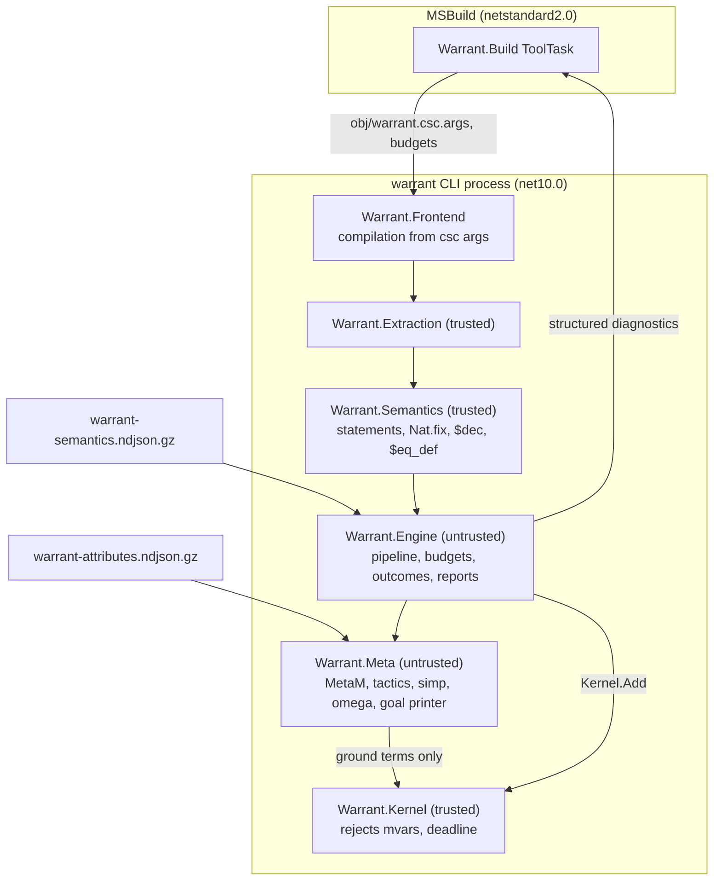
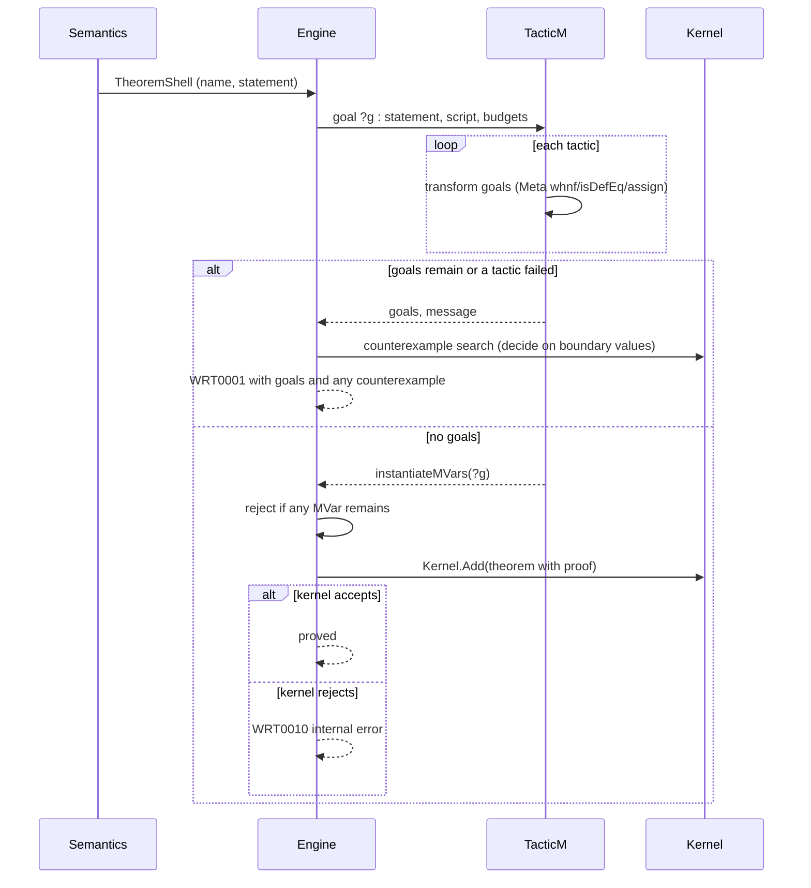
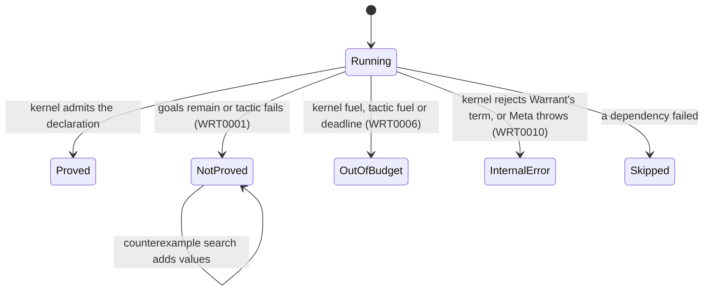
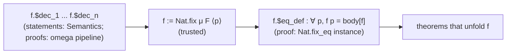
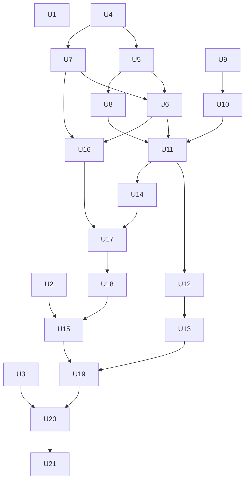

# M5a Meta and Tactics - Plan

The design is explained chapter by chapter, literate-programming style, in [docs/m5a/](../m5a/README.md).
This plan owns the decisions (KTD1 to KTD31) and the work units (U1 to U21); the chapters explain them and cite them by ID.
Ticket: git-bug `8958455` (M5a), with `624cb3c`, `1e637f0`, `d953584` and `338bdc9`.

---

## Goal Capsule

- **Objective:** A developer states a claim about all inputs of a `[Verified]` C# method, builds the project with `dotnet build` or Visual Studio's MSBuild, and either gets a proof that Warrant's kernel and Lean's kernel both accept, or a build error at the theorem that shows the goal that could not be proved.
- **Means:** an untrusted port of Lean 4.35.0's `Meta` layer and tactics produces proof terms (KTD1, KTD6), the trusted translator gains quantified statements and well-founded recursion (KTD12, KTD14), and a thin MSBuild task runs `warrant verify` as a child process (KTD20).
- **Authority:** this plan's Requirements win on behaviour and its KTDs on mechanism; the `docs/m5a/` chapters explain and never override; `docs/design.md` governs anything this plan does not decide, except where U21 amends it; the M4 plan's KTDs still hold unless a KTD here replaces one by name.
- **Stop conditions:** stop and ask if a session-settled decision proves unworkable (for example, a metavariable reaches `Kernel.Add` through a path the rejection check cannot see), if a ported tactic needs a Lean construction this plan defers (indexed `cases`, `noConfusion`, functional induction), or if a unit needs one of the user's uncommitted files (see Dependencies).
- **Execution profile:** units in the order of the Unit Index's phases; each phase ends at one of the ticket's checkpoints, and well-founded recursion moves after `omega` because its decrease proofs need it (KTD16).
- **Finishing:** an implementer (`ce-work` or a person) builds the units; the repository owner reviews and merges, one pull request per phase.

---

## Product Contract

### Summary

Build milestone M5a as `docs/design.md` §11 and ticket `8958455` define it: `Warrant.Meta` with tactics `intro`, `exact`, `apply`, `cases`, `induction`, `unfold`, `simp` and `omega`; quantified theorems with `Prove.That(...).By(...)`; well-founded recursion with `Spec.Decreases` and generated equation lemmas; an attribute sidecar for Init and the semantics library; `Int32`/`Int64` to `Int` bridging lemmas; an in-process `warrant verify`; and a thin `Warrant.Build` MSBuild task that runs it.
It also delivers the property-based differential tests (`624cb3c`) and the report-helper cleanup (`1e637f0`) early, and the cross-kernel harness (`d953584`) and kernel property tests (`338bdc9`) before the milestone closes.

### Problem Frame

After M4, Warrant can check claims about fixed inputs, such as `Payout(1000, 250, 500) == 500`.
That catches examples, not bugs: the useful claims are about every input, and those cannot be checked by computation.
M5a is the first milestone where such a claim is proved by search (tactics), checked by the kernel, and reported in the normal build, which is the developer experience the design promises (§8.3).
It also fixes shapes that later milestones build on: how metavariables enter the shared term type, what the sidecar holds, how recursion is encoded, and what the build task passes to the engine.
M6's verification conditions, M7's loop invariants and M8's `grind` all run on the Meta layer M5a builds.

### Requirements

**Claims and proofs**

- R1. A `[Theorem]` method with parameters states a claim for all values of its parameters; `Spec.ForAll`, `Spec.Exists` and `Spec.Implies` build quantified and conditional claims inside it.
- R2. `.By(...)` runs a proof script of `Tactic` calls; when the script does not close the goal, the build reports WRT0001 at the theorem with the remaining goals shown in Lean's goal layout with C# names.
- R3. A theorem counts as proved only when the kernel admits the exact declaration `Warrant.Semantics` built; no term containing a metavariable is ever admitted.
- R4. When a claim over `int`, `long`, `bool` or enum parameters is false, the diagnostic names concrete parameter values that falsify it whenever a search of boundary values finds them.

**Recursion**

- R5. A `[Verified]` method that calls itself, and whose block body starts with `Spec.Decreases(measure)`, translates to a well-founded definition the kernel admits; each recursive call's decrease obligation is proved or reported with its goal.
- R6. Each recursive definition has a kernel-checked equation lemma stating its body, which `Tactic.Unfold` and `Tactic.Simp` use.
- R7. Mutual recursion and recursion without `Spec.Decreases` are rejected with WRT0002 naming the construct.

**Tactics**

- R8. `Tactic.Intro`, `Exact`, `Apply`, `Cases`, `Induction`, `Unfold`, `Simp`, `Omega`, `AllGoals` and `Try` are available, and `Lean.Const` and `nameof` name lemmas for them.
- R9. `Tactic.Simp()` uses Warrant's default simp set and configuration (Key Decisions); `Tactic.Omega()` decides linear arithmetic over `int` and `long` through the bridging lemmas.

**Build and CLI**

- R10. `warrant verify` translates, proves and reports a compilation in-process, taking the compilation from a Csc argument file or, like `translate`, from a directory.
- R11. A project that references `Warrant.Build` runs verification after `CoreCompile` under `dotnet build` and Visual Studio's MSBuild; a failed theorem fails the build with an error at the theorem's file, line and column.
- R12. A project that references `Warrant` but runs no verification gets a warning, and every verified build prints a one-line summary of what was checked.
- R13. Each theorem runs under a kernel fuel budget, a tactic fuel budget and a wall-clock limit, set per project and per theorem; exhausting any of them fails the theorem with WRT0006.
- R14. Each way a theorem can fail has its own diagnostic: not proved (WRT0001), out of budget (WRT0006), an internal error where the kernel rejected a term Warrant produced (WRT0010), and a compilation Warrant cannot reproduce from the compiler's arguments (WRT0012).

**Assurance**

- R15. The differential tests are properties with shrinking, a pinned and replayable seed, and an opt-in long run, and they cover a well-founded unit evaluated both by the kernel and by rewriting with its equation lemma.
- R16. The certificate of a verified quantified theorem passes `scripts/cross-check.sh`'s translated-output step, so Lean's kernel re-checks it.
- R17. Before M5a closes, Warrant's verdicts are compared with Ansatz's and the lean-kernel-arena kernels' on the shared corpus, and the §10.3 kernel property tests exist and pass.

### Key Decisions

- **`Tactic.Simp()` uses Warrant's own defaults: a curated simp set of about 120 Init lemmas plus Warrant's `ite_eq_iff` and the semantics library's simp lemmas, with `decide` and `contextual` on.** (session-settled: user-directed — chosen over mirroring Lean's `Simp.Config` defaults: Lean's defaults do not close design §5.1's `ValidImpliesPositive`, and Lean's full Init simp set is about 12 times the bundle.) Governs R9.
- **Differential tests evaluate a well-founded unit two ways: by kernel `Eq.refl` over `WellFounded.Nat.fix`, and on a few inputs by rewriting with its equation lemma.** (session-settled: user-directed — chosen over kernel evaluation alone and over rewriting alone: the rewriting check also exercises the equation lemmas.) Governs R15.
- **CI trust (design Q9): every build re-checks every proof with the kernel; M5a has no cache.** (session-settled: user-approved — chosen over trusting signed caches, which waits for M5b's cache.) Governs R11, R13.
- **Budgets (design Q8): kernel fuel stays at 20M steps for builds and 100M for corpus runs; tactics get their own fuel; each theorem gets a 30-second wall-clock limit; all three are adjustable per project and per theorem.** (session-settled: user-approved — chosen over unlimited search: a hung proof must fail the build, not stall it.) Governs R13.
- **Visual Studio's MSBuild is checked on a machine with Visual Studio installed, and reported as not run where it is absent.** (session-settled: user-approved — chosen over claiming it from `dotnet build` alone.) Governs R11.

### Success Criteria

The M5a row of design §11, with its well-founded clause amended by the Key Decisions:

- `Increment(x) > x` over `int` fails the build, with its goal and the counterexample `x = 2147483647` shown, under `dotnet build`, Visual Studio 2026's MSBuild and Visual Studio 2022's MSBuild.
- Design §5.1's `ValidImpliesPositive` (with `int` amounts) passes with `.By(Tactic.Unfold(nameof(Validate)), Tactic.Simp())`.
- A well-founded recursive method whose decrease obligation needs `omega` passes.
- A quantified theorem over a translated `int` method closed by `Tactic.Simp()` then `Tactic.Omega()` passes.
- Differential tests pass for a well-founded unit, by kernel evaluation and by equation-lemma rewriting.
- The certificate of a verified quantified theorem passes `scripts/cross-check.sh`.
- `d953584` and `338bdc9` are closed.

### Scope Boundaries

**Out of M5a (later milestones):**

- The server, content-addressed cache, store, `explain` and analyzers (M5b); until then extraction raises its own diagnostics, as in M4.
- Contracts, exceptions, `null`, `/`, `%`, `decimal` and strings (M6 and M7).
- `decide` over finite domains, `split` and `grind` (design Q20, M8).
- Generated-program differential testing (`f3a8a1c`, M6).

**Considered and not built:**

- Structural recursion: unreachable for M5a's types, because `Int32` has no `brecOn` and records and closed types cannot be recursive (KTD14). Revisit when recursive types arrive.
- Indexed `cases`, `injection`, `noConfusion` and custom eliminators: no exit-criterion goal needs them; `cases` on an equation reports that it is not supported yet (KTD8).
- Mutual recursion: rejected (R7); Lean's `PSum` packing would cost about two days once self-recursion works.
- Tabled instance resolution: Init's instance graph for the M5a types is shallow, so a depth-first search suffices (KTD10).
- A `Spec.Decreases` form for expression-bodied methods: the developer writes a block body; revisit if the code fix in M5b is not enough.
- A per-decrease-call proof script: decrease obligations always run the omega pipeline (KTD15); a failure shows the goal, and the developer restructures or adds a guard.
- Skipping verification when inputs are unchanged: an MSBuild stamp is a cache, which Q9 rules out for M5a.

### Deferred to Follow-Up Work

- Theorems about recursive functions by measure induction or functional induction (Lean's `FunInd.lean`); M5a proves recursive methods' decrease and uses their equation lemmas, and `Tactic.Induction` covers inductive types only.
- `warrant verify <project>` that evaluates the project itself; M5a takes a Csc argument file or a directory (R10), and the reference is updated to match.
- Source-generator output in the compilation: M5a reports a project whose sources do not compile without generated code (KTD21), with an opt-in for `EmitCompilerGeneratedFiles`.
- Trace diffing against Ansatz (design §10.4, ticket `0c23ac4`).

### Dependencies

- Lean 4.35.0 through elan, lean4export `5a9a355`, and the repo's `tools/lean-replay`, as in M4.
- Visual Studio 2026 (MSBuild 18.11) and Visual Studio 2022 (MSBuild 17.14) are installed on the development machine; .NET SDKs 9.0.320 and 10.0.403 are installed.
- U20 needs the Clojure CLI (Windows `deps.exe`, or WSL Ubuntu with JDK 21 and Clojure) to run Ansatz, and network access to download the lean-kernel-arena test tarball and `results.json`. Installing either needs the owner's approval when U20 starts.
- The owner has uncommitted mode-only changes to `scripts/count-export.py`, `scripts/cross-check.sh`, `scripts/export-lean-library.sh` and `scripts/export-semantics.sh`, and uncommitted changes to `.gitignore` and `compose.yaml`. U7, U17, U18 and U19 edit some of these scripts, so the implementer asks the owner before the first edit how to keep the mode changes out of the commits.

### Outstanding Questions

- Deferred, not blocking: ticket `8958455` (2026-11-02 review) moves structural recursion into M5a. This plan defers it, because no M5a type can recurse structurally (Scope Boundaries). The owner confirms the ticket amendment; no unit depends on the answer.

---

## Planning Contract

### Key Technical Decisions

**Terms and the kernel**

- KTD1. **`Warrant.Cic.Expr` gains an `MVar` kind and `Warrant.Cic.Level` gains an `MVar` level, both with cached `HasExprMVar`/`HasLevelMVar` flags; the kernel rejects a declaration whose type or value has either, before type checking, and its type checker throws a `KernelException` on an `MVar`.** (session-settled: user-approved — chosen over a separate Meta-only term type, which would duplicate substitution and traversal code.) Level metavariables are needed because `apply` and `simp` instantiate universe-polymorphic lemmas such as `Eq.mpr` and `congrArg` with fresh levels. Lean's C++ kernel checks both up front ("declaration has metavariables"); Ansatz's kernel misses level mvars, which is the gap this check closes. The NDJSON writer refuses both, and `LevelOps` treats a level mvar as an atom so Meta can reuse normalisation (docs/m5a/02).
- KTD2. **The kernel takes an optional deadline next to its fuel, checked in `Tick()`; passing it raises the same `KernelResourceException` as running out of fuel.** A resource limit can only reject, never accept, so this keeps the M2 rule that exhaustion is never success. It is the smallest trusted change that lets a 30-second limit stop a long `whnf`.

**Meta**

- KTD3. **`Warrant.Meta` reimplements Lean's `whnf`, `inferType`, `isDefEq`, `instantiateMVars` and binder construction (`mkLambdaFVars` with delayed assignment) in Lean's shape; it calls the kernel only on terms without metavariables, and only to check them or to add the final declaration.** The kernel's checker cannot assign metavariables, ignores transparency, unfolds theorems, and caches results that would go stale once a metavariable is assigned. Ansatz's history shows the same split (its "two unification worlds" bug came from a second unifier). Delayed assignment is ported faithfully because `intro`, `revert` and `induction` produce proofs through it, and getting it wrong leaks free variables into certificates (docs/m5a/02).
- KTD4. **Meta's local context is its own persistent, ordered structure; the kernel's `LocalContext` is used only when Meta hands a ground term to the kernel.** The kernel's context is an append-only dictionary, while goals need order, clearing and renaming, and backtracking needs snapshots.
- KTD5. **Transparency follows Lean 4.35.0 exactly: modes `none < reducible < instances < implicit < default < all`, and statuses `reducible`, `semireducible`, `irreducible`, `implicitReducible` and `instanceReducible` read from the sidecar.** `simp` and instance resolution run at `reducible` or `instances` and must not unfold what Lean would not, or the lemmas that fire, and so the proofs Warrant finds, differ from Lean's. A missing reducibility entry silently stops lemmas from matching, so the sidecar exports every non-default status (KTD9).
- KTD6. **Tactics are ported from Lean's `Meta`-level implementations (`MVarId.intro`, `apply`, `cases`, `induction`, `unfold`, `assumption`, `refl`), not from the `Elab` tactics, and run in a C# `TacticM` holding the goal list.** Warrant builds terms directly, so it has no term elaborator, and the `Elab` versions of `cases` and `induction` depend on custom eliminators Warrant will not have. Goals therefore show `Nat.succ n` rather than `n + 1`; docs/m5a/04 records the difference.
- KTD7. **The goal display ports `Lean/Meta/PPGoal.lean`'s layout with a small notation printer, not Lean's delaborator; hypotheses carry C# parameter names, and translated constants print as C# names.** The output is what WRT0001 shows, so it must read like Lean's goals (`x : Int32`, `⊢ Increment x > x`) without porting thousands of lines of delaborator and parenthesizer.
- KTD8. **The engine generates `T.casesOn` and `T.ctorIdx` for every translated inductive, as kernel-checked definitions marked reducible and auxiliary-recursor for Meta; `noConfusion` waits.** The kernel generates only `.rec` (M4 KTD9). In 4.35.0, distinct-constructor contradictions go through `ctorIdx` and Init's `noConfusion_of_Nat`, so `cases` and `simp`'s constructor-equality step need only these two. They are definitions, not statements, so generating them in the untrusted engine adds nothing to the trusted base.

**Sidecar, simp and omega**

- KTD9. **The attribute sidecar is a versioned NDJSON file, `tests/data/warrant-attributes.ndjson.gz`, exported by a Lean program from the pinned toolchain next to the bundle, holding simp entries (priority, pre/post, `←`), `@[congr]` lemmas, instances (class, priority, order), non-default reducibility statuses, matcher info and class out-params for every constant in the bundle; discrimination-tree keys are recomputed in C# from the kernel-checked types, with Lean's keys kept only as a test oracle.** The sidecar can then only choose which checked lemmas tactics try, never change what they say. Ansatz's `dump_attrs.lean` is the template; it lacks reducibility, which Ansatz approximates and gets wrong for `@[reducible] def`. The engine adds generated entries for translated declarations (open enums reducible, recursive definitions irreducible). The sidecar's hash joins the bundle's in reports (docs/m5a/05).
- KTD10. **Instance resolution is a depth-first search over the sidecar's instances in Lean's order (priority, then most recent first), with out-parameter handling and a depth and fuel bound, inside `withNewMCtxDepth`; no tabling.** `apply`, `simp`'s `decide` and argument synthesis, and `omega`'s proof building all need `Decidable`, `LT`, `LE`, `OfNat` and `HAdd` instances at `Int32`, `Int64`, `Int`, `Nat` and `Bool`, whose instance graph is shallow.
- KTD11. **`simp` ports Lean's `Simp.main`, rewriting, congruence and `Simp.Result` proof construction, plus the structural simprocs `reduceIte` and `reduceDIte` and the `decide` step; the ground arithmetic simprocs are not ported, and literals are handled by Warrant `no_index` lemmas discharged by `decide`.** (session-settled: user-approved — chosen over a full port and over a bespoke procedure: Lean-shaped proofs keep Lean's kernel able to re-check them, and later milestones extend the code rather than replace it.) Running the pinned Lean showed that a literal lemma without `no_index` never fires, because of how discrimination trees key numerals (docs/m5a/05).
- KTD12. **`omega` ports Lean's frontend, problem solver and justification-to-proof translation, emitting `Lean.Omega.*` proofs, and adds one atom rule: an `Int32.toInt x` or `Int64.toInt x` atom contributes its range facts, as Lean's does for `BitVec.toNat`.** (session-settled: user-approved — same decision as KTD11.) Its proofs make the kernel recompute `Lean.Omega` functions on literal lists, so the C# arithmetic must match Init's definitions exactly; a mismatch is a safe kernel rejection that differential tests catch early. Kernel fuel is not a risk: Lean-built simp and omega proofs for the exit examples passed Warrant's kernel at 100,000 fuel per declaration.
- KTD13. **`Tactic.Omega()` first runs an omega-prep simp set at every hypothesis and the goal, then `omega`; the prep set rewrites `Int32`/`Int64` comparisons and arithmetic to `Int` with `Int.bmod`, then `Int.bmod` with `Int.bmod_def`, because omega treats `bmod` as an opaque atom.** This is design §6.2's bridging, shaped like Lean's `bv_omega`. The prep set's lemma names live in one C# list, and each is a bundle root. Without `bmod_def`, the true variants of the exit examples fail.

**Translation**

- KTD14. **A self-recursive method with `Spec.Decreases(e)` is translated to `WellFounded.Nat.fix` with measure `fun x => Int.toNat (Int32.toInt e[x])` (or `Int64.toInt`), parameters packed in a right-nested `PSigma` read by projections, and `dite` in place of `ite` on every branch that leads to a recursive call; there is no structural recursion and no measure inference.** This is the term Lean 4.35.0 itself builds for a Nat measure. Unlike `WellFounded.fix`, it reduces in the kernel on concrete inputs (Lean proved `f 1000 = 1000` by kernel evaluation in 1.2 seconds), which is what lets the differential tests evaluate recursive units with M4's `Eq.refl` method. Projections rather than `PSigma.casesOn` avoid Lean's argument-pushing and its undo machinery; Lean's kernel accepted that variant. A negative measure clamps to 0, which leaves a call from a non-positive state with an unprovable obligation (docs/m5a/03).
- KTD15. **Semantics builds, per recursive unit, decrease theorems `f.$dec_k` (one per call site) and the equation lemma `f.$eq_def : ∀ p, f p = body[f]`; the engine proves each `$dec_k` with the omega pipeline and each `$eq_def` with the bare `WellFounded.Nat.fix_eq` instance; a missing equation lemma fails translation.** Neither statement is soundness-critical (a wrong one fails to check or proves something true), but `$eq_def` must be exactly M4's body translation so `unfold` and `simp` see the same terms a theorem's statement does. The definition depends on its `$dec_k` theorems, so they are admitted first. Ansatz swallows equation failures, which leaves definitions that simp cannot unfold; Warrant makes it an error. Inside `F` a recursive result is `rec …`, which a `$dec_k` statement cannot name, so a `let` whose value contains a recursive call becomes a plain `∀` binder of its type in later `$dec_k` statements, and a recursive call inside another recursive call's argument is rejected with WRT0002 (`nested recursion`). Certificates of recursive units carry `propext`, `Classical.choice` (from Init's `SInt` lemmas) and `Quot.sound` (from `Nat.fix_eq`), all standard.
- KTD31. **A proof about a recursive method assumes each call returns; the model has no stack, so a run that would exhaust the CLR's stack is outside it, and the assumption report lists this for every recursive unit.** `Nat.fix` always returns while `Sum(int.MaxValue)` throws `StackOverflowException`, which cannot be caught, so without the line a verified method could crash with no warning. Bounding recursion depth in the model would make every recursive definition partial and is not attempted.
- KTD16. **Well-founded recursion is implemented after `omega` (phase F), not at checkpoint 3 as the ticket orders it.** Every decrease obligation over `int` needs the bridging lemmas and `omega`; scheduled earlier, recursion could be translated but no recursive unit could be admitted.
- KTD17. **A quantified statement is a `Condition` whose `Decidable` instance is optional; `Spec.ForAll<T>(x => p)` becomes `∀ x : T, P`, `Spec.Exists<T>(x => p)` becomes `∃ x : T, P`, and a theorem's parameters become outer `∀` binders in order.** The M4 `rfl`/`decide` proofs need an instance, so they are tried only when one exists (M4 KTD12 still applies to closed statements). `Spec.Exists` translates, but M5a has no tactic that supplies a witness; it is useful as a hypothesis through `Cases`.
- KTD18. **VIR gains `ForAll`, `Exists`, `Decreases` and a proof-script field on theorem units; a script is a list of generic tactic nodes (name, then arguments: lemma references, strings, numbers, nested tactics and named options), and lemma references resolve through the semantic model to unit keys or Lean names; the schema version becomes 2.** A generic tactic node lets later tactics arrive without new VIR kinds (M4 KTD5). Resolving `nameof` through the semantic model catches overloads and adds a dependency edge, so a lemma is admitted before the theorem that uses it and a failed lemma skips its users.

**Engine, CLI and build**

- KTD19. **A theorem runs in its own budget scope: the engine catches resource exhaustion, tactic failure, Meta exceptions and kernel rejection separately, and maps each to its diagnostic (R14); a kernel rejection of a term the engine or translator produced is WRT0010 with the kernel's message.** The M4 pipeline catches only `KernelException`, so an `InvalidOperationException` from an unexpected term would abort the whole run. WRT0010 says "this is Warrant's bug", which a user must not mistake for a false claim.
- KTD20. **`warrant verify` runs the whole pipeline in-process and writes one structured record per diagnostic with `--format msbuild`, and human-readable lines otherwise; exit codes are 0 (all proved, possibly with warnings), 1 (at least one error diagnostic), 2 (usage or internal error).** One record per diagnostic keeps a multi-line goal in one MSBuild event; the first line of each message is self-contained because Visual Studio's Error List shows only one line.
- KTD21. **The CLI, not the MSBuild task, builds the compilation and extracts VIR: the task sets `ProvideCommandLineArgs`, writes `@(CscCommandLineArgs)` to `obj/warrant.csc.args` (reusing the last file when `CoreCompile` was skipped), and passes it to `warrant verify --csc-args`, which parses it with Roslyn's `CSharpCommandLineParser`.** (session-settled: user-directed — chosen over extraction inside the task as design §8.3 describes: extraction is built against Roslyn 4.8, which cannot parse C# 13 or 14, the SDK 10 default, and loading Roslyn into Visual Studio's .NET Framework MSBuild depends on fragile assembly binding.) The arguments carry the real defines, so extraction stops comparing every `#if` combination when they are given, except in a multi-targeted project, where the task asks the CLI to keep M4's combination check so code whose translation differs between target frameworks is rejected rather than verified for one; the check also stays for the directory mode. Source generators run only inside Csc, so a compilation that does not compile without them is an error (WRT0012) naming the missing symbols, rather than a verification of different code or a green build.
- KTD22. **`Warrant.Build` is a netstandard2.0 `ToolTask` with no Roslyn reference, packaged as a development dependency with `build/` targets only and the framework-dependent CLI under `tools/net10.0/any/`, launched through `$(DOTNET_HOST_PATH)`; the target runs after `CoreCompile`, skips design-time builds, runs in the inner build of the first entry of `$(TargetFrameworks)` in multi-targeted builds, and has no `Inputs`/`Outputs`.** No `Inputs`/`Outputs` follows from the Q9 decision. Running once per project avoids duplicate diagnostics and doubled time, and `build/` (not `buildTransitive/`) keeps projects that only consume a verified library from verifying it again.
- KTD23. **The `Warrant` package's `build/` targets warn (WRT0011) when `Warrant.Build` is not imported or `WarrantEnabled` is false.** Without it a project builds green with no theorem checked, and nothing tells the developer. MSBuild targets cannot see whether the project has `[Verified]` code, so the warning does not try; `build/` limits it to projects that reference `Warrant` directly, and a developer silences it with `NoWarn`.
- KTD24. **Budgets are MSBuild properties (`WarrantKernelFuel`, `WarrantTacticFuel`, `WarrantTimeoutSeconds`) passed to the CLI as options, and per-theorem overrides are named arguments on `[Theorem]` (`TimeoutSeconds`, `TacticFuel`, `KernelFuel`).** Named attribute arguments are compile-time constants that extraction can read, and they keep the override next to the theorem.
- KTD25. **When a theorem fails, the engine searches for a counterexample by evaluating `decide` of the claim in the kernel on boundary combinations of the parameters (as the differential tests choose them), and reports the first falsifying assignment.** `omega` gives constraints, not a model, and the tutorial and the exit criterion show concrete values. The search is untrusted and diagnostic only; a found counterexample upgrades WRT0001's text, never its meaning. It runs outside the theorem's budgets, with a kernel fuel cap per combination and a two-second cap overall, and a combination that exhausts its cap is skipped, so the search can neither turn WRT0001 into WRT0006 nor cost a failing build more than a few seconds per theorem.

**Testing and cross-checks**

- KTD26. **The differential tests become FsCheck properties (`Prop.ForAll` with shrinkers toward boundary values, records and enums) run through one helper that pins the seed, prints it on failure, reads `WARRANT_PBT_SEED`, `WARRANT_PBT_COUNT` and `WARRANT_PBT_LONG`, and keeps the exhaustive boundary combinations.** (session-settled: user-approved — `624cb3c` scheduled as early M5a work, before recursion and quantified theorems extend the translator.) Recursive units draw inputs whose measure is at most 1,000 to start, lowered by U15 to what its fuel measurement allows, because `int.MaxValue` would recurse 2³¹ times and crash the test host with a stack overflow.
- KTD27. **The cross-kernel harness compares verdicts with lean-kernel-arena's published `results.json` (official, nanoda and lean4lean) on the downloaded arena tests, and runs Ansatz's `arena-check` locally on the shared corpus and Warrant's exports; a kernel that cannot run prints SKIPPED, and the ticket closes only when every row has a verdict or an explanation in `docs/kernel.md`.** Every arena kernel's verdict is already published, so no kernel has to be built.
- KTD28. **The new kernel property tests (defeq reflexive, symmetric and transitive; substitution and instantiation preserve typing; universe instantiation preserves well-formedness) reuse the generators in `tests/Warrant.Kernel.Tests/PropertyTests.cs`, and `docs/kernel.md` lists them.**
- KTD29. **The tactic engine's emitted constants are listed in one C# table, and a test checks every name is a bundle root, as M4's test does for the translator's.** A tactic that names a missing constant would otherwise fail only when a goal reaches it, and a certificate with a missing constant fails `lean-replay` with "unknown constant", which looks like a kernel disagreement.
- KTD30. **Projects: `src/Warrant.Meta` (net10.0, untrusted) holds Meta, tactics, simp, omega and the goal printer; `src/Warrant.Build` (netstandard2.0) holds the task; `Warrant.Engine` references `Warrant.Meta`, and neither references Roslyn.** One assembly for Meta and tactics mirrors Lean's `Lean.Meta`, and keeping Roslyn out keeps M5b's server Roslyn-free (design §3.2).

### High-Level Technical Design

The components after M5a, and which depends on which:



How one theorem is proved (the engine's loop, KTD19):



A theorem's outcomes (R14):



The proof-script surface and its VIR form (KTD18), as a grammar sketch:

```text
theorem   ::= [Theorem(budget*)] static Proof Name(param*) => Prove.That(claim) [.By(tactic, …)]
claim     ::= bool-expr | Spec.Implies(claim, claim) | Spec.ForAll<T>(x => claim) | Spec.Exists<T>(x => claim)
tactic    ::= Tactic.Name(arg*) [.With(option*)]
arg       ::= nameof(member)        -> lemma reference: unit key, plus a dependency edge
            | Lean.Const("Lean.Name") -> lemma reference: Lean name, must be a bundle root
            | "identifier"          -> hypothesis or binder name
            | tactic                -> nested (AllGoals, Try)
VIR:      tactic-node { name, args: [ref-unit | ref-lean | string | number | tactic], options: {name: value} }
```

A recursive unit's declarations, in admission order (KTD14, KTD15):



### Output Structure

```text
src/Warrant.Cic/                     MVar kind and level mvars (U4)
src/Warrant.Kernel/                  mvar rejection, deadline (U4)
src/Warrant.Meta/                    new project (U5 to U8, U11, U14, U16 to U18)
  Basic/                             LocalContext, MetavarContext, MetaM
  Reduce/                            WHNF, InferType, ExprDefEq, LevelDefEq
  Attributes/                        sidecar loader, reducibility, DiscrTree, instances
  Tactic/                            TacticM, intro, exact, apply, cases, induction, unfold
  Tactic/Simp/                       simp
  Tactic/Omega/                      omega
  Display/                           goal printer
src/Warrant.Build/                   new project: ToolTask and build/ targets (U13)
src/Warrant/                         Tactic, Spec.ForAll/Exists/Decreases, Lean, Proof.By (U9)
lean/Warrant/                        bridging and simp lemmas (U17, U18)
tools/warrant-attrs/                 Lean program that dumps the sidecar (U7)
scripts/export-attributes.sh         sidecar export (U7)
tests/data/warrant-attributes.ndjson.gz
tests/corpus/m5a/                    accepted, refuted, rejected, expected.json (U9, U19)
tests/Warrant.Meta.Tests/            new (U5 to U8, U11, U14, U16 to U18)
tests/Warrant.Build.Tests/           new: task unit tests and build integration tests (U13)
```

### Alternative Approaches Considered

- **Call the kernel's checker as Meta's `whnf` and `isDefEq`.** Rejected (KTD3): it cannot assign metavariables or respect transparency, and Ansatz's attempt at a second unifier beside it produced inconsistent results.
- **Encode holes as free variables.** Rejected by the settled decision (KTD1); Ansatz migrated away from it.
- **Port Lean's `Elab` tactics.** Rejected (KTD6): they depend on the term elaborator and custom eliminators.
- **Extract VIR inside the MSBuild task.** Rejected (KTD21).
- **Encode recursion with `WellFounded.fix`.** Rejected (KTD14): the kernel cannot evaluate it on concrete inputs, so differential tests would need a new evaluator.
- **Use Lean's full Init simp set.** Rejected (Key Decisions): about 31,000 constants against the bundle's 2,483, re-checked on every load.

### Risks

| Risk | Mitigation |
|---|---|
| `isDefEq` is the largest and subtlest port (about 2,200 C# lines); a divergence from Lean makes tactics fail or find different proofs. | Port function by function with Lean's names, test against goals Lean solves, and add a debug mode that kernel-checks every ground intermediate (U6). |
| Delayed assignments leak free variables into proofs. | U5 tests `mkLambdaFVars` and delayed assignment directly, U11's tests chain `intro`, `apply` and `intro`, and the kernel rejects any leak as `declHasFVars`, which surfaces as WRT0010, never as a proof. |
| A missing reducibility or matcher entry makes `simp` silently miss lemmas. | The sidecar exports every non-default status; U16's key oracle compares recomputed keys with Lean's for every simp entry. |
| The C# omega disagrees with `Init/Omega` arithmetic. | Property tests run C# `tidy`, `combo` and normalisation against kernel evaluation of the Init definitions (U18). |
| Kernel evaluation of `Nat.fix` is too slow for useful differential depths. | U15 measures fuel per recursion level and sizes the measure bound; inputs over budget are reported as skipped, and a test with every input skipped fails. |
| Visual Studio's Error List shows multi-line goals badly. | The first line is self-contained (KTD20), the goal is also logged as a high-importance message, and U13 checks the IDE by hand once. |
| VS 2022's MSBuild cannot use SDK 10. | U13 tests VS 2022 with a sample pinned to SDK 9 and `net8.0`; the CLI still runs on .NET 10. |
| Ansatz has never run full Init at 4.35.0 and admits mutual blocks differently. | KTD27's table records Ansatz-only rejections with their explanation; `docs/kernel.md` lists each. |

---

## Implementation Units

| U-ID | Phase | Title | Files touched (primary) | Depends on |
|---|---|---|---|---|
| U1 | A | Report helpers and outcome wording | `src/Warrant.Engine/Reports/`, `src/Warrant.Cli/TranslateCommand.cs` | none |
| U2 | A | Property-based differential tests | `tests/Warrant.Engine.Tests/Differential/`, `tests/Warrant.TestSupport/` | none |
| U3 | A | Kernel property tests | `tests/Warrant.Kernel.Tests/PropertyTests.cs`, `docs/kernel.md` | none |
| U4 | B | Metavariables in terms; kernel rejection and deadline | `src/Warrant.Cic/`, `src/Warrant.Kernel/`, `src/Warrant.Lean4Export/` | none |
| U5 | B | Meta core: contexts, MetaM, instantiateMVars, binders | `src/Warrant.Meta/Basic/` | U4 |
| U7 | B | Attribute sidecar export and loader | `tools/warrant-attrs/`, `scripts/export-attributes.sh`, `src/Warrant.Meta/Attributes/` | U4 |
| U6 | B | Meta whnf, inferType and isDefEq | `src/Warrant.Meta/Reduce/` | U5, U7 |
| U8 | B | Goal printer | `src/Warrant.Meta/Display/` | U5 |
| U9 | C | Surface, VIR and extraction for quantified theorems and scripts | `src/Warrant/`, `src/Warrant.Vir/`, `src/Warrant.Extraction/`, `tests/corpus/m5a/` | none |
| U10 | C | Quantified statements in Semantics | `src/Warrant.Semantics/` | U9 |
| U11 | C | TacticM, basic tactics and the verify pipeline | `src/Warrant.Meta/Tactic/`, `src/Warrant.Engine/` | U6, U8, U10 |
| U12 | C | `warrant verify` and compilations from Csc arguments | `src/Warrant.Cli/VerifyCommand.cs`, `src/Warrant.Frontend/` | U11 |
| U13 | C | `Warrant.Build` task, package and build tests | `src/Warrant.Build/`, `src/Warrant/build/`, `tests/Warrant.Build.Tests/` | U12 |
| U14 | D | `cases`, `induction`, `casesOn` and `ctorIdx` | `src/Warrant.Meta/Tactic/`, `src/Warrant.Engine/` | U11 |
| U16 | E | Discrimination trees and instance resolution | `src/Warrant.Meta/Attributes/` | U6, U7 |
| U17 | E | `simp` and the default simp set | `src/Warrant.Meta/Tactic/Simp/`, `lean/Warrant/`, `lean/bundle-roots.txt` | U14, U16 |
| U18 | F | Bridging lemmas, omega-prep and `omega` | `src/Warrant.Meta/Tactic/Omega/`, `lean/Warrant/`, `lean/bundle-roots.txt` | U17 |
| U15 | F | Well-founded recursion and equation lemmas | `src/Warrant.Extraction/`, `src/Warrant.Semantics/`, `src/Warrant.Engine/`, `tests/Warrant.Engine.Tests/Differential/` | U2, U18 |
| U19 | G | Exit corpus and certificate cross-check | `tests/corpus/m5a/`, `scripts/cross-check.sh`, `scripts/lib/lean-toolchain.sh` | U13, U15 |
| U20 | G | Cross-kernel harness | `scripts/cross-kernel.sh`, `docs/kernel.md` | U3, U19 |
| U21 | G | Documentation | `docs/design.md`, `docs/proving/`, `docs/m5a/`, `REPRODUCING.md` | U19, U20 |

Phases end at the ticket's checkpoints: B is checkpoint 1, C is 2, D is 3 without recursion, E is 4, F is 5 plus recursion (KTD16), and G is 6.
U-IDs are listed in execution order; U6 follows U7 because transparency needs the sidecar's reducibility map.



### U1. Report helpers and outcome wording

- **Goal:** The engine owns every outcome's wording and the bundle's identity, so `translate`, `verify` and the build task print the same text.
- **Requirements:** R14 (ticket `1e637f0`).
- **Dependencies:** none.
- **Files:**
  - `src/Warrant.Vir/VirTree.cs` (one `IdOf` helper for pre-order node IDs)
  - `src/Warrant.Engine/Pipeline.cs`, `src/Warrant.Engine/Reports/AssumptionReport.cs` (use `IdOf`; drop `FallbackName` for `LeanNames.FallbackDisplay`)
  - `src/Warrant.Engine/Reports/OutcomeText.cs` (new: WRT0001 and WRT0006 wording, bundle name and SHA-256)
  - `src/Warrant.Cli/TranslateCommand.cs`
  - `tests/Warrant.Cli.Tests/TranslateTests.cs`, `tests/Warrant.Engine.Tests/`
- **Approach:** a pure move; the CLI calls `OutcomeText` and prints what it returns.
- **Patterns to follow:** `Reports/MarkdownReport.cs` for engine-owned text.
- **Test scenarios:**
  - `warrant translate tests/corpus/m4/accepted` prints byte-identical output before and after.
  - The assumption report for the M4 corpus is byte-identical.
  - `IdOf` returns the same ID as the two old scans for every node of every M4 corpus unit.
- **Verification:** the CLI and report tests pass unchanged.

### U2. Property-based differential tests

- **Goal:** A translation bug fails the differential tests with a shrunk counterexample and a seed that reproduces it.
- **Requirements:** R15 (KTD26, ticket `624cb3c`).
- **Dependencies:** none.
- **Files:**
  - `tests/Warrant.TestSupport/Pbt.cs` (new: config helper, seed parsing, failure hint)
  - `tests/Warrant.TestSupport/Generators.cs` (shrinkers for `int` and `long` toward boundaries, records, enums)
  - `tests/Warrant.Engine.Tests/Differential/DifferentialTests.cs`, `Inputs.cs`, `README.md`
  - `tests/Warrant.Semantics.Tests/ClrAgreementTests.cs`
- **Approach:**
  1. Express each corpus function's agreement as `Prop.ForAll(arb, args => model(args) == clr(args))`.
  2. Keep the exhaustive boundary combinations as a separate deterministic test.
  3. Default seed fixed; `WARRANT_PBT_SEED=random` or a `seed,gamma` pair replays; `WARRANT_PBT_LONG=1` runs 10,000 cases.
  4. Apply the same helper to the CLR-agreement tests.
- **Execution note:** prove the harness first by temporarily swapping `Le` and `Lt` in `Switches.Matches` and checking that the failure is shrunk and replays; revert before committing.
- **Patterns to follow:** `tests/Warrant.Kernel.Tests/PropertyTests.cs` (`Config.QuickThrowOnFailure.WithMaxTest`).
- **Test scenarios:**
  - A deliberately broken `Le`/`Lt` fails with a shrunk input such as `0` or a boundary, and the message contains `WARRANT_PBT_SEED=<seed,gamma>`.
  - Re-running with that seed reproduces the same failure.
  - An unset seed gives the same inputs on two runs.
  - `WARRANT_PBT_LONG=1` runs 10,000 cases per function.
  - A record input shrinks field by field.
- **Verification:** the default run stays within the time recorded in `Differential/README.md`.

### U3. Kernel property tests

- **Goal:** The §10.3 properties the kernel's evidence rests on have FsCheck tests.
- **Requirements:** R17 (KTD28, ticket `338bdc9`).
- **Dependencies:** none.
- **Files:** `tests/Warrant.Kernel.Tests/PropertyTests.cs`, `docs/kernel.md`.
- **Approach:** reuse the existing well-typed-term generators; definitional equality is tested on pairs related by known reductions (beta, delta, Nat literals) so transitivity has non-trivial chains.
- **Test scenarios:**
  - `IsDefEq(a, a)` holds for generated well-typed terms.
  - `IsDefEq(a, b)` equals `IsDefEq(b, a)`.
  - `IsDefEq(a, b)` and `IsDefEq(b, c)` imply `IsDefEq(a, c)` for generated reduction chains.
  - Instantiating a well-typed body with a well-typed argument of the binder's type gives a term whose inferred type is the instantiated type.
  - Instantiating level parameters with well-formed levels keeps a well-typed declaration well-typed.
- **Verification:** the tests pass and `docs/kernel.md` lists them.

### U4. Metavariables in terms; kernel rejection and deadline

- **Goal:** Meta can build terms with metavariables, and no such term can pass the kernel.
- **Requirements:** R3, R13 (KTD1, KTD2).
- **Dependencies:** none.
- **Files:**
  - `src/Warrant.Cic/Expr.cs` (`MVarId`, `MVarExpr`, `HasExprMVar`, `HasLevelMVar`; hashing tag 13; equality)
  - `src/Warrant.Cic/Level.cs` (`LMVarId`, `Level.MVar`, `HasMVar`)
  - `src/Warrant.Kernel/Kernel.cs` (`CheckNoMVar` before `CheckNoFVar`), `TypeChecker.cs` (`InferTypeCore` rejects), `TypeChecker.Whnf.cs` (default arms throw `KernelException`), `ExprOps.cs` (pass `MVar` through), `LevelOps.cs` (atom), `Inductive.cs` call sites
  - `src/Warrant.Kernel/TypeChecker.cs` (`KernelLimits` gains an optional deadline; `Tick()` checks it)
  - `src/Warrant.Lean4Export/Lean4ExportWriter.cs` (refuse both)
  - `tests/Warrant.Cic.Tests/ExprTests.cs`, `tests/Warrant.Kernel.Tests/MVarRejectionTests.cs` (new)
- **Approach:** every one of the 13 kind dispatches gets an explicit `MVar` arm; none falls into a default.
- **Execution note:** write the rejection tests first; this is trusted code.
- **Test scenarios:**
  - `Kernel.Add` rejects a definition whose value contains `?m`, with a "declaration has metavariables" message naming it.
  - `Kernel.Add` rejects a theorem whose type has `Sort ?u` only inside a binder domain.
  - `Kernel.Add` rejects a constant reference with a level mvar `c.{?u}`.
  - `TypeChecker.Infer` on `?m` throws `KernelException`, not `InvalidOperationException`.
  - `?m` and `?n` hash and compare differently; `?m` equals `?m`.
  - `Instantiate` and `Abstract` leave `?m` unchanged and keep its flags.
  - The NDJSON writer throws on a term with `?m`.
  - A deadline in the past makes `Kernel.Add` of a heavy declaration throw `KernelResourceException`; no deadline leaves behaviour unchanged.
  - Full Init and the M4 bundle re-check with the same verdicts and fuel.
- **Verification:** all kernel tests pass, and `scripts/cross-check.sh` still agrees.

### U5. Meta core: contexts, MetaM, instantiateMVars, binders

- **Goal:** Meta has Lean's metavariable context, local context and binder operations, so tactics can create goals and assemble proofs.
- **Requirements:** R3 (KTD3, KTD4).
- **Dependencies:** U4.
- **Files:**
  - `src/Warrant.Meta/Warrant.Meta.csproj` (new, net10.0), `Warrant.slnx`
  - `src/Warrant.Meta/Basic/LocalContext.cs`, `MetavarContext.cs`, `MetaM.cs`, `MkBinding.cs`, `InstantiateMVars.cs`, `CollectMVars.cs`
  - `tests/Warrant.Meta.Tests/` (new project)
- **Approach:**
  1. Port `Lean/LocalContext.lean` and `Lean/MetavarContext.lean` (kinds, depth, expression, level and delayed assignments, `isAssignable`, `dependsOn`, `collectForwardDeps`) over `System.Collections.Immutable`.
  2. Port `MkBinding` (`elimMVarDeps`, `revert`, `mkBinding`) with delayed assignments for synthetic-opaque goals.
  3. Port `instantiateMVars`' documented behaviour (the C++ source is not in the toolchain; use upstream v4.35.0 and Ansatz's `zonk-expr` as references), with beta of assigned heads, delayed-assignment rules and a per-context cache.
  4. Port `MetaM` state, save and restore, fresh mvars and levels, `withLocalDecl`, `withNewMCtxDepth`, the telescopes and `mkLambdaFVars`/`mkForallFVars`/`mkLetFVars`.
  5. Meta fuel is charged in this layer's loops and checked against the theorem's deadline.
- **Patterns to follow:** Lean 4.35.0's function names and order; `src/Warrant.Kernel/LocalContext.cs` for abstraction helpers.
- **Test scenarios:**
  - `mkLambdaFVars [x] ?g`, where `?g`'s context contains `x`, yields `?n x` with a delayed assignment; once `?g := x`, `instantiateMVars` yields `fun x => x`.
  - A delayed mvar is not instantiated while its pending mvar is unassigned.
  - `checkedAssign ?m := f ?m` fails the occurs check.
  - Assigning `?m := y` where `y` is not in `?m`'s context fails the scope check.
  - `withNewMCtxDepth` makes outer mvars read-only.
  - Save, assign, restore leaves the context as before.
  - `instantiateMVars` on a 10,000-deep chain of assignments finishes in linear time.
- **Verification:** the Meta tests pass; every proof term built in tests is mvar-free and accepted by `Kernel.Add`.

### U7. Attribute sidecar export and loader

- **Goal:** Meta knows Lean's reducibility, instances, simp entries and matchers for every constant in the bundle.
- **Requirements:** R9 (KTD9).
- **Dependencies:** U4.
- **Files:**
  - `tools/warrant-attrs/` (new Lean program, after Ansatz's `scripts/dump_attrs.lean` and `dump_instances.lean`)
  - `scripts/export-attributes.sh` (new; same toolchain and roots as `export-semantics.sh`)
  - `tests/data/warrant-attributes.ndjson.gz` (committed), `tests/data/README.md`
  - `src/Warrant.Meta/Attributes/Sidecar.cs`, `Reducibility.cs`, `MatcherInfo.cs`
  - `tests/Warrant.Meta.Tests/SidecarTests.cs`
- **Approach:**
  1. Fold each extension's module entries (scoped entries are missed by `getState` after `importModules`).
  2. Keep only names in the bundle closure.
  3. Write a header with the Lean githash, the bundle's SHA-256 and a format version.
  4. The C# loader parses strictly (unknown fields fail) and exposes reducibility, instances, simp and congr entries, matcher info and out-params.
- **Execution note:** this edits beside `scripts/export-semantics.sh`, which has the owner's uncommitted mode change; ask first.
- **Test scenarios:**
  - `Int.bmod` loads as `implicitReducible`, `GT.gt` as `reducible`, and an Init instance declared with `instance` as `instanceReducible`.
  - `instDecidableEqInt32` is an instance of `DecidableEq` with priority 1000.
  - `Bool.false_eq` keeps its low priority.
  - Every name in the sidecar is in the bundle.
  - A header whose bundle hash differs from the loaded bundle fails loading with a message naming both hashes.
  - Re-running the export gives a byte-identical file.
- **Verification:** the export is reproducible and the loader tests pass.

### U6. Meta whnf, inferType and isDefEq

- **Goal:** Meta reduces, infers and unifies terms with metavariables as Lean does, at every transparency.
- **Requirements:** R3, R8 (KTD3, KTD5).
- **Dependencies:** U5, U7.
- **Files:**
  - `src/Warrant.Meta/Reduce/Whnf.cs`, `InferType.cs`, `ExprDefEq.cs`, `LevelDefEq.cs`, `Transparency.cs`, `Check.cs`
  - `tests/Warrant.Meta.Tests/WhnfTests.cs`, `DefEqTests.cs`
- **Approach:**
  1. Port `whnfCore`, `unfoldDefinition?` with `canUnfoldDefault`, `reduceRec` with K and structure eta, `reduceMatcher?`, `reduceNat?` and `getStuckMVar?`; reuse `ExprOps` and the kernel's Nat literal operations as pure helpers.
  2. Port `isExprDefEqAuxImpl`: quick path, proof irrelevance, `processAssignment` with Miller patterns, first-order and constant approximation, `checkAssignment`, lazy delta with heights, eta, eta-struct, projection, Nat offsets, and postponed level constraints; `synthPending` returns false for now.
  3. `Check` converts the Meta context to a kernel `LocalContext` and calls the kernel on ground terms.
  4. A debug flag kernel-checks every ground term Meta assigns.
- **Patterns to follow:** Lean's `WHNF.lean`, `ExprDefEq.lean` and `LevelDefEq.lean`; Ansatz's `meta.clj` notes on quadratic re-instantiation and spine comparison.
- **Test scenarios:**
  - `?m + 1 =?= x + 1` assigns `?m := x`.
  - `?f x =?= g x x` assigns `?f := fun x => g x x` (Miller pattern).
  - At `reducible`, `GT.gt a b =?= LT.lt b a` succeeds and `Int32.add a b` does not unfold.
  - At `default`, `Increment 41 =?= 42` succeeds.
  - A theorem constant never unfolds.
  - Two proofs of the same proposition are defeq.
  - A failed unification leaves the context unchanged.
  - `whnfR` reduces an Init `match` application through its matcher info.
  - The debug flag catches a deliberately ill-typed assignment.
- **Verification:** the tests pass with the debug flag on.

### U8. Goal printer

- **Goal:** A goal prints in Lean's layout with C# names, readable in a build log.
- **Requirements:** R2 (KTD7).
- **Dependencies:** U5.
- **Files:** `src/Warrant.Meta/Display/GoalPrinter.cs`, `Notation.cs`; `tests/Warrant.Meta.Tests/GoalPrinterTests.cs`.
- **Approach:** port `PPGoal.lean`'s layout (case tag, grouped hypotheses, `⊢`); print `Eq`, `Ne`, `LE`, `LT`, `GE`, `GT`, `HAdd`, `HSub`, `HMul`, `Neg`, `And`, `Or`, `Not`, `Iff`, `ite`, `dite`, `OfNat` numerals, `Int32.toInt`, `∀`, `∃`, `→` and projections by field name with Lean's precedences; hide implicit and instance arguments; print translated constants through `Translation.Display`.
- **Test scenarios:**
  - `∀ x : Int32, Increment x > x` after `intro` prints `x : Int32` then `⊢ Increment x > x`.
  - Hypotheses `a b : Int32` group on one line.
  - `p.Amount` prints by field name, not `p.2`.
  - `if p.Amount ≤ 0 then InvalidAmount else …` prints with C# member names.
  - Nested `+` and `*` print with minimal parentheses.
  - An unassigned mvar prints `?m.3`.
- **Verification:** golden-text tests pass.

### U9. Surface, VIR and extraction for quantified theorems and scripts

- **Goal:** A developer can write quantified theorems, proof scripts and decrease measures, and extraction turns them into VIR.
- **Requirements:** R1, R2, R5, R7, R8, R13 (KTD17, KTD18, KTD24).
- **Dependencies:** none.
- **Files:**
  - `src/Warrant/Tactic.cs`, `Lean.cs` (new), `Spec.cs` (`ForAll`, `Exists`, `Decreases`), `Prove.cs` (`Proof.By`), `Attributes.cs` (`[Theorem]` named budget arguments)
  - `src/Warrant.Vir/` (`ForAll`, `Exists`, `Decreases` nodes; `ProofScript` with tactic nodes; schema version 2; writer, reader, tree and hash)
  - `src/Warrant.Extraction/Walker.cs`, `Extractor.cs` (theorems with parameters; single-parameter lambdas inside `Spec.ForAll`/`Exists`; `.By`; lemma references via the semantic model and dependency edges; self-recursion with a leading `Spec.Decreases`; mutual recursion and missing `Spec.Decreases` stay WRT0002)
  - `tests/corpus/m5a/` (new: `accepted/`, `refuted/`, `rejected/`, `expected.json`), `tests/corpus/m4/expected.json` (parameterised theorems leave the M4 rejected list; `Factorial`, which has no `Spec.Decreases`, stays)
  - `tests/Warrant.Vir.Tests/`, `tests/Warrant.Extraction.Tests/`
- **Approach:**
  1. Check that Roslyn's operation tree keeps `[Conditional]` `Spec.Decreases` calls; if it does not, read the call from the syntax tree.
  2. VIR encodings of existing nodes stay byte-identical; only the version field and new kinds change hashes.
  3. A `nameof` lemma resolves to a unit key; an ambiguous or unknown name is WRT0004.
- **Execution note:** write the corpus first, as M4 did, so every rule has a failing test.
- **Test scenarios:**
  - `Prove.That(Increment(x) > x)` with parameter `x` extracts a theorem unit with parameter `x`.
  - `Spec.ForAll<int>(y => y + 0 == y)` extracts a `ForAll` node binding `y`.
  - `.By(Tactic.Unfold(nameof(Validate)), Tactic.Simp())` extracts a two-step script whose first argument resolves to `Validate`'s key and adds a dependency on it.
  - `Tactic.Simp(nameof(MyLemma))` naming an overloaded method is WRT0004.
  - `Lean.Const("Nat.add_comm")` extracts a Lean-name reference.
  - `[Theorem(TimeoutSeconds = 60)]` extracts the override.
  - A self-recursive block body with `Spec.Decreases(n)` first extracts with a `Decreases` node.
  - `Factorial` without `Spec.Decreases` is WRT0002 "recursion without Spec.Decreases".
  - `IsEven`/`IsOdd` stay WRT0002 "mutual recursion".
  - A lambda outside `Spec.ForAll`/`Exists` stays WRT0002.
  - Every M4 unit's VIR is unchanged except the version field.
- **Verification:** corpus extraction matches `tests/corpus/m5a/expected.json` and the M4 expectations.

### U10. Quantified statements in Semantics

- **Goal:** A theorem with parameters becomes a closed `∀` proposition, exactly as the C# claim reads.
- **Requirements:** R1, R3 (KTD17).
- **Dependencies:** U9.
- **Files:**
  - `src/Warrant.Semantics/Operators.cs` (`Condition` with optional instance), `BodyTranslator.cs` (parameter fvars in statements; `ForAll`, `Exists`), `Translator.cs` (drop the "theorems with parameters need M5a" rejection), `Translation.cs` (`TheoremShell` carries a script)
  - `tests/Warrant.Semantics.Tests/TranslationTests.cs`
  - `tests/Warrant.Engine.Tests/Differential/TheoremStatementTests.cs`
- **Approach:** parameters become fvars, then `MkPi`; `Spec.Implies` keeps its M4 form; `Spec.ForAll` inside another statement nests.
- **Test scenarios:**
  - `Increment(x) > x` gives `∀ (x : Int32), Increment x > x`, where `>` is `@GT.gt Int32 instLTInt32`.
  - `ValidImpliesPositive(p)` gives `∀ (p : Payment), Validate p = PaymentResult.Valid → p.Amount > 0`.
  - `Spec.ForAll<int>(y => …)` gives a `∀ y : Int32` binder.
  - `Spec.Exists<bool>(b => b)` gives `∃ b : Bool, b = true`.
  - A parameterless M4 theorem translates byte-identically.
  - Statement tests evaluate a quantified statement's instance at boundary values and compare with the CLR.
- **Verification:** translation tests pass; every M4 theorem keeps its statement.

### U11. TacticM, basic tactics and the verify pipeline

- **Goal:** A theorem with a script of `Intro`, `Exact`, `Apply`, non-recursive `Unfold`, `AllGoals` and `Try` is proved or reported with its goals, end to end through the engine; `assumption` and `rfl` are internal helpers that `Exact` and `simp` use.
- **Requirements:** R2, R3, R4, R8, R13, R14 (KTD6, KTD19, KTD25).
- **Dependencies:** U6, U8, U10.
- **Files:**
  - `src/Warrant.Meta/Tactic/TacticM.cs`, `Intro.cs`, `Exact.cs`, `Apply.cs`, `Assumption.cs`, `Refl.cs`, `Unfold.cs` (delta path), `Combinators.cs` (`AllGoals`, `Try`)
  - `src/Warrant.Engine/Pipeline.cs` (theorem scope, budgets, outcome mapping), `Outcomes.cs` (`NotProvedOutcome` with goals and counterexample, `InternalErrorOutcome`), `Counterexample.cs`, `TacticRunner.cs` (VIR script to `TacticM` calls), `Reports/OutcomeText.cs`
  - `src/Warrant.Engine/EmittedConstants.cs` (KTD29)
  - `tests/Warrant.Meta.Tests/TacticTests.cs`, `tests/Warrant.Engine.Tests/TheoremTests.cs`
- **Approach:**
  1. `TacticM` holds goals; `liftMetaTactic` wraps each ported `MVarId` operation; unsolved goals after the script give ``unsolved goals``; a failing tactic gives ``Tactic `x` failed``.
  2. The engine starts each theorem with goal `?g : statement` and introduces the theorem's own parameters, in order and under their C# names, before the script; `Spec.ForAll` and `Spec.Exists` binders are left for `Tactic.Intro`. It then runs the script (or, with no script, M4's `rfl`/`decide` when the statement has an instance), instantiates, rejects any remaining mvar, and calls `Kernel.Add`.
  3. On failure, it runs the counterexample search on the theorem's own parameters.
  4. Every outcome switch gains the new outcomes.
  5. Measure tactic fuel over the M5a corpus and set the default tactic fuel to ten times the largest use, recorded in chapter 7's budget table.
- **Test scenarios:**
  - `Spec.ForAll<int>(x => x == x)` with `.By(Tactic.Intro("x"), Tactic.Exact(Lean.Const("rfl")))` is proved.
  - A theorem with parameters `a` and `b` claiming `Spec.Implies(a == b, b == a)` starts from goal `a b : Int32 ⊢ a = b → b = a`, and `Intro("h")`, `Apply(Lean.Const("Eq.symm"))`, `Exact("h")` prove it.
  - A chain of `Intro`, `Apply` and `Intro` produces a certificate with no free variables, which the kernel admits.
  - `Increment(x) > x` with no script reports WRT0001 with goal `x : Int32 ⊢ Increment x > x` and counterexample `x = 2147483647`.
  - A script that leaves two goals shows both, separated by a blank line.
  - `Tactic.Exact(Lean.Const("Nat.zero"))` on an `Int32` goal reports a type mismatch with both types.
  - A tactic fuel of 1 reports WRT0006 naming tactic fuel; a 0-second timeout reports WRT0006 naming the time limit.
  - A deliberately wrong proof injected after the script is rejected by the kernel and reported as WRT0010.
  - A theorem whose lemma failed is skipped, naming the lemma.
  - Every M4 corpus theorem keeps its M4 outcome.
  - Every constant in `EmittedConstants` is a bundle root.
- **Verification:** engine and tactic tests pass; checkpoint 2's false theorem fails through `TheoremTests`.

### U12. `warrant verify` and compilations from Csc arguments

- **Goal:** `warrant verify` proves a real project's theorems with the compiler's own settings.
- **Requirements:** R10, R12, R13 (KTD20, KTD21, KTD24).
- **Dependencies:** U11.
- **Files:**
  - `src/Warrant.Cli/VerifyCommand.cs` (new), `Program.cs`
  - `src/Warrant.Frontend/CompilationFactory.cs` (`FromCscArgs`, with Roslyn's `CSharpCommandLineParser`)
  - `src/Warrant.Extraction/Extractor.cs` (skip the `#if` combination check when real defines are given, unless `--keep-conditional-check` is passed)
  - `tests/Warrant.Cli.Tests/VerifyTests.cs`
- **Approach:** options `--csc-args <file>`, `--project-dir`, `--format msbuild|text`, `--out <file.ndjson>`, `--report <dir>`, `--keep-conditional-check` (multi-targeted builds, KTD21), and the three budgets; text output follows `translate`'s; a compilation that has errors without generated sources is the error WRT0012; the summary line counts units, theorems proved and theorems failed.
- **Test scenarios:**
  - A csc-args file with `/define:DEBUG` makes a `#if DEBUG` method translate under that define, with no combination check.
  - A `/langversion:14` file with a C# 14 feature in unverified code compiles and verifies.
  - `--format msbuild` writes one record per diagnostic, including a multi-line goal, and the file, line and column of the theorem.
  - Exit codes are 0, 1 and 2 for all-proved, a failed theorem and a missing args file; a run whose only diagnostics are warnings (WRT0008) exits 0.
  - A project whose code needs a source generator reports WRT0012, naming the missing symbols, and exits 1.
  - With `--keep-conditional-check`, a method whose body differs under `#if NET8_0` is rejected with M4's `preprocessor conditional` diagnostic.
  - `--out` writes NDJSON that `warrant check` accepts.
  - The directory mode gives the same results as `translate` for the M4 corpus.
- **Verification:** CLI tests pass.

### U13. `Warrant.Build` task, package and build tests

- **Goal:** `dotnet build` and Visual Studio's MSBuild verify a project and fail it on an unproved theorem, with the goal shown.
- **Requirements:** R11, R12 (KTD21, KTD22, KTD23).
- **Dependencies:** U12.
- **Files:**
  - `src/Warrant.Build/Warrant.Build.csproj` (new, netstandard2.0, `Microsoft.Build.Utilities.Core` 17.11.48 with `PrivateAssets=all`, `ExcludeAssets=runtime`), `WarrantVerify.cs`, `OutputParser.cs`
  - `src/Warrant.Build/build/Warrant.Build.props`, `Warrant.Build.targets`
  - `src/Warrant/build/Warrant.targets` (the WRT0011 warning, KTD23)
  - `tests/Warrant.Build.Tests/` (new: parser and exit-code unit tests; integration tests with sample projects)
- **Approach:**
  1. The target runs after `CoreCompile` unless `DesignTimeBuild` is true, only in the inner build of the first entry of `$(TargetFrameworks)` when multi-targeted (passing `--keep-conditional-check`), writes the args file only when Csc produced arguments, and launches the CLI through `$(DOTNET_HOST_PATH)`, falling back to `dotnet` on the path.
  2. `LogEventsFromTextOutput` parses each record and calls `Log.LogError` with code, file, line, column and message; the goal is also logged as a high-importance message.
  3. `HandleTaskExecutionErrors` adds no MSB6006 when errors were logged, and logs WRT0010 with stderr's tail on exit 2.
  4. Integration tests pack to a temporary feed with a unique version, build isolated sample directories with `-nodeReuse:false`, and run `dotnet build`, VS 2026's `MSBuild.exe`, and VS 2022's `MSBuild.exe` with a sample pinned to SDK 9 and `net8.0`; a host that `vswhere` cannot find is skipped with a visible reason.
- **Execution note:** this is packaging work; prove it by building the samples, not by unit tests alone.
- **Test scenarios:**
  - The `Increment` sample fails `dotnet build` with `Increments.cs(…): error WRT0001: …` and the goal and counterexample in the log.
  - The same sample fails under VS 2026's and VS 2022's MSBuild with the same diagnostic.
  - A sample with only true theorems builds and prints the summary line.
  - A second `dotnet build` with no changes verifies again and succeeds.
  - A design-time build does not run verification.
  - A multi-targeted sample verifies once and reports each diagnostic once.
  - A multi-targeted sample whose verified method differs under `#if NET8_0` fails with the `preprocessor conditional` diagnostic.
  - A sample that references `Warrant` but not `Warrant.Build` gets WRT0011; an app that references a verified library, and not `Warrant` directly, gets neither WRT0011 nor a verification run.
  - A sample that needs a source generator fails with WRT0012 and no MSB6006.
  - A CLI crash (exit 2) logs WRT0010 with the CLI's stderr.
  - A goal with Unicode (`⊢`, `≤`) reaches the log intact under both MSBuilds.
- **Verification:** the integration matrix passes, and the Visual Studio IDE's Error List is checked by hand once and recorded in the PR.

### U14. `cases`, `induction`, `casesOn` and `ctorIdx`

- **Goal:** Goals split by constructor of `bool`, closed enums, records and Init inductives.
- **Requirements:** R8 (KTD6, KTD8).
- **Dependencies:** U11.
- **Files:**
  - `src/Warrant.Meta/Tactic/Revert.cs`, `Clear.cs`, `FVarSubst.cs`, `RecursorInfo.cs`, `Induction.cs`, `Cases.cs`
  - `src/Warrant.Engine/Constructions.cs` (generate `casesOn` and `ctorIdx` for translated inductives; sidecar entries for them)
  - `tests/Warrant.Meta.Tests/CasesTests.cs`, `tests/corpus/m5a/accepted/`
- **Approach:** port `MVarId.induction` and the no-index path of `MVarId.cases`; indexed families report "cases on an indexed family is not supported yet"; refuse goals with unassigned mvars, as Ansatz learned to.
- **Test scenarios:**
  - `Cases(b)` on `b : Bool` gives goals with `b` replaced by `false` and `true`.
  - `Cases(s)` on a closed `ClaimStatus` gives one goal per member, in declaration order, with C# member names.
  - `Cases(p)` on a `Payment` record gives one goal with its fields as hypotheses.
  - `Induction(n)` on `n : Nat` gives a zero goal and a successor goal with the induction hypothesis.
  - `Cases(h)` on `h : a = b` reports the unsupported message.
  - Each generated `casesOn` and `ctorIdx` is admitted by the kernel, and Lean's kernel accepts them in the cross-check.
- **Verification:** tests pass; a closed-enum theorem closed by `Cases` then `rfl` in each branch is proved.

### U16. Discrimination trees and instance resolution

- **Goal:** Meta finds simp lemmas and instances by term shape, as Lean does.
- **Requirements:** R9 (KTD9, KTD10).
- **Dependencies:** U6, U7.
- **Files:** `src/Warrant.Meta/Attributes/DiscrTree.cs`, `Instances.cs`, `SynthInstance.cs`; `tests/Warrant.Meta.Tests/DiscrTreeTests.cs`, `InstanceTests.cs`.
- **Approach:** port `mkPath`, `getMatch`, `getMatchWithExtra` and `getUnify` with numeral keys, `no_index`, ignored instance and proof arguments, and reducible unfolding; port `synthInstance` as a depth-first search with out-parameter preprocessing.
- **Test scenarios:**
  - For every simp entry in the sidecar, the recomputed keys equal Lean's exported keys.
  - `Decidable (a ≤ b)` at `Int32` resolves to `Int32.decLe a b`.
  - `DecidableEq PaymentResult` resolves through the open enum's reducible abbreviation to `instDecidableEqInt32`.
  - `OfNat Int32 5` and `HAdd Int Int ?γ` (out-parameter) resolve.
  - An instance search beyond the depth bound fails cleanly.
- **Verification:** the key oracle passes for every entry.

### U17. `simp` and the default simp set

- **Goal:** `Tactic.Simp()` proves `ValidImpliesPositive` after `Tactic.Unfold`.
- **Requirements:** R8, R9 (KTD11, Key Decisions).
- **Dependencies:** U14, U16.
- **Files:**
  - `src/Warrant.Meta/Tactic/Simp/` (`Result`, `Main`, `Rewrite`, `Congr`, `SimpTheorems`, `Discharge`, `Simprocs` for `reduceIte`/`reduceDIte`, goal and hypothesis plumbing, `DefaultSet`)
  - `lean/Warrant/Simp.lean` (new: `ite_eq_iff`, `dite_eq_iff`, literal `toInt` lemmas with `no_index`), `lean/bundle-roots.txt`, `tests/data/warrant-semantics.ndjson.gz`, `tests/data/warrant-attributes.ndjson.gz`
  - `tests/Warrant.Meta.Tests/SimpTests.cs`, `tests/corpus/m5a/accepted/Payments.cs`
- **Approach:** the default set is the curated lemma list in `DefaultSet` plus the library's `@[simp]` lemmas, each with its sidecar priority, `decide` and `contextual` on; options on `Tactic.Simp` turn them off and add lemmas; the curated set has no permutation lemmas, so AC ordering is not needed.
- **Execution note:** regenerating the bundle edits `scripts/export-semantics.sh`'s inputs; ask about the owner's uncommitted mode change first.
- **Test scenarios:**
  - Covers the Success Criteria: `ValidImpliesPositive` with `Unfold(nameof(Validate))` then `Simp()` is proved, and the proof depends only on `propext`.
  - The same theorem with `Simp().With(decide: false)` fails and shows the remaining goal.
  - `Simp()` rewrites `if true then a else b` to `a` through `reduceIte`.
  - A hypothesis `h : x ≤ 0 ∧ False` simplifies to `False` and closes the goal.
  - `Simp(nameof(MyLemma))` uses a C# theorem as a rewrite rule.
  - A looping user lemma stops at the tactic fuel budget with WRT0006.
  - Lean's kernel accepts each simp certificate in the cross-check.
- **Verification:** tests pass; the bundle and sidecar re-export reproducibly.

### U18. Bridging lemmas, omega-prep and `omega`

- **Goal:** `Tactic.Omega()` proves linear claims about translated `int` and `long` code and explains why it could not.
- **Requirements:** R4, R8, R9 (KTD12, KTD13).
- **Dependencies:** U17.
- **Files:**
  - `src/Warrant.Meta/Tactic/Omega/` (`Frontend`, `OmegaM`, `Core`, `MinNatAbs`, `FalseOrByContra`, `Proofs`, `Prep`)
  - `lean/Warrant/Bridge.lean` (new: any lemma the prep set needs that Init lacks), `lean/bundle-roots.txt` (the `Int32`/`Int64` names in docs/m5a/06 and every Init constant omega's code names), the regenerated bundle and sidecar
  - `tests/Warrant.Meta.Tests/OmegaTests.cs`, `OmegaArithmeticProperties.cs`
- **Approach:** port with `BigInteger` coefficients; the atom rule for `toInt` adds range facts; the failure message keeps omega's constraints with atoms printed through the goal printer, after the original C# goal.
- **Test scenarios:**
  - Covers the Success Criteria: `Spec.Implies(x < int.MaxValue, Increment(x) > x)` with `Unfold`, `Simp`, `Omega` is proved.
  - `Increment(x) > x` fails with omega's constraints and the counterexample `x = 2147483647`.
  - `Clamp(x) <= 100` (with literals) is proved.
  - The decrease shape `¬ n ≤ 0 → (n - 1).toInt.toNat < n.toInt.toNat` is proved.
  - `long` versions of the above pass.
  - A three-variable problem that Fourier–Motzkin eliminates exactly (no shadows needed) is proved.
  - Property test: C# `tidy`, `combo` and coefficient normalisation agree with kernel evaluation of the `Lean.Omega` definitions on random inputs.
- **Verification:** tests pass; Lean's kernel accepts the omega certificates.

### U15. Well-founded recursion and equation lemmas

- **Goal:** A recursive C# method with `Spec.Decreases` is translated, its termination is proved, and its equation lemma exists.
- **Requirements:** R5, R6, R7, R15 (KTD14, KTD15, KTD31, Key Decisions).
- **Dependencies:** U2, U18.
- **Files:**
  - `src/Warrant.Semantics/Recursion.cs` (new: packing, `dite` placement, `Nat.fix` term, `$dec_k` and `$eq_def` statements), `Statements.cs`, `BodyTranslator.cs`, `Translation.cs` (several theorem shells per unit), `LeanNames.cs` (`$dec_k`, `$eq_def`)
  - `src/Warrant.Meta/Tactic/Unfold.cs` (equation-lemma path: rewrite with `$eq_def` through simp's traversal)
  - `src/Warrant.Engine/Pipeline.cs` (admit `$dec_k`, then the definition, then `$eq_def`; sidecar entry marking the definition irreducible), `Reports/AssumptionReport.cs` (the stack assumption, KTD31)
  - `lean/bundle-roots.txt` (`dite`, `WellFounded.Nat.fix`, `WellFounded.Nat.fix_eq`, `InvImage`, `Int.toNat`, `PSigma`, `PSigma.mk`, `instLTNat`)
  - `tests/Warrant.Engine.Tests/Differential/` (bounded-measure generators; equation-lemma evaluator on a few inputs)
  - `tests/corpus/m5a/accepted/Recursion.cs`, `tests/Warrant.Semantics.Tests/RecursionTests.cs`
- **Approach:**
  1. The definition's body and the `$dec_k` statements use `dite` on every branch that leads to a recursive call, and `ite` elsewhere; `$eq_def` keeps M4's `ite` throughout (KTD15).
  2. Each call site's obligation binds the parameters, the enclosing `let`s and the `dite` hypotheses in scope; a `let` whose value contains a recursive call is bound without its value, and nested recursion is rejected (KTD15).
  3. Recursive calls in join points, `&&`/`||` operands and closed-enum switch arms get only the hypotheses in scope there; an unprovable obligation is reported with its goal.
  4. The evaluator rewrites with `$eq_def` and reduces the rest by whnf, proving `f a = r` by `Eq.trans` steps, and runs on five inputs per recursive unit.
  5. Measure the kernel fuel per recursion level and set the generator's measure bound from it.
- **Test scenarios:**
  - Covers the Success Criteria: `Sum(n)` (`if (n <= 0) return 0; return n + Sum(n - 1);` with `Spec.Decreases(n)`) is admitted, its decrease proved by omega.
  - A two-parameter recursion packs into `PSigma` and is admitted.
  - A call with no guard (`return Bad(n - 1);`) reports WRT0001 on the decrease obligation with goal `⊢ (n - 1).toInt.toNat < n.toInt.toNat`.
  - `Spec.Decreases(n)` with a `long` parameter uses `Int64.toInt`.
  - `$eq_def`'s statement equals the M4 translation of the body with the recursive call as a constant.
  - Covers the Success Criteria: differential tests pass for `Sum` by kernel `Eq.refl` and, on five inputs, by equation-lemma rewriting.
  - An input over the fuel budget is reported as skipped; a test with every input skipped fails.
  - `Tactic.Unfold(nameof(Sum))` rewrites with `$eq_def`.
  - `Fib` written as `var a = Fib(n - 1); return a + Fib(n - 2);` is admitted, with `a` a plain binder in `$dec_2`.
  - `F(F(n - 1))` is WRT0002 `nested recursion`.
  - The assumption report for `Sum` lists that each call is assumed to return without exhausting the stack.
  - Lean's kernel accepts the definition, the `$dec_k` theorems and `$eq_def`.
- **Verification:** tests pass and the fuel measurement is recorded in `Differential/README.md`.

### U19. Exit corpus and certificate cross-check

- **Goal:** The exit criterion is demonstrated by a corpus that both kernels check.
- **Requirements:** R16, Success Criteria.
- **Dependencies:** U13, U15.
- **Files:**
  - `tests/corpus/m5a/` (all exit examples; refuted `Increment`), `tests/corpus/m5a/expected.json`
  - `tests/Warrant.Engine.Tests/CorpusTests.cs`
  - `scripts/cross-check.sh` (an M5a step: `warrant verify tests/corpus/m5a/accepted --out m5a.ndjson`, then `lean-replay`), `scripts/lib/lean-toolchain.sh` (use the elan toolchain when present, so Windows runs need no unzip)
- **Approach:** the corpus test compares every member's outcome with `expected.json`, including the WRT code, the goal text of refuted members and the counterexample.
- **Execution note:** `scripts/cross-check.sh` has the owner's uncommitted mode change; ask first.
- **Test scenarios:**
  - Every accepted member is proved; every refuted member fails with its expected goal; every rejected member has its expected diagnostic.
  - `scripts/cross-check.sh` ends with "all verdicts agree" on Windows without `LEAN_TOOLCHAIN_BIN`, twice in a row.
  - A tampered certificate (one proof replaced) is rejected by both kernels.
- **Verification:** the cross-check passes, including the M5a step.

### U20. Cross-kernel harness

- **Goal:** Warrant's verdicts are compared with independent kernels, and every disagreement is explained.
- **Requirements:** R17 (KTD27, ticket `d953584`).
- **Dependencies:** U3, U19.
- **Files:** `scripts/cross-kernel.sh` (new), `scripts/lib/arena.sh` (download and sha256 checks), `docs/kernel.md` (verdict table and explanations), `tests/data/arena/` (a regression fixture per disagreement).
- **Approach:** download the arena tarball and `results.json` at a recorded commit; run `warrant check` on each test and compare with the expected outcome and the official, nanoda and lean4lean verdicts; run Ansatz `arena-check --fuel 100000000` on the shared corpus, Warrant's exports and the M5a certificates when available, else print SKIPPED; declines and timeouts are no verdict.
- **Execution note:** installing the Clojure CLI or using WSL needs the owner's approval.
- **Test scenarios:**
  - Every arena test with outcome `reject` is rejected by Warrant, and every `accept` accepted, or listed with its reason.
  - A test whose sha256 differs from `results.json` is skipped with a message.
  - With no Clojure available, the Ansatz column prints SKIPPED and the script still exits 0 for the arena part.
  - Ansatz's verdicts on init-medium, the arena fixtures and the M5a certificates agree with Warrant's, or each difference has an entry in `docs/kernel.md`.
- **Verification:** the harness runs and `docs/kernel.md` holds the table; `d953584` closes.

### U21. Documentation

- **Goal:** The documents describe M5a as built.
- **Requirements:** all.
- **Dependencies:** U19, U20.
- **Files:**
  - `docs/m5a/` (chapters updated to match the code)
  - `docs/design.md` (§4.2 structural recursion; §7.1 metavariables decided; §8.3 extraction in the CLI; §11 M5a row; §12 Q8 and Q9 decided)
  - `docs/proving/reference.md` (tactics, `[Theorem]` budget arguments, MSBuild properties, `warrant verify` options, WRT0010 and WRT0011), `docs/proving/tutorial.md`, `docs/proving/how-to.md`, `docs/proving/README.md`
  - `docs/kernel.md` (mvar rejection, deadline, property tests), `REPRODUCING.md` (test counts, cross-check on Windows, the build integration tests)
- **Test expectation:** none -- documentation; the tutorial's commands and outputs are copied from real runs.
- **Verification:** every chapter's claims match the code; the tutorial's steps reproduce.

---

## Verification Contract

| Gate | Command or check | Proves |
|---|---|---|
| Build | `dotnet build` | All projects build with warnings as errors, including `Warrant.Build` on netstandard2.0. |
| Tests | `dotnet test` | U1 to U18's unit and corpus tests, with no Lean toolchain installed. |
| Build integration | `dotnet test tests/Warrant.Build.Tests` with `WARRANT_BUILD_INTEGRATION=1` | The `dotnet build`, VS 2026 and VS 2022 MSBuild matrix (U13). |
| Long property run | `WARRANT_PBT_LONG=1 dotnet test --filter Differential` | 10,000 cases per function agree (U2). |
| Lean library | `lake build` in `lean/` with Lean 4.35.0 | The library's lemmas prove. |
| Bundle and sidecar | `scripts/export-semantics.sh` and `scripts/export-attributes.sh`, then compare with the committed files | Both committed files are exactly what the library exports. |
| Cross-check | `scripts/cross-check.sh` | Lean's kernel accepts the translated M4 and M5a corpora; ends with "all verdicts agree". |
| Cross-kernel | `scripts/cross-kernel.sh` | `d953584`'s verdict table (U20). |

---

## Definition of Done

- Every unit's Verification holds, and every gate in the Verification Contract passes.
- Each Success Criterion holds, item by item.
- `docs/m5a/`, the KTDs and the code agree.
- Tickets `8958455`, `624cb3c`, `1e637f0`, `d953584` and `338bdc9` are updated with what was done, and closed.
- No experimental or abandoned code remains in the diff, and none of the owner's uncommitted changes (script mode bits, `.gitignore`, `compose.yaml`) are committed.

---

## Appendix

### Sources and research

- Design: `docs/design.md` §3.2, §4.2, §5.1, §6.2, §7.1, §8.3, §9, §10, §11 and §12 Q8, Q9, Q20; the M4 plan and `docs/m4/`.
- Repository: `src/Warrant.Cic/Expr.cs` and `Level.cs` (no mvars; 13 kind dispatches across Cic, Kernel and Lean4Export); `src/Warrant.Kernel/Kernel.cs` (`CheckNoFVar`), `TypeChecker.cs` (`Tick`, `KernelLimits`), `TypeChecker.Whnf.cs` (default arm throws `InvalidOperationException`); `src/Warrant.Engine/Pipeline.cs` (catches only `KernelException`; corpus fuel by default); `src/Warrant.Extraction/Extractor.cs` (`RejectCycles`, the `#if` combinations); `tests/Warrant.Kernel.Tests/PropertyTests.cs` (existing §10.3 coverage); `tests/Warrant.Engine.Tests/Differential/Inputs.cs` (`Gen.Sample`, no seed).
- Lean 4.35.0, read in `src/Lean/Meta` (`Basic`, `InferType`, `WHNF`, `ExprDefEq`, `LevelDefEq`, `MetavarContext`, `PPGoal`, `DiscrTree`, `SynthInstance`, `Tactic/{Intro,Apply,Cases,Induction,Unfold,Simp}`, `Constructions`), `src/Lean/Elab/Tactic/Omega`, `src/Lean/Elab/PreDefinition/WF`, `Init/WF.lean`, `Init/Omega`, `Init/Data/SInt/Lemmas.lean`. The C++ kernel, `instantiateMVars` and `mkCasesOn` are not shipped in the toolchain; U4 and U5 check them against upstream v4.35.0.
- Lean 4.35.0, run: `unfold Validate; simp` fails on the translated shape and `simp +decide +contextual only [ite_eq_iff', …]` closes it with `propext` only; bridging simp then omega proves `x < Int32.maxValue → Increment x > x` and fails on `Increment x > x` with constraints, not a model; a literal lemma needs `no_index`; `termination_by n.toInt.toNat` builds `WellFounded.Nat.fix`, which the kernel evaluates (`f 1000 = 1000` in 1.2 s, `f 100000` in 31.6 s), while a lexicographic measure gets stuck; the bare `Nat.fix_eq` instance proves a hand-built equation lemma; packing by `PSigma` projections is accepted; `termination_by structural` on `Int32` fails. Warrant's existing kernel accepted the Lean-built simp and omega certificates (1,618 declarations) in 1.2 s at 100,000 fuel per declaration.
- Ansatz `4ff56b8` (built for Lean 4.33.1): shared `Expr` with `MVAR` and the "two unification worlds" history (`doc/hole-elaboration.md`); its kernel misses level mvars; `scripts/dump_attrs.lean`, `dump_instances.lean`, `dump_matchers.lean` and `generate-bundle.py`; simp priorities that prevent loops; WF encodings and swallowed equation failures (`src/ansatz/wf.clj`); `tools/arena_check.clj` exit codes.
- lean-kernel-arena `236ab46`: 33 checkers, 247 tests, published `results.json` and `lean-arena-tests.tar.gz`.
- MSBuild and SDK 10.0.403: `Microsoft.CSharp.Core.targets` (`ProvideCommandLineArgs`, `CscCommandLineArgs`, `_MaxSupportedLangVersion`), Roslyn's `ManagedCompiler.cs`, `Microsoft.Managed.Core.targets` (`CompilerGeneratedFilesOutputPath`); Visual Studio 2026 18.11 and 2022 17.14 found by `vswhere`.
- FsCheck 3.6.0: `Arb.From(gen, shrinker)`, `Config.WithReplay(Replay(Rnd(seed, gamma)))` with odd gamma, and the failure message format, checked in a scratch project.
