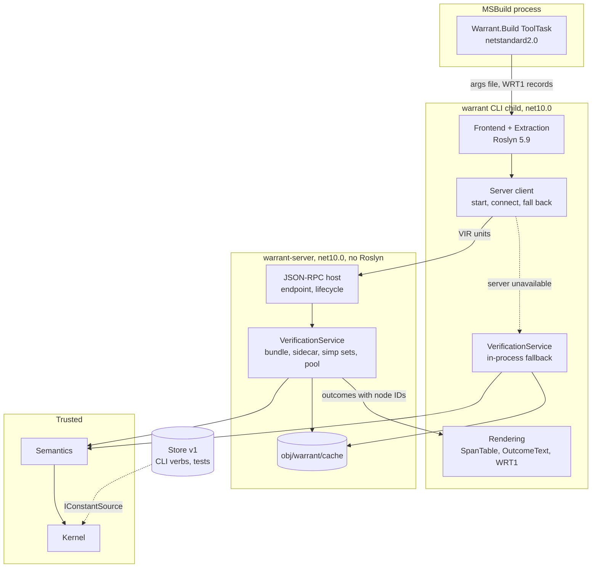
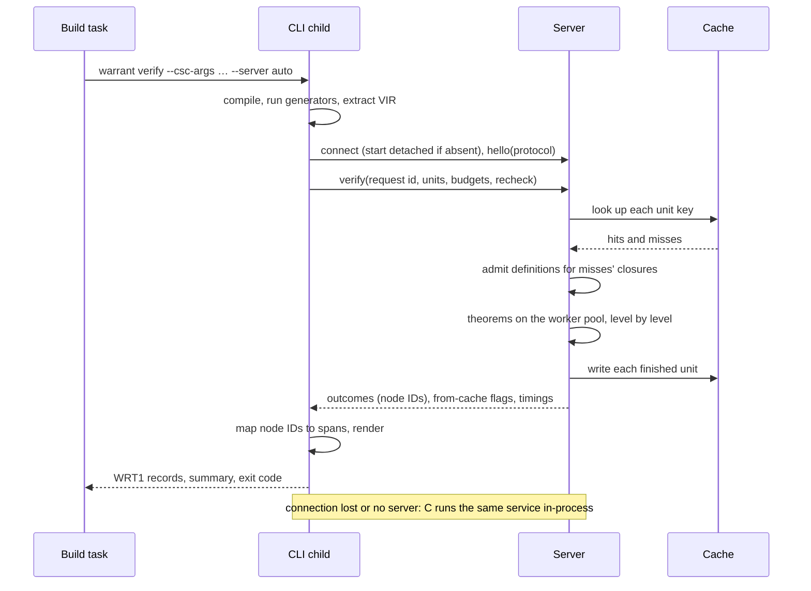
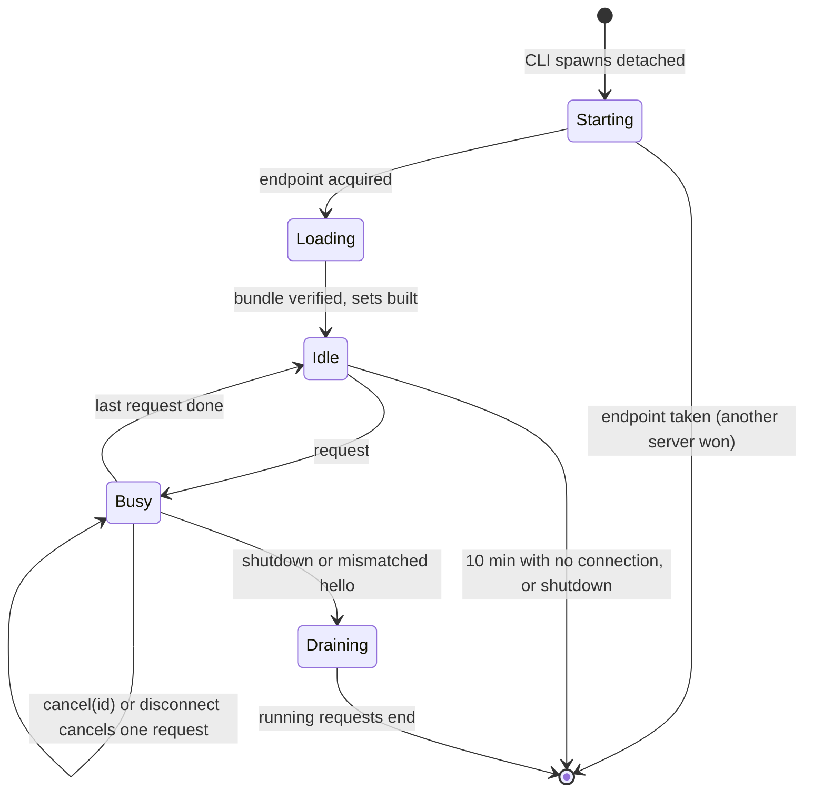
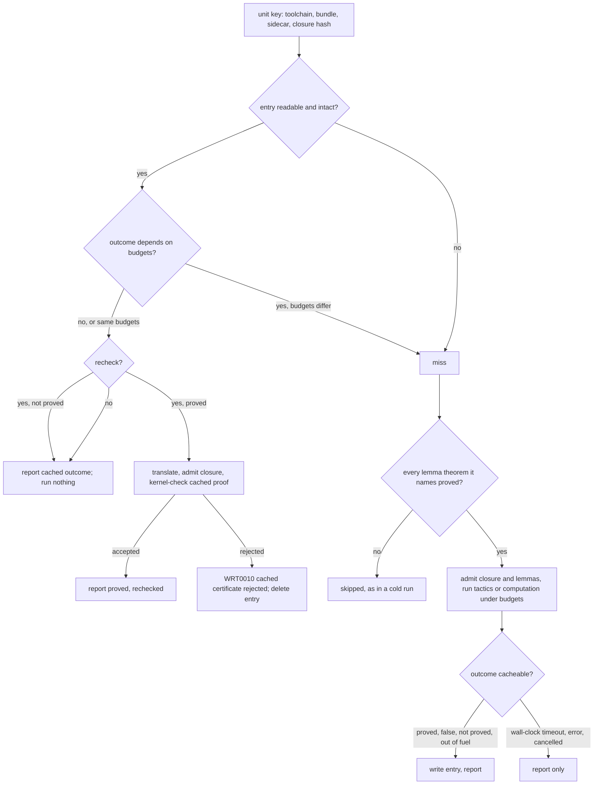
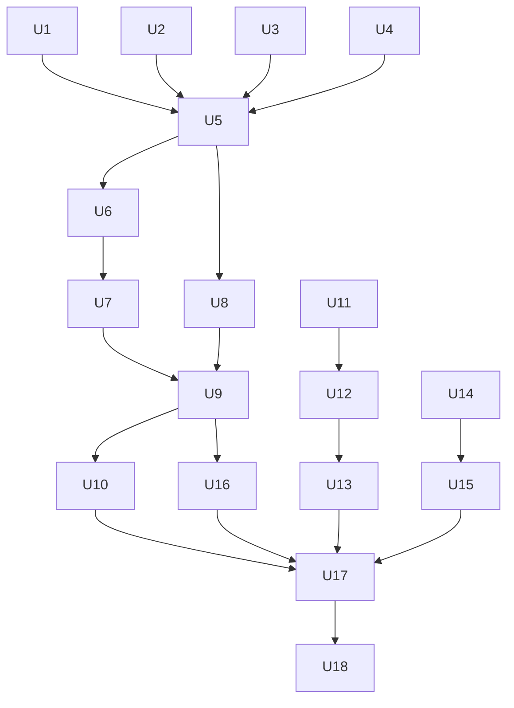

# M5b Server, Cache and Store - Plan

The design is explained chapter by chapter, literate-programming style, in [docs/m5b/](../m5b/README.md).
This plan owns the decisions (KTD1 to KTD33) and the work units (U1 to U18); the chapters explain them and cite them by ID.
Ticket: git-bug `da1f97b` (M5b). The Mathlib run that M5b's store waited for (`7afb02b`) is done: [docs/mathlib.md](../mathlib.md).

---

## Goal Capsule

- **Objective:** A developer who rebuilds a verified C# project without changing it gets the same diagnostics in a fraction of the time, because no proof is searched for again. CI can still demand that every proof it accepts was checked by the kernel against the current code. The developer can also stop a long verification, see why a proof failed step by step, and get unsupported-code errors as they type.
- **Means:** a per-user verification server keeps the checked semantics bundle loaded and verifies units in parallel (KTD1, KTD8). The `warrant` CLI child that the build task already runs becomes its client and falls back to in-process verification (KTD5). A content-addressed cache under `obj/warrant/` stores outcomes and per-unit proof certificates (KTD13, KTD14). Store v1 holds imported Lean libraries on disk for lazy loading (KTD17, KTD18). Roslyn analyzers report extraction's diagnostics in the IDE (KTD21).
- **Authority:** this plan's Requirements win on behaviour and its KTDs on mechanism. The `docs/m5b/` chapters explain and never override. `docs/design.md` governs anything this plan does not decide, except where U18 amends it. The M4 and M5a plans' KTDs still hold unless a KTD here replaces one by name.
- **Stop conditions:** stop and ask if a session-settled decision proves unworkable, for example if the CLI child cannot start a server that survives a cancelled build on some host (KTD4), or if a trusted-code change (U3, U12) cannot be made reject-only. Also stop if a unit needs one of the owner's uncommitted files (see Dependencies).
- **Execution profile:** units in the Unit Index's phase order. Phase A changes the engine with no server, so every later phase builds on an in-process path that already has the final shape.
- **Finishing:** an implementer (`ce-work` or a person) builds the units; the repository owner reviews and merges, one pull request per phase.

---

## Product Contract

### Summary

Build milestone M5b as `docs/design.md` §11 and ticket `da1f97b` define it: a verification server with `verify`, `cancel`, `status`, `explain`, `export` and `report`; a content-addressed result cache with `WarrantRecheck`; store v1 with trusted and verified import; the CLI verbs `check-store`, `import` and `explain`; and the first deterministic analyzers.
The build task keeps running the `warrant` CLI, which compiles and extracts as in M5a and now hands the units to the server.
The milestone ends with latency and memory baselines recorded for M8.

### Problem Frame

M5a verifies every theorem on every build. The CLI child starts .NET, loads and re-checks the 2,835-constant semantics bundle, and runs every tactic again, even when nothing changed (design D15, Q9).
That cost grows with every theorem a project adds, and a developer pays it on each keystroke-to-build loop.
Nothing can be stopped once started except by killing the build, a failed proof shows only the goal where the script stopped, and unsupported constructs are reported only after a full build.
Design §8 always intended a long-lived server with a cache for this; M5a deferred it so the first end-to-end result did not wait.
Store v1 was also waiting for a measured memory figure: all of Mathlib in memory takes 12.6 GiB and 26 minutes to check, so imported libraries cannot simply be loaded whole.

### Requirements

**Server and fallback**

- R1. A build verifies through a per-user verification server that the CLI starts on demand and later builds reuse; the server exits after an idle period and never outlives a request it is serving.
- R2. The server answers `verify`, `cancel`, `status`, `explain`, `export` and `report`.
- R3. Verifying through the server and verifying in-process produce byte-identical build output, except for outcomes decided by a wall-clock limit and the summary's report of where results came from.
- R4. When the server cannot be started, reached or matched to the client's toolchain, verification runs in-process and a build message says why; `WarrantUseServer=false` turns the server off, and it is off by default when `ContinuousIntegrationBuild` is true.

**Budgets, cancellation and parallelism**

- R5. Every unit (definitions, decrease proofs, equation lemmas and theorems) runs under the M5a budgets (design Q8), and exhausting kernel fuel, tactic fuel or the wall-clock limit reports WRT0006 naming the budget.
- R6. Cancelling a build, interrupting the CLI, or a `cancel` request stops the running verification within about a second, the server keeps serving other requests, and units that finished before the cancel keep their results.
- R7. The theorems of one request are verified in parallel, and the diagnostics come out in the same order as a sequential run.

**Cache and recheck**

- R8. A second build with no relevant change runs no tactics, reports the same diagnostics as the first, and its summary says how many results came from the cache.
- R9. Changing a method invalidates exactly the cached results of units whose VIR closure includes it; changing the bundle, the attribute sidecar or Warrant's own code invalidates everything.
- R10. A cache entry that is unreadable, truncated, edited or written by a different toolchain is treated as absent; wall-clock timeouts, internal errors and cancelled units are never cached.
- R11. With `WarrantRecheck=true`, every cached proof is re-checked by the kernel against statements rebuilt from the current code, with no tactic run; a rejected certificate is an error naming the unit, and its entry is removed.
- R12. `dotnet clean` and Rebuild remove the project's cache.

**Store**

- R13. `warrant import` builds a store from lean4export NDJSON files in trusted or verified mode, and a store being rewritten never disturbs a process reading the previous version.
- R14. `warrant check-store` re-checks every declaration in a store with Warrant's kernel; a store of Lean 4.35.0's Init plus the semantics library passes it.
- R15. Opening a store reads constants by name on first use, so opening the Mathlib store and reading a few thousand constants costs a small fraction of loading Mathlib.

**CLI and analyzers**

- R16. `warrant explain <unit>` shows, for one unit, the hypotheses and goals before and after each tactic of its script and the failure, without needing a running server.
- R17. `warrant server status` shows what the server holds and is running, `warrant server cancel <id>` cancels a request, and `warrant server shutdown` stops it.
- R18. `Warrant.Analyzers` reports WRT0002, WRT0003, WRT0004, WRT0005, WRT0008 and WRT0009 in the IDE at the location extraction reports them, does no I/O, produces identical output on repeated runs, and never reports proof results.
- R19. In a build, each extraction diagnostic is reported exactly once.

**Baselines**

- R20. Per-unit verification latency (server cold, server warm, cache hit, recheck, in-process) and server memory are measured on the M5a corpus, together with the cost of opening the Mathlib store, and recorded for M8.

### Key Decisions

- **Cache hits are trusted locally; `WarrantRecheck=true` makes the kernel re-check every cached proof against statements rebuilt from the current code, and the docs recommend it for CI.** (session-settled: user-directed — chosen over kernel-checking every hit, which makes `WarrantRecheck` redundant, and over signing entries with a per-user key, which adds key management and stops CI agents sharing entries: the second build stays fast, and CI still trusts only the kernel.) An entry is written only after the kernel accepted its certificate and carries a content hash, so an accidental corruption is a miss; a deliberate edit of `obj/warrant/` is outside what local builds defend against. Governs R8, R10, R11.
- **The `warrant` CLI child keeps compiling and extracting, and sends VIR to the server, which stays free of Roslyn.** (session-settled: user-approved — chosen over loading Roslyn into the server, which contradicts design §3.2 and would put a second compiler version in a long-lived process: each build still pays one short process start.) Governs R1, R3.
- **When the server is unavailable the build falls back to in-process verification rather than failing; CI can turn the server off.** (session-settled: user-approved — chosen over failing the build: a server problem is environmental, and the in-process path is M5a's tested one.) Governs R4.
- **Store v1 loads constants lazily by name and is proved on Init plus the semantics library; Mathlib can be imported but is not loaded by default.** (session-settled: user-approved — chosen over loading libraries whole, given Mathlib's measured 12.6 GiB.) Governs R13, R14, R15.
- **The cache lives per project under `obj/warrant/` and in the server's memory; a per-user cache shared across projects is deferred.** (session-settled: user-approved — chosen over building the shared cache now: per-project entries need no cross-project invalidation story.) Governs R8, R12.
- **A request's theorems verify in parallel, and the protocol keeps design §8.1's priority field, unused until an IDE client exists.** (session-settled: user-approved.) Governs R7.
- **The analyzers report the same diagnostics extraction finds and never proof results.** (session-settled: user-approved — chosen over analyzers that query the server, which would need I/O, which Roslyn forbids, RS1035.) Governs R18.

### Success Criteria

The M5b row of design §11:

- The M5a exit corpus and the build samples verify through the server with the same diagnostics as in M5a.
- A second build is served from the cache with zero tactic runs, shown by the summary line and by the server's counters.
- `WarrantRecheck=true` re-checks every cached certificate with the kernel alone, and a tampered certificate is rejected with an error naming its unit.
- The Init + semantics store passes `warrant check-store`.
- `warrant server cancel` aborts a running verify, and the server then serves the next request.
- A unit over its kernel fuel, tactic fuel or wall-clock budget reports a timeout (WRT0006), including a definition and a decrease proof.
- Analyzer output is identical across 20 concurrent runs.
- Baseline per-unit latency and server memory are recorded in `docs/m5b/08-testing-and-baselines.md` and design §11.

### Scope Boundaries

**Out of M5b (later milestones):**

- Live IDE proof feedback, a language server, `grind` and typed Mathlib handles (M8).
- Contracts and the Std closure (M6).
- A per-user cache shared across projects, and signed cache entries.

**Considered and not built:**

- Kernel-checking every cache hit: the owner chose local trust with opt-in recheck (Key Decisions).
- Loading the semantics bundle from the store: the bundle stays a verified load at server start (KTD19), because nothing a C# program translates to names a constant outside it until M6. Revisit when the Std closure or typed Mathlib handles arrive.
- Cache eviction beyond `dotnet clean`: entries are small (one unit's certificate), and a size cap without measurements would be a guess. Revisit if R20's baselines show growth that matters.
- Crash-loop detection: a server that crashes on a unit makes each build fall back in-process with the reason logged, which is slower but correct and visible. Revisit if it happens in practice.
- Re-proving a certificate that recheck rejects in the same run: the error must stay visible (R11); the next build re-proves because the entry is gone.
- Reusing old certificates after a Warrant upgrade: the toolchain identity changes, so every key misses and the first build after an upgrade re-proves. An M8 optimisation.
- `dotnet build-server shutdown` integration: the SDK hard-codes its servers and has no extension point; `warrant server shutdown` is the equivalent.

### Deferred to Follow-Up Work

- Using a store as the verification environment's base (Std in M6, Mathlib handles in M8); the seam exists after U12.
- Server-side single-flight across projects, and an IDE priority lane, once a second kind of client exists.
- Trace diffing against Ansatz (design §10.4, ticket `0c23ac4`).

### Dependencies

- Lean 4.35.0 through elan, lean4export `5a9a355` and `tools/lean-replay`, as in M5a; the full Init export from `scripts/export-lean-library.sh` for the opt-in Init store test, and `D:\warrant-mathlib\mathlib.ndjson` (or a fresh export, REPRODUCING step 10) for the Mathlib store baseline.
- Visual Studio 2026 and 2022 for the build integration matrix, as in M5a.
- New packages: StreamJsonRpc 2.26.150; Microsoft.CodeAnalysis.CSharp 4.8.0 for the analyzer (already used by Extraction); Microsoft.CodeAnalysis.CSharp.Analyzer.Testing 1.1.4 and Microsoft.CodeAnalysis.BannedApiAnalyzers in tests and builds only.
- The owner has uncommitted changes to `.gitignore` and `compose.yaml`, an untracked `.claude/`, and mode-only changes under `scripts/`. No unit edits those scripts except U17, which adds a new one; nothing of the owner's is committed.

---

## Planning Contract

### Key Technical Decisions

**Server and protocol**

- KTD1. **A new net10.0 project `src/Warrant.Server` hosts the transport and the process lifecycle only; the verification itself lives in a `VerificationService` in `src/Warrant.Engine/Service/`, which the server and the CLI's in-process path both call.** One implementation behind both paths is what makes R3's byte-identical output a property rather than a hope. The server references Engine, Meta, Kernel, Semantics, Vir and Lean4Export and never Roslyn (design §3.2); it ships as `warrant-server.dll` beside the CLI in the `Warrant.Build` package's `tools/net10.0/any/` (docs/m5b/01).
- KTD2. **Transport is StreamJsonRpc 2.26.150 with `SystemTextJsonFormatter` and source-generated contracts, one `JsonRpc` per connection, `SynchronizationContext = null`, and `CancelLocallyInvokedMethodsWhenConnectionIsClosed = true`; only the protocol's methods are registered.** JSON keeps the wire readable in logs and tests; StreamJsonRpc stays out of the netstandard2.0 task, whose host is .NET Framework MSBuild, because its dependency closure would conflict with Visual Studio's own assemblies (docs/m5b/01).
- KTD3. **The endpoint name is a hash of the user, the elevation, the server's directory and the toolchain identity (KTD9): a named pipe with `CurrentUserOnly` and `FirstPipeInstance` on Windows, and a Unix domain socket in a 0700 per-user directory (`$XDG_RUNTIME_DIR/warrant/` or `/tmp/warrant-<uid>/`) guarded by an exclusive lock file elsewhere; a `hello` handshake checks the protocol version, and a server that receives a mismatched `hello` shuts down.** Putting the toolchain in the name gives a rebuilt or upgraded Warrant its own server, so no build reaches a server running other code. On .NET 10, named pipes on Unix neither set the socket file's mode nor stop a second server unlinking the first, so the raw socket in a private directory replaces them there. The client checks ownership too, as Roslyn's compiler client does, because another local user could otherwise squat the predictable name and answer "proved" to everything: on Windows the client also opens the pipe with `CurrentUserOnly`; on Unix the client and the server both `lstat` the socket directory and require a real directory owned by the current user with mode 0700, and the client checks the connected peer's user ID. Any failed check is "server unavailable", so the build falls back in-process with the reason logged; this applies to `WARRANT_SERVER_ENDPOINT` overrides too (docs/m5b/01).
- KTD4. **The CLI starts the server detached, so a cancelled build cannot kill it: on Windows through `CreateProcess` with `CREATE_NO_WINDOW`, `DETACHED_PROCESS`, `CREATE_NEW_PROCESS_GROUP` and `CREATE_BREAKAWAY_FROM_JOB` (retried without breakaway when the job forbids it), with no inherited handles; on Unix through `posix_spawn` with `POSIX_SPAWN_SETSID` and the standard streams on `/dev/null`.** An inherited stdout handle makes MSBuild wait for the server after the CLI exits (msbuild#2981), and a server in the CLI's process group or job dies with every Ctrl+C or tree kill. The CLI starts the server from a copy of its files in a per-user directory named by the toolchain identity, created once under a temporary name and renamed into place, so a running server never locks the package folder or a repository's `bin/` (which a rebuild must overwrite, and which a rebuilt CLI with a new identity could no longer reach to shut down); the endpoint's "server directory" input is that copy. The CLI waits up to 20 seconds for a starting server, 5 seconds for a running one, and falls back otherwise. The server exits 10 minutes after its last connection closes and no work runs (`WARRANT_SERVER_IDLE_SECONDS` overrides), and logs to a size-capped per-user file (docs/m5b/01).
- KTD5. **Any failure to start, connect, handshake or complete a request makes the CLI verify the remaining units in-process through the same `VerificationService`, and log the reason as a normal-importance message; `--server off` (from `WarrantUseServer=false`) skips the server, and the targets default `WarrantUseServer` to false when `ContinuousIntegrationBuild` is true.** A message rather than a warning keeps `TreatWarningsAsErrors` builds green, as Roslyn's compiler server does; CI agents are ephemeral, so a server would only add a process that outlives the job (docs/m5b/02).
- KTD6. **Requests and responses are records in `Warrant.Engine.Service`: a verify request carries the protocol version, a client-chosen request id, the project directory, the cache directory, the budgets, the recheck flag and each unit's canonical VIR bytes (`VirWriter`) with its display name; the response carries per-unit outcomes, whether each came from the cache, and server-side timings.** VIR bytes are already canonical and hashed (design §4.1), so the server re-reads them with `VirReader` and needs no Roslyn. The client keeps the `SpanTable` and the source text and does all rendering (docs/m5b/02).
- KTD7. **Outcomes refer to VIR node IDs instead of spans (the failing tactic, a decrease's call and measure), and the renderer maps them through the current extraction's `SpanTable`, which gains an enumeration.** A cached outcome then never points at stale lines, which docs/m4 already claimed and the code did not do. Goal text and messages stay server-side, because they depend on display names, not positions (docs/m5b/02).

**Engine**

- KTD8. **The engine verifies a request in stages: it translates every unit and admits the non-theorem units in dependency order on one large-stack thread; then it runs the theorems level by level on a pool of large-stack worker threads, each theorem in its own fork of the frozen run environment and sidecar; after each level it admits the proved theorems into a new fork, freezes it, and starts the next level from it. Results come back in the request's unit order, the extraction order the client sent, whatever order workers finish in.** A theorem cannot be called from code (WRT0003), but a script may name another theorem as a lemma with `nameof` (`Tactic.Exact(nameof(Lemma))`), which makes it a dependency that is admitted first and whose failure skips the user (`Walker.Scripts.cs`, `Pipeline.Skip`). A theorem's level is one more than the deepest theorem it names; most theorems name none and run in the first level. Recursive definitions stay in the sequential stage because their decrease proofs must be admitted before callers. The pool has `min(ProcessorCount - 1, 8)` workers, at least 1, shared by all requests in a server; a wall-clock deadline starts when a worker picks a unit up, so queueing never eats a theorem's budget (docs/m5b/03).
- KTD9. **The toolchain identity is a SHA-256 over the module version IDs of `Warrant.Cic`, `Warrant.Kernel`, `Warrant.Semantics`, `Warrant.Meta`, `Warrant.Engine`, `Warrant.Vir` and `Warrant.Lean4Export`.** Builds are deterministic, so the MVID changes exactly when the code does; a hand-kept version string (as `Extractor.Version` is) would not change when the engine is rebuilt in development. It keys the cache, names the endpoint, heads every certificate, and appears in `status` (docs/m5b/04).
- KTD10. **The `VerificationService` loads the semantics bundle (verified, as `SemanticsBundle.Load` does today), the attribute sidecar, the default simp set and omega's preparation set once, and keys the simp caches on the frozen base sidecar instead of each run's fork, building them over the frozen bundle environment rather than whichever fork asks first.** Today `DefaultSimpSet` and `Omega.Prep` rebuild per run because they key on the fork; with per-theorem forks (KTD8) they would rebuild per theorem. A set built over one theorem's fork and kept for the process would see that theorem's constants, so the sets are built from the bundle alone. Per-run mutable state (`RunState`'s outcome map and admitted list) becomes per worker and is merged after each level (docs/m5b/03).
- KTD11. **Definitions, equation lemmas and decrease proofs run in a budget scope like a theorem's, and a resource exhaustion anywhere in a unit becomes WRT0006 naming the budget.** Today `Admit` catches `KernelResourceException` as a `KernelException` and reports WRT0010, and definitions have fuel but no deadline, which fails R5 (docs/m5b/03).
- KTD12. **`KernelLimits` and `MetaLimits` gain a `CancellationToken`, polled at the existing every-1,024-steps clock check whether or not a deadline is set; a cancellation throws `KernelResourceException("cancelled")`, which can only reject.** .NET cannot abort a thread, so cooperative polling inside the trusted kernel is the only way to stop it short of killing the process; this is the same kind of change as M5a's deadline (M5a KTD2) and gets the same reject-only test. Meta must not swallow it: today `Check` wraps every `KernelException` from its internal type checker in a plain `MetaException` (`Reduce/Check.cs`), which `first`, `try` and the unifier treat as an ordinary failure, and `Pipeline.Compute` continues past a `KernelException`; so a cancellation or deadline there could surface as "not proved". `Check` rethrows a kernel resource exception as `MetaResourceException` and builds its type checker with the run's limits, and the engine treats any resource exception as one. A cancelled unit gets a `CancelledOutcome` that is neither cached nor rendered as a diagnostic. The server links each request's token to `$/cancelRequest`, to a client disconnect and to `cancel(id)` (docs/m5b/03).
- KTD32. **The counterexample search is bounded by fuel only: a cap on combinations tried and kernel fuel per combination, with no clock, replacing M5a KTD25's two-second limit.** A clock-bounded search finds different values under different load, so the server and the in-process path would disagree (R3) and a cached not-proved entry would freeze whichever answer one run found. The caps are set so the search's worst case on the M5a corpus stays near two seconds. The search's per-combination limits carry the request's cancellation token, and a cancellation ends the search rather than counting as a failed combination (docs/m5b/03).
- KTD33. **A script's `Lean.Const` that names a constant some translated unit admitted, when that unit is not among the theorem's dependencies, is WRT0004 asking for `nameof` instead.** `Lean.Const` adds no dependency, so such a script resolves in a cold sequential run, where every earlier unit is in the environment, and fails in a run that admits only a closure (KTD15) or a parallel fork (KTD8). Rejecting it in every run makes the outcome the same in every run (docs/m5b/03).

**Cache and recheck**

- KTD13. **A cache entry's key is a SHA-256 over the cache format version, the toolchain identity (KTD9), the bundle file's SHA-256, the sidecar file's SHA-256 and the unit's VIR closure hash (`VirHash.Closures`); an entry for an outcome that depends on budgets (false with read-back values, not proved, or out of fuel) stores the effective budgets and hits only when they match, and a proved entry stores the kernel and tactic fuel and time its proof used and hits only when the current budgets are at least that.** The key also covers the display names of the units in the closure, because cached goal text and messages print them and they are formatted outside the hashed VIR. The stored budgets are every field of the kernel and tactic limits, including the kernel's numeral size limit, because a false outcome's read-back values use them. A proof does not need more budget than it used, but a project that lowers its budgets below that must see the failure a cold CI build would. The closure hash already covers the unit's own VIR, its facts (overflow, language, extractor and Roslyn versions) and every callee's closure; the other inputs are exactly what the closure does not cover. Editing Warrant.Engine, including the protocol records, invalidates every entry; that is safe and expected (docs/m5b/04).
- KTD14. **Each entry is one JSON file named by its key under `$(BaseIntermediateOutputPath)warrant/cache/`, holding the key's inputs, the outcome with node IDs, the unit's assumption-report data, the unit's certificate (the lean4export NDJSON of only the declarations the unit admitted) and a SHA-256 of the body; it is written to a temporary file and renamed into place, and a reader that finds a bad hash, format or toolchain deletes the file and treats it as a miss.** Entries are immutable and content-addressed, so concurrent builds writing the same key race harmlessly, and a crash leaves at most a temporary file. One directory per project, shared by configurations and target frameworks, is safe because the key covers everything. Proved, false, not-proved and fuel-exhausted outcomes are cached, for theorems and for recursive definitions (whose certificate holds the decrease theorems and the equation lemma, and whose failed decrease proof is a cached not-proved outcome); wall-clock timeouts, internal errors, failed units and cancellations are not (R10). Before writing an entry the service checks that the request was not cancelled and the unit's deadline had not passed, so an outcome produced while being interrupted is never stored. The cache sits behind an interface in Engine with the file implementation beside it, so `explain` and tests use a null cache, and the in-process path reads and writes the same files as the server, which is what makes recheck meaningful with the server off in CI. The server keeps a bounded in-memory map (4,096 entries) in front of the disk, keyed by cache directory and key; a memory entry counts as a hit only while its file still exists in that directory with the length and last-write time it had when read, so `dotnet clean`, a deleted bad entry and a hand edit all reach the disk path, and every deletion also evicts the memory entry. Recheck always reads the entry from disk. The server runs at most one computation per key at a time (docs/m5b/04).
- KTD15. **The service always translates the whole request; on a cache hit it reports the cached outcome and runs nothing else for that unit; when a unit misses, the service admits the units in its closure first: definitions with the cached decrease-proof terms of recursive callees, and lemma theorems with their cached proofs, each checked by the kernel.** Translating everything keeps name collisions and translation failures reported even when every unit hits. Admission without tactics is cheap, and the kernel checks every term admitted in a run, so a miss never depends on a cached term it did not check. A cached decrease proof or lemma proof the kernel rejects turns that unit into a miss; a lemma whose cached outcome is not proved skips its users, exactly as a cold run does (docs/m5b/04).
- KTD16. **With `--recheck` (from `WarrantRecheck=true`), every unit with a proved cache entry is translated afresh by `Warrant.Semantics`, its definitions are admitted with the cached decrease proofs, the lemma theorems it names are admitted first with their own rechecked proofs in level order (KTD8), and the cached proof term is checked against the freshly built theorem with the kernel (`Kernel.Add`, then `ProofTerms.IsAdmittedAs`); no tactic runs for a unit that has an entry, and a lemma whose recheck fails skips its users.** Replaying the cached NDJSON alone would only show that the certificate is consistent with itself, not that it proves the current claim. A rejected certificate is WRT0010 "cached certificate for `<unit>` was rejected by the kernel: …", the entry is deleted, and the unit is not re-proved in that run. Cached false and not-proved outcomes are reported as they are; they cannot make anything count as proved (docs/m5b/04).

**Store**

- KTD17. **A store is a directory holding immutable version directories (`v1-<hash12>/`, each with `manifest.json`, `names.idx` and `decls.bin`) and a `current` file naming the active one, replaced atomically; readers map a version's files read-only with `FileShare.Read | FileShare.Delete` and keep that version until disposed, and `warrant import` deletes versions nobody has open.** Windows will not overwrite a mapped file, so a store is never rewritten in place. `decls.bin` holds one self-contained record per declaration (its own name, level and expression tables, keeping the expression DAG inside a declaration), stored once per content hash; `names.idx` is a sorted table from constant name to record. Every file starts with a magic number, format version and length that are checked before any span is read, because a truncated mapped file raises SIGBUS on Unix rather than an exception. The manifest records the format, Lean and lean4export versions, each source file's SHA-256 (including the bundle's, so the sidecar binding is unchanged), the import mode, the toolchain identity that verified it in verified mode, whether quotients are initialized, and the counts (docs/m5b/05).
- KTD18. **`KernelEnvironment` gains an optional base `IConstantSource` (defined in `Warrant.Kernel`: look up a constant by name, a count, and the quotient flag) that `Find` consults after its own constants and parents; a source-backed environment's `Constants` enumeration throws, and nothing in Kernel, Meta or Engine enumerates.** Every kernel read already goes through `Find`, `Get`, `CheckName` and `IsQuotInitialized`, so the seam is one fall-through in a trusted file. The store adapter in `src/Warrant.Store` materializes constants on first use with thread-safe memoisation and interns names across records; the kernel never writes to the source, so a frozen environment stays frozen. A source is a trusted import: only a store creates one, never the cache. The quotient flag is the one input that widens what the kernel accepts (it enables quotient reduction, and `Quotient.Add` returns early when it is set), so the store reader sets it only when the store holds the quotient constants exactly as `Quotient.ExpectedConstants` defines them (docs/m5b/05).
- KTD19. **In M5b the verification environment stays the shipped bundle, loaded and verified when the server starts; the store serves the CLI verbs and the lazy-loading tests.** No translated C# names a constant outside the bundle until M6's Std closure, and keeping today's verified load keeps the trusted base and the sidecar binding exactly as M5a left them. When a store becomes a verification base (M6), its record decoder becomes trusted code and joins the toolchain identity (KTD9) (docs/m5b/05).
- KTD20. **`warrant import <file.ndjson[.gz]>... --store <dir> [--verified] [--fuel N]` reads the files in order, accepting a constant repeated in a later file only if it is identical, and in verified mode stores what the kernel admitted (its own constructors and recursors, as `warrant export` does); `warrant check-store <dir> [--fuel N] [--quiet]` re-reads the records in their stored order into a fresh environment, checks each with the kernel and prints the same summary as `warrant check`.** The Init + semantics store is `warrant import init.ndjson tests/data/warrant-semantics.ndjson.gz --store …`: the bundle adds the `Warrant` library's declarations, and its Init closure repeats Init's constants exactly (docs/m5b/05).

**Analyzers**

- KTD21. **`src/Warrant.Analyzers` (netstandard2.0, Microsoft.CodeAnalysis.CSharp 4.8.0, `EnforceExtendedAnalyzerRules`) compiles the `Warrant.Extraction` and `Warrant.Vir` sources into its own single assembly and ships in the `Warrant` package under `analyzers/dotnet/cs/`; Extraction and Vir also set `EnforceExtendedAnalyzerRules` and ban clocks, randomness, GUIDs and `Environment` through BannedApiAnalyzers.** One assembly means no helper loads in the compiler host, so two Warrant versions in one IDE session cannot bind each other's copy. RS1035 checks only the project it is set on, so the shared sources need it too. Compiling against Roslyn 4.8 keeps the analyzer loadable by the .NET 8 SDK and Visual Studio 2022 (docs/m5b/06).
- KTD22. **Extraction gains a diagnostics-only entry point that runs the same subset checks for one member, without `Compilation.GetDiagnostics()` and without the `#if` combination check, and the analyzer reports through symbol-start actions per `[Verified]` or `[Theorem]` member, plus a compilation-end action for WRT0008.** `Extractor.Extract` checks the whole compilation and may re-parse it up to 64 times, which is too slow per keystroke; sharing the rule code with `Extract` is what makes the IDE and the build agree, and a test compares them member by member on the corpora (docs/m5b/06).
- KTD23. **The `Warrant` package's own `build/Warrant.targets`, which ships the analyzer, removes it from `@(Analyzer)` before `CoreCompile` in builds that are not design-time builds, whether or not `Warrant.Build` is referenced or `WarrantEnabled` is true, so it runs only in the IDE and the CLI stays the one reporter in builds.** A project that references `Warrant` without `Warrant.Build` is supported (it gets WRT0011) and must keep building. Error-severity analyzer diagnostics in a command-line build would fail `CoreCompile`, skip verification of every other unit, and repeat what the CLI reports. Chosen over warning severity in builds, which would still report everything twice (docs/m5b/06).

**CLI, build and the remaining methods**

- KTD24. **`warrant explain <unit> [--project-dir <dir>] [--csc-args <file>]` compiles and extracts from the build's most recent `warrant.csc.args`, picks the unit by display name or documentation-comment ID, and verifies that one unit with a tactic trace recorder (server or in-process); it never reads or writes the cache.** No trace exists today: `TacticRunner` records only the failing tactic. The recorder is untrusted and records, per tactic, its name, its node ID and the printed goals before and after (docs/m5b/07).
- KTD25. **`export(units)` returns the certificate NDJSON for the given units from the cache (or by verifying them), and `warrant verify --out` uses it with unchanged output; `report(project)` returns the JSON assumption report of the project's last verify, which the server keeps per project directory.** `--report` keeps rendering locally, because the Markdown report quotes source text only the client has (docs/m5b/07).
- KTD26. **`warrant server status | cancel <id> | shutdown` manage the server; `status` prints the process id, endpoint, toolchain identity, uptime, bundle hash, GC heap size, working set, cache counters (hits, misses, tactic runs) and active requests with their ids.** The SDK's `dotnet build-server shutdown` cannot reach a third-party server, and the tests and the exit criterion need a client for `cancel(id)` (docs/m5b/07).
- KTD27. **The targets add `WarrantUseServer` (default true, false under CI), `WarrantRecheck` (default false) and `WarrantCacheDir` (default `$(BaseIntermediateOutputPath)warrant/cache/`), pass them as `--server auto|off`, `--recheck` and `--cache-dir`, and delete the cache directory in `Clean`; the summary line becomes `Warrant: n verified units, n theorems proved (k from cache), n not proved. [server|in-process]`.** `BaseIntermediateOutputPath` exists with `UseArtifactsOutput` too, unlike a literal `obj/`. The ToolTask and its WRT1 records are otherwise unchanged (docs/m5b/02).

**Testing**

- KTD28. **A parity test runs the M5a exit corpus and the build samples through the server and in-process and compares the `--format msbuild` output byte for byte, with wall-clock outcomes, the summary record's cached count and path tag, and any fallback message record excluded.** Those three parts differ between the paths by design; the unit and theorem counts in the summary stay in the comparison. It is the regression guard for R3 and KTD1 (docs/m5b/08).
- KTD29. **Server tests host the server class in the test process on a unique endpoint; process tests start `warrant-server` with `WARRANT_SERVER_ENDPOINT` set to a unique name and always shut it down; the build integration tests set `WarrantUseServer=false` except the dedicated server samples, which shut their server down afterwards.** A server left running holds the temporary package folder that `PackedPackages` deletes (docs/m5b/08).
- KTD30. **Baselines come from a script, `scripts/measure-m5b.sh`, that builds the M5a samples under each mode, reads the per-unit timings from the CLI's `--timings` output and the memory from `warrant server status`, and imports and opens the Mathlib store; GC heap and working set are reported separately, because mapped store pages count in the working set.** (docs/m5b/08)

**Documentation**

- KTD31. **U18 amends design §3 and §3.2 (extraction stays in the CLI child; the server receives VIR), §7.2 (2,835 constants), §7.3, §8.1–§8.3, §11 and §12 Q9 (decided, with a new decision-log entry), `docs/m5a/07` (the child process stays), docs/m4's node-ID claim, the proving guide (`WarrantRecheck`, `WarrantUseServer`, the new verbs, `explain`), REPRODUCING and the README.** As with M5a's U21, the chapters are written with the plan and brought up to date with the code at the end.

### High-Level Technical Design

**Components.** Arrows point from caller to callee; the dashed box is the trusted base.



**A build through the server.**



**Server lifecycle.**



**One unit in a verify request.**



**Store layout.**

```text
<store>/
  current                 one line: the active version directory
  v1-3f9a12c4be07/
    manifest.json         format, Lean 4.35.0, lean4export 3.1.0, sources + SHA-256,
                          mode, verifying toolchain, quotients, counts
    names.idx             header; sorted (name -> record offset, length, kind)
    decls.bin             header; records, each with local name/level/expr tables
```

### Output Structure

```text
src/
  Warrant.Engine/Service/        VerificationService, contracts, cache, scheduler, toolchain identity
  Warrant.Server/                warrant-server: JSON-RPC host, endpoint, lifecycle, logging
  Warrant.Store/                 store writer, reader, IConstantSource adapter
  Warrant.Analyzers/             analyzer (Extraction and Vir sources compiled in)
  Warrant.Cli/                   ServerClient, ServerCommand, ImportCommand, CheckStoreCommand, ExplainCommand
tests/
  Warrant.Server.Tests/
  Warrant.Store.Tests/
  Warrant.Analyzers.Tests/
docs/m5b/                        README and chapters 1 to 8
scripts/measure-m5b.sh
```

### Alternative Approaches Considered

- **Extraction in the build task, as design §3 drew it.** Rejected in M5a (M5a KTD21) and still blocked: the task runs in .NET Framework MSBuild, where Roslyn 5.9 cannot load and Roslyn 4.8 cannot parse C# 14.
- **A server that compiles too.** Would remove the per-build process start, but puts Roslyn and source generators in a long-lived process that must match each project's SDK; rejected by the owner (Key Decisions).
- **The store as the verification base in M5b.** Would exercise lazy loading on every build, but changes the trusted base (trusted import of the bundle instead of today's verified load) for no user-visible gain until M6 (KTD19).

### Risks

| Risk | Mitigation |
|---|---|
| A trusted-code change (cancellation in `Tick`, the environment's base source) admits something it should not. | Each is a single fall-through or a throw; each gets a reject-only test and the kernel property tests run unchanged (U3, U12). |
| Detaching the server fails on some host (a job object without breakaway, a sandboxed build), so cancel kills it or MSBuild waits on it. | The client falls back in-process when the server dies; a process test cancels a build and checks the server survives; the Stop condition covers a host where it cannot work. |
| Parallel theorems change output order or expose shared mutable state in Meta. | Results are sorted by unit key; the parity test (KTD28) runs the corpus 10 times; `SemanticsBundleFixture` already shares the frozen bundle across parallel tests. |
| A store's quotient flag widens what the kernel accepts. | The reader sets it only when the quotient constants match `Quotient.ExpectedConstants` (KTD18); a test feeds a store with a forged flag. |
| Wall-clock outcomes differ between server and in-process. | They are excluded from parity and never cached (KTD14). |
| Lazy store records lose cross-declaration sharing and slow the kernel. | Measured in R20's baselines; the store is not on the verify path in M5b (KTD19). |
| StreamJsonRpc's dependency closure grows the `Warrant.Build` package. | Measured at U8; it ships only in `tools/`, never loaded by MSBuild. |
| The analyzer and extraction drift apart. | One copy of the rule code (KTD21, KTD22) and a member-by-member agreement test on both corpora. |

---

## Implementation Units

| U-ID | Phase | Title | Files touched (primary) | Depends on |
|---|---|---|---|---|
| U1 | A | Outcomes with node IDs | `src/Warrant.Engine/Outcomes.cs`, `src/Warrant.Vir/SpanTable.cs`, `src/Warrant.Engine/Reports/` | none |
| U2 | A | Budgets for every unit | `src/Warrant.Engine/Pipeline.cs` | none |
| U3 | A | Cancellation in the kernel and Meta | `src/Warrant.Kernel/TypeChecker.cs`, `src/Warrant.Meta/Basic/MetaBudget.cs` | none |
| U4 | A | Toolchain identity and per-unit certificates | `src/Warrant.Engine/Service/`, `src/Warrant.Engine/EngineResult.cs` | none |
| U5 | A | VerificationService and parallel theorems | `src/Warrant.Engine/Service/`, `src/Warrant.Meta/Tactic/Simp/DefaultSet.cs`, `src/Warrant.Cli/VerifyCommand.cs` | U1, U2, U3, U4 |
| U6 | B | Result cache | `src/Warrant.Engine/Service/Cache/` | U5 |
| U7 | B | Cache hits, closure admission and recheck | `src/Warrant.Engine/Service/` | U6 |
| U8 | C | `warrant-server` | `src/Warrant.Server/` | U5 |
| U9 | C | CLI client, fallback and `warrant server` | `src/Warrant.Cli/` | U7, U8 |
| U10 | C | Build properties, clean and build tests | `src/Warrant.Build/`, `tests/Warrant.Build.Tests/` | U9 |
| U11 | D | Store format, writer and reader | `src/Warrant.Store/` | none |
| U12 | D | Kernel base source and store adapter | `src/Warrant.Kernel/KernelEnvironment.cs`, `src/Warrant.Store/` | U11 |
| U13 | D | `import` and `check-store` | `src/Warrant.Cli/` | U12 |
| U14 | E | Diagnostics-only extraction | `src/Warrant.Extraction/` | none |
| U15 | E | `Warrant.Analyzers` | `src/Warrant.Analyzers/`, `src/Warrant/` | U14 |
| U16 | F | Tactic trace, `explain`, `export` and `report` | `src/Warrant.Engine/TacticRunner.cs`, `src/Warrant.Engine/Service/`, `src/Warrant.Cli/` | U9 |
| U17 | G | Exit corpus end to end and baselines | `tests/`, `scripts/measure-m5b.sh` | U10, U13, U15, U16 |
| U18 | G | Documentation | `docs/design.md`, `docs/m5b/`, `docs/proving/`, `REPRODUCING.md` | U17 |

Phase A changes the engine behind today's in-process path; B adds the cache to it; C puts it behind the server; D and E are independent of C and of each other once their dependencies land; F follows C, because `explain` uses the CLI client (U16 needs U9); G closes the milestone.



### U1. Outcomes with node IDs

- **Goal:** outcomes name positions by VIR node ID, so a cached outcome renders at the current lines.
- **Requirements:** R3, R8 (KTD7).
- **Dependencies:** none.
- **Files:**
  - `src/Warrant.Engine/Outcomes.cs` (`NotProvedOutcome`, `DecreaseFailure`, `ReadBackSide`)
  - `src/Warrant.Engine/Pipeline.cs`, `src/Warrant.Engine/TacticRunner.cs` (record node IDs instead of resolving spans)
  - `src/Warrant.Vir/SpanTable.cs` (enumeration)
  - `src/Warrant.Engine/Reports/OutcomeText.cs`, `AssumptionReport.cs`, `src/Warrant.Cli/VerifyCommand.cs`, `TranslateCommand.cs` (map through the `SpanTable`)
  - `tests/Warrant.Engine.Tests/`, `tests/Warrant.Vir.Tests/`
- **Approach:**
  1. Replace each `VirSpan?` in an outcome with the node ID `VirTree.IdOf` gives; keep `ReadBackSide.NodeId` and drop its span.
  2. Rendering takes the unit's `SpanTable` and resolves IDs at the point it needs a location or source text.
  3. `SpanTable` gains an ordered enumeration of (node ID, span) pairs.
- **Patterns to follow:** `ReadBackSide` already carries a node ID; `OutcomeText.NotProvedMessage` already takes a span lookup function.
- **Test scenarios:**
  - A not-proved theorem's diagnostic points at the failing tactic's line, as in M5a.
  - The same outcome rendered with a `SpanTable` from an extraction where blank lines were added above the method points at the shifted line.
  - A decrease failure points at the recursive call and its measure.
  - Existing M4 and M5a corpus expectations pass unchanged.
- **Verification:** all engine, CLI and corpus tests pass with no change to expected output.

### U2. Budgets for every unit

- **Goal:** a definition, equation lemma or decrease proof that runs out of a budget reports WRT0006 like a theorem does.
- **Requirements:** R5 (KTD11).
- **Dependencies:** none.
- **Files:** `src/Warrant.Engine/Pipeline.cs`, `src/Warrant.Engine/Outcomes.cs`, `tests/Warrant.Engine.Tests/BudgetTests.cs` (new or extended), `tests/corpus/m5a/` (one rejected-by-budget case if the corpus format allows)
- **Approach:**
  1. `Admit`, `AdmitRecursive` and the decrease and equation-lemma admissions open a `TheoremBudget`-style scope from the project budgets and the unit's `[Theorem]`-equivalent overrides (definitions have none).
  2. `KernelResourceException` and Meta budget exhaustion in those paths become `UndecidedOutcome` naming the budget; other `KernelException`s keep their current outcome.
- **Patterns to follow:** `TheoremBudget` and the existing WRT0006 paths in `Pipeline.Compute` and `RunScript`.
- **Test scenarios:**
  - A definition that needs more kernel fuel than a tiny project budget reports WRT0006 "kernel fuel".
  - A recursive definition whose decrease proof exceeds a 1-tactic-step budget reports WRT0006 "tactic fuel".
  - A definition checked against a deadline already passed reports WRT0006 "time limit".
  - A theorem's existing WRT0006 cases are unchanged.
- **Verification:** no path in the pipeline reports WRT0010 for a resource exhaustion.

### U3. Cancellation in the kernel and Meta

- **Goal:** a running kernel check or tactic stops promptly when its request is cancelled, and can only reject.
- **Requirements:** R6 (KTD12).
- **Dependencies:** none.
- **Files:**
  - `src/Warrant.Kernel/TypeChecker.cs` (`KernelLimits`, `Tick`)
  - `src/Warrant.Meta/Basic/MetaBudget.cs`, `MetaLimits`, `src/Warrant.Meta/Reduce/Check.cs` (rethrow kernel resource exceptions as `MetaResourceException`; pass the limits)
  - `src/Warrant.Engine/Pipeline.cs`, `src/Warrant.Engine/Outcomes.cs` (`CancelledOutcome`)
  - `tests/Warrant.Kernel.Tests/CancellationTests.cs`, `tests/Warrant.Meta.Tests/`, `tests/Warrant.Engine.Tests/`
- **Approach:**
  1. `KernelLimits` and `MetaLimits` carry an optional token; the 1,024-step check polls it whether or not a deadline is set.
  2. A cancelled token throws `KernelResourceException` with reason `cancelled` from the kernel, and Meta's equivalent from Meta.
  3. `Check` keeps a kernel resource exception a resource exception, and `Pipeline.Compute` stops treating one as "try the next method".
  4. The engine maps a cancellation to `CancelledOutcome` and stops starting new units.
- **Execution note:** write the reject-only kernel test first, as M5a did for the deadline.
- **Patterns to follow:** M5a U4's deadline in `Tick` and its tests.
- **Test scenarios:**
  - A kernel check of a declaration that would be accepted, with a token cancelled before the check, is a resource limit, never acceptance.
  - A long kernel computation (a `decide` over a large `Nat`) cancelled after 100 ms returns within 1 s.
  - A tactic script spinning in `simp` stops within 1 s of cancellation.
  - A cancellation raised inside `Check` under `first` or `try` ends the unit as cancelled, not as not proved.
  - A deadline passed inside `Check` reports WRT0006, not WRT0001.
  - Without a token, fuel and deadline behaviour is unchanged (existing tests).
  - An engine run cancelled midway reports the finished units' outcomes and `CancelledOutcome` for the rest.
- **Verification:** the kernel property tests and corpus tests pass unchanged; the new tests pass.

### U4. Toolchain identity and per-unit certificates

- **Goal:** each unit's outcome carries the declarations it admitted, writable as a standalone certificate, and the toolchain has an identity that changes with its code.
- **Requirements:** R9, R11 (KTD9, KTD14).
- **Dependencies:** none.
- **Files:**
  - `src/Warrant.Engine/Service/Toolchain.cs` (new)
  - `src/Warrant.Engine/Pipeline.cs`, `src/Warrant.Engine/EngineResult.cs`, `src/Warrant.Engine/Outcomes.cs` (per-unit admitted list)
  - `src/Warrant.Engine/Certificates.cs` (new: write a unit's declarations as NDJSON; read proof terms back against an environment)
  - `tests/Warrant.Engine.Tests/CertificateTests.cs`
- **Approach:**
  1. Record the declarations each unit admits (definitions, constructions, decrease theorems, equation lemmas, the theorem) on its outcome.
  2. A unit certificate is the lean4export NDJSON of exactly those declarations; it names bundle and callee constants without including them.
  3. Reading a certificate against an environment that holds the bundle and the callees yields its declarations; recheck takes only the proof values from them.
  4. `Toolchain.Identity` hashes the MVIDs of the assemblies KTD9 lists.
- **Patterns to follow:** `AdmittedDeclarations.Of`, `EngineResult.WriteNdjson`, `Lean4ExportWriter`.
- **Test scenarios:**
  - A proved theorem's certificate, read into a fork of the bundle plus its callees' certificates, is accepted by `ExportChecker`.
  - The concatenation of the bundle and every unit certificate of the M5a corpus equals what `verify --out` writes today, as a set of declarations.
  - `Toolchain.Identity` is stable across two calls and differs when computed over a different assembly list.
  - A certificate with one proof replaced by another theorem's proof is rejected when checked as a whole.
- **Verification:** `scripts/cross-check.sh` still accepts `verify --out` output.

### U5. VerificationService and parallel theorems

- **Goal:** one service verifies a request, holds long-lived state, runs theorems in parallel, and is what `warrant verify` calls in-process.
- **Requirements:** R3, R5, R6, R7 (KTD1, KTD6, KTD8, KTD10).
- **Dependencies:** U1, U2, U3, U4.
- **Files:**
  - `src/Warrant.Engine/Service/VerificationService.cs`, `Contracts.cs` (requests, responses, outcome DTOs), `WorkerPool.cs` (large-stack threads)
  - `src/Warrant.Engine/Pipeline.cs` (split into the sequential admission stage and per-theorem work)
  - `src/Warrant.Meta/Tactic/Simp/DefaultSet.cs`, `src/Warrant.Meta/Tactic/Omega/Prep.cs` (key on the frozen base sidecar; build over the bundle)
  - `src/Warrant.Engine/Counterexample.cs` (fuel and combination caps, no clock)
  - `src/Warrant.Kernel/KernelThread.cs` (a reusable large-stack worker)
  - `src/Warrant.Cli/VerifyCommand.cs` (build a request; render the response)
  - `tests/Warrant.Engine.Tests/ServiceTests.cs`, `tests/Warrant.Cli.Tests/VerifyTests.cs`
- **Approach:**
  1. Contracts are plain records with a System.Text.Json source-generated context; outcome DTOs mirror `UnitOutcome` with node IDs.
  2. The service is constructed once with the bundle path and the sidecar path and loads both (KTD10).
  3. `Verify(request, token)` reads each unit's VIR bytes, translates all units, admits non-theorem units in dependency order on one large-stack thread, freezes, then runs theorems level by level on the shared pool, admitting each level's proved theorems into a new frozen fork (KTD8).
  4. The counterexample search drops its clock for a combination cap (KTD32), and a script's `Lean.Const` naming another unit's constant outside its dependencies is WRT0004 (KTD33).
  5. Responses list units in the request's order; the CLI renders them exactly as `VerifyCommand.Verify` does today.
- **Execution note:** keep the current corpus output byte-identical; run the corpus tests after each step.
- **Patterns to follow:** `SemanticsBundleFixture` (shared frozen bundle across threads); `KernelThread.Run`.
- **Test scenarios:**
  - The M5a exit corpus through the service gives the same outcomes as the M5a pipeline.
  - A request with 16 independent theorems on 4 workers finishes and returns them in request order; repeated 10 times, the output is identical.
  - A theorem that times out does not delay the others' results beyond its own limit.
  - Simp sets are built once per service, not per theorem (a counter on the set builder).
  - `warrant verify` output for the CLI test fixtures is unchanged.
  - A unit whose VIR bytes fail to read reports WRT0010 for that unit only.
  - Cancelling during a failing theorem's counterexample search stops it within one second.
  - A theorem whose script uses `Tactic.Exact(nameof(Lemma))` runs after `Lemma` and is proved; when `Lemma` is not proved, it is skipped, as in M5a.
  - A chain of three theorems, each naming the previous, runs in three levels and gives the sequential outcomes.
  - The counterexample for `AlwaysLarger` is `x = 2147483647` on every one of 10 runs with 4 workers busy.
  - A script with `Lean.Const` naming another translated unit's equation lemma, without `nameof`, reports WRT0004.
  - The default simp set built once contains no constant from any theorem's fork.
- **Verification:** all existing tests pass; the service tests pass.

### U6. Result cache

- **Goal:** finished units are stored on disk and in memory under keys that change exactly when their result could.
- **Requirements:** R8, R9, R10, R12 (KTD13, KTD14).
- **Dependencies:** U5.
- **Files:** `src/Warrant.Engine/Service/Cache/CacheKey.cs`, `CacheEntry.cs`, `ResultCache.cs`; `src/Warrant.Engine/Service/VerificationService.cs`; `tests/Warrant.Engine.Tests/CacheTests.cs`
- **Approach:**
  1. Compute closure hashes for the request with `VirHash.Closures`, then each unit's key (KTD13).
  2. Look up the memory map by (cache directory, key) and accept a memory hit only if the file still exists with the same length and last-write time; otherwise read the directory; validate hash, format and toolchain; delete a bad file and evict it from memory.
  3. Write each cacheable outcome as soon as it finishes, temporary file then rename, ignoring an existing identical file.
  4. Single-flight per key inside a service.
- **Test scenarios:**
  - A unit verified twice with the same inputs hits the second time, and the service's tactic counter does not move.
  - Editing a callee's body changes the caller's key and not an unrelated unit's.
  - Changing the sidecar file's bytes misses every unit.
  - A truncated entry, an entry with one byte flipped, and an entry with another toolchain identity are each misses and are deleted.
  - A not-proved entry written with 1,000 tactic fuel misses at 2,000 and hits at 1,000.
  - A theorem proved using 1,000 tactic steps hits under a 2,000-step project budget and misses under a 500-step one, which then reports WRT0006 as a cold run does.
  - A false entry written with one numeral size limit misses under another.
  - A wall-clock timeout, a WRT0010 and a cancelled unit write nothing.
  - A unit that finishes as not proved after its request was cancelled writes nothing.
  - A recursive definition's entry holds its decrease theorems and equation lemma; a definition whose decrease proof failed is cached as not proved.
  - Renaming a callee's display name (same VIR) misses its users' entries, so cached goal text never shows the old name.
  - Two services writing the same key at once leave one valid entry.
  - A missing cache directory is created on first write; a deleted one mid-run is a miss, not an error.
  - A warm service reports a miss for every unit after the cache directory is deleted, and a second project with the same unit but an empty cache directory also misses.
  - An entry edited on disk while its memory copy is warm is re-read, fails its hash and is deleted.
- **Verification:** cache tests pass; corpus output with a cold cache equals output with a warm cache.

### U7. Cache hits, closure admission and recheck

- **Goal:** hits run nothing, misses admit what they depend on cheaply, and recheck replays every cached proof through the kernel.
- **Requirements:** R8, R11 (KTD15, KTD16).
- **Dependencies:** U6.
- **Files:** `src/Warrant.Engine/Service/VerificationService.cs`, `src/Warrant.Engine/Service/Recheck.cs`, `src/Warrant.Engine/Pipeline.cs`, `tests/Warrant.Engine.Tests/RecheckTests.cs`
- **Approach:**
  1. Partition units into hits and misses; for the misses, collect their closures and admit those definitions (decrease proofs from cached certificates, checked by the kernel; a rejected one makes the callee a miss).
  2. With recheck, every proved hit goes through translate, admit closure (lemma theorems first, each rechecked, in level order), then `Kernel.Add` of the theorem shell with the cached proof and `ProofTerms.IsAdmittedAs`.
  3. A rejected certificate yields WRT0010 with the unit and kernel message and deletes the entry.
- **Test scenarios:**
  - Covers the exit criterion: a second run of the M5a exit corpus reports every theorem from the cache with zero tactic runs.
  - Editing one theorem's script re-proves that theorem only; its callee definitions are admitted without tactics.
  - A recursive callee's cached decrease proof is reused when a caller theorem misses.
  - Recheck of the warm corpus reports every proved theorem as rechecked, with zero tactic runs.
  - A warm recheck of a theorem that names a lemma reports both as rechecked.
  - Recheck of an entry whose proof term was replaced by another theorem's proof reports WRT0010 naming the unit, and the entry is gone afterwards.
  - Recheck after changing a callee's body (same theorem text) misses the theorem, because its closure changed.
  - A cached false outcome under recheck is reported as false.
  - A theorem that names a lemma misses while the lemma hits: the lemma's cached proof is admitted (kernel-checked) and the theorem is proved as in a cold run.
  - A lemma cached as not proved skips its user on the next build without running the user's script.
  - Adding a unit whose name collides with a cached unit's reports the collision although every other unit hits.
  - Covers R3: a cold run and a warm run with one theorem edited give byte-identical output, apart from the summary's cached count.
- **Verification:** recheck and cache tests pass.

### U8. `warrant-server`

- **Goal:** a long-lived process serves the protocol to one user's clients.
- **Requirements:** R1, R2, R6, R17 (KTD1, KTD2, KTD3, KTD4 server side, KTD12, KTD26).
- **Dependencies:** U5.
- **Files:**
  - `src/Warrant.Server/Warrant.Server.csproj` (new, net10.0, `AssemblyName` `warrant-server`), `Program.cs`, `Endpoint.cs`, `RpcTarget.cs`, `Lifecycle.cs`, `ServerLog.cs`
  - `src/Warrant.Engine/Service/Contracts.cs` (hello, status, cancel, shutdown)
  - `src/Warrant.Build/Warrant.Build.csproj` (pack the server beside the CLI)
  - `tests/Warrant.Server.Tests/` (new)
- **Approach:**
  1. Acquire the endpoint (pipe or socket and lock file); exit quietly if another server holds it.
  2. Load the service, then accept connections; one `JsonRpc` per connection with KTD2's settings.
  3. `hello` checks the protocol version; `verify` links the request token to the RPC token, the connection and the request-id table; `cancel(id)` cancels by id; `status` reports KTD26's fields; `shutdown` drains.
  4. Idle timer and log file per KTD4.
- **Patterns to follow:** Roslyn's `VBCSCompiler` dispatcher shape (accept loop, keep-alive, GC on idle).
- **Test scenarios:**
  - Two clients verify different projects concurrently and get correct results.
  - `cancel(id)` from a second connection stops a running verify within 1 s; the first client gets cancelled outcomes and the next verify succeeds.
  - Closing the client connection mid-verify cancels that request's work.
  - A `hello` with another protocol version gets an error and the server exits after its running requests.
  - A second server started on the same endpoint exits and the first keeps serving.
  - With a 2-second idle setting, the server exits 2 seconds after the last client disconnects, and not while a request runs.
  - `status` reports an active request's id while it runs and the counters after it ends.
  - On Unix, the socket's directory has mode 0700.
  - On Unix, a socket directory that already exists but is owned by another user, is a symlink or has mode 0777 makes the server refuse to start and the client fall back.
- **Verification:** server tests pass on Windows; the Unix-specific tests run in CI on Linux when available, otherwise they are reported as skipped.

### U9. CLI client, fallback and `warrant server`

- **Goal:** `warrant verify` uses the server when it can and in-process otherwise, with the same output.
- **Requirements:** R1, R3, R4, R6, R17 (KTD4 client side, KTD5, KTD26, KTD27 CLI options, KTD28).
- **Dependencies:** U7, U8.
- **Files:** `src/Warrant.Cli/ServerClient.cs`, `ServerLauncher.cs` (Windows `CreateProcess`, Unix `posix_spawn`), `ServerCommand.cs`, `VerifyCommand.cs`, `Program.cs`; `tests/Warrant.Cli.Tests/ServerClientTests.cs`, `ParityTests.cs`
- **Approach:**
  1. `--server auto|off`, `--cache-dir`, `--recheck` and `--timings` options.
  2. Connect, else start detached and wait (KTD4), else fall back; a lost connection reruns the request's unfinished units in-process.
  3. Ctrl+C sends `$/cancelRequest` and exits with the cancelled units unreported.
  4. The summary names the path taken and the cached count; a fallback writes one message record with the reason.
  5. `warrant server status|cancel|shutdown`.
- **Test scenarios:**
  - Covers R3: the parity test (KTD28) passes on the M5a exit corpus and the CLI fixtures, run 10 times.
  - With no server running, `verify --server auto` starts one, verifies through it, and the server is still running after the CLI exits.
  - Rebuilding the CLI's output folder while a server started from it is running succeeds, because the server runs from its per-identity copy.
  - With `WARRANT_SERVER_ENDPOINT` pointing at a name nobody can create, the CLI falls back and prints the reason once.
  - Killing the server mid-request makes the CLI finish in-process with the same diagnostics.
  - `--server off` never connects (no server process appears).
  - A pipe or socket served by a process the client cannot verify as the current user's makes the client fall back with the reason logged.
  - Ctrl+C during a long theorem cancels it on the server, and `status` then shows no active request.
  - `warrant server status` with no server prints that none is running and exits 0.
- **Verification:** CLI tests pass; a manual run shows the server surviving a cancelled `dotnet build` on Windows (recorded in the PR).

### U10. Build properties, clean and build tests

- **Goal:** MSBuild users control the server and recheck, clean removes the cache, and the build matrix covers the new paths.
- **Requirements:** R4, R8, R11, R12 (KTD27, KTD29).
- **Dependencies:** U9.
- **Files:** `src/Warrant.Build/WarrantVerify.cs`, `src/Warrant.Build/build/Warrant.Build.props`, `Warrant.Build.targets`; `tests/Warrant.Build.Tests/` (unit tests with `FakeCli`, integration samples)
- **Approach:**
  1. New task parameters for the three properties and their CLI options; `WarrantUseServer` defaults to false when `ContinuousIntegrationBuild` is true.
  2. A `Clean` hook deletes `$(WarrantCacheDir)`.
  3. The task logs a fallback message record at normal importance.
- **Test scenarios:**
  - The task's command line includes `--server off` when `WarrantUseServer=false` or under `ContinuousIntegrationBuild=true` without an override, and `--recheck` when `WarrantRecheck=true`.
  - A second `dotnet build` of the true-theorems sample reports every theorem from the cache.
  - `dotnet clean` removes `obj/warrant/cache/`, and the next build reports no cached results.
  - `WarrantRecheck=true` on a warm sample reports rechecked theorems and succeeds.
  - The `Increment` sample still fails with WRT0001 and its counterexample, through the server, under `dotnet build` and both Visual Studio MSBuilds.
  - A server sample shuts its server down at the end, and the temporary package folder is deleted.
- **Verification:** the integration matrix passes with `WARRANT_BUILD_INTEGRATION=1`.

### U11. Store format, writer and reader

- **Goal:** declarations can be written to and read back from an immutable, versioned, memory-mapped store.
- **Requirements:** R13, R15 (KTD17).
- **Dependencies:** none.
- **Files:** `src/Warrant.Store/Warrant.Store.csproj` (new, net10.0, references Cic, Kernel and Lean4Export), `StoreWriter.cs`, `StoreReader.cs`, `Manifest.cs`, `RecordCodec.cs`, `NameIndex.cs`; `tests/Warrant.Store.Tests/` (new)
- **Approach:**
  1. The record codec writes one declaration with its own name, level and expression tables and reads it back to the same `Declaration`.
  2. The writer streams declarations into a new version directory, deduplicates records by SHA-256, writes the index and manifest, then replaces `current`.
  3. The reader validates headers and opens the version `current` names, read-only with delete sharing.
- **Test scenarios:**
  - Every declaration of the semantics bundle round-trips through the codec to an equal declaration (`ExportChecker.ConstantsMatch`).
  - Writing the same input twice produces byte-identical version directories.
  - A reader holding version 1 keeps reading it while version 2 is written and `current` switches; deleting version 1 succeeds after the reader is disposed.
  - A truncated `decls.bin`, a wrong magic number and a newer format version are each rejected with a message naming the file.
  - Looking up a name not in the store returns nothing.
- **Verification:** store tests pass on Windows, including the open-while-replacing case.

### U12. Kernel base source and store adapter

- **Goal:** the kernel can check declarations against constants read lazily from a store.
- **Requirements:** R14, R15 (KTD18).
- **Dependencies:** U11.
- **Files:** `src/Warrant.Kernel/IConstantSource.cs` (new), `src/Warrant.Kernel/KernelEnvironment.cs`; `src/Warrant.Store/StoreConstantSource.cs`; `tests/Warrant.Kernel.Tests/ConstantSourceTests.cs`, `tests/Warrant.Store.Tests/`
- **Approach:**
  1. `KernelEnvironment` takes an optional source at construction of a base environment; `Find` falls through to it; `Count` adds its count; `Constants` throws when a source is set; the quotient flag comes from it.
  2. The adapter materializes records on first lookup with thread-safe memoisation and a shared name interner.
- **Execution note:** write the reject-only kernel tests first.
- **Test scenarios:**
  - The semantics bundle's own declarations check against an environment whose base is a trusted Init store opened lazily, and the store materializes only the constants they use.
  - A declaration whose dependency is missing from the store is rejected with "unknown constant".
  - A store whose manifest claims quotients are initialized but whose `Quot` constants differ from the expected ones opens with quotients not initialized, and a declaration relying on quotient reduction is rejected.
  - A forked, frozen store-backed environment is read by 8 threads checking different declarations at once, with the same verdicts as sequentially.
  - An environment without a source behaves exactly as before (existing kernel tests).
- **Verification:** kernel property tests and corpus tests pass unchanged.

### U13. `import` and `check-store`

- **Goal:** users build stores from exports and re-check them with Warrant's kernel.
- **Requirements:** R13, R14 (KTD20).
- **Dependencies:** U12.
- **Files:** `src/Warrant.Cli/ImportCommand.cs`, `CheckStoreCommand.cs`, `Program.cs` (usage); `tests/Warrant.Cli.Tests/StoreCommandTests.cs`; `tests/Warrant.Kernel.Tests/CorpusTests.cs` (opt-in Init store)
- **Approach:**
  1. `import` streams each file through the reader; verified mode runs `ExportChecker` and writes what it admitted; a repeated constant must equal the stored one.
  2. `check-store` streams records in stored order into a fresh environment through `ExportChecker` and prints `warrant check`'s summary.
- **Test scenarios:**
  - Importing the bundle in verified mode, then `check-store`, accepts all 2,835 constants.
  - Covers the exit criterion (opt-in, `WARRANT_INIT_EXPORT`): importing full Init and then the bundle, then `check-store`, accepts every declaration.
  - Importing a file with a constant that differs from an earlier file's fails naming the constant.
  - A trusted store with one tampered record (a theorem's proof swapped) fails `check-store` at that declaration.
  - Importing into a store that a reader holds open succeeds and the reader is unaffected.
- **Verification:** the opt-in Init store test passes locally and its time is recorded for U17.

### U14. Diagnostics-only extraction

- **Goal:** extraction can check one member for unsupported constructs quickly, with the same rules as a full extraction.
- **Requirements:** R18 (KTD22).
- **Dependencies:** none.
- **Files:** `src/Warrant.Extraction/Extractor.cs`, `Diagnose.cs` (new entry point), `src/Warrant.Extraction/Warrant.Extraction.csproj` and `src/Warrant.Vir/Warrant.Vir.csproj` (`EnforceExtendedAnalyzerRules`, banned symbols); `tests/Warrant.Extraction.Tests/DiagnoseTests.cs`
- **Approach:**
  1. Factor the per-member checks `ExtractOne` performs so both `Extract` and the new entry call them.
  2. The new entry skips `GetDiagnostics()` and the `#if` combinations, and returns the diagnostics with their `VirSpan`s.
  3. Add the banned-symbol list and fix anything it flags.
- **Test scenarios:**
  - For every member of the M4 and M5a corpora, the new entry's diagnostics equal `Extract`'s for that member (IDs and spans), excluding WRT0008 and the `#if` diagnostic.
  - A member using an unsupported construct gets WRT0002 from the new entry without the compilation's errors being computed.
  - Extraction and Vir build with no RS1035 or banned-symbol findings.
- **Verification:** extraction tests and corpus tests pass unchanged.

### U15. `Warrant.Analyzers`

- **Goal:** developers see unsupported-construct and malformed-spec errors while typing, identical on every run, and builds report each once.
- **Requirements:** R18, R19 (KTD21, KTD22, KTD23).
- **Dependencies:** U14.
- **Files:** `src/Warrant.Analyzers/Warrant.Analyzers.csproj` (new), `WarrantAnalyzer.cs`; `src/Warrant/Warrant.csproj` (pack under `analyzers/dotnet/cs/`); `src/Warrant/build/Warrant.targets` (remove from `@(Analyzer)` in non-design-time builds); `tests/Warrant.Analyzers.Tests/` (new)
- **Approach:**
  1. Link the Extraction and Vir sources into the analyzer project; one output assembly.
  2. Symbol-start actions for attributed members call the diagnostics-only entry; a compilation-end action reports WRT0008; `EnableConcurrentExecution` and no analysis of generated code.
  3. Descriptors reuse the IDs, titles and severities the CLI reports.
- **Test scenarios:**
  - Each rejected-corpus member gets the same ID at the same span from the analyzer as from extraction.
  - Covers the exit criterion: 20 concurrent analyzer runs over a multi-file compilation produce byte-identical sorted diagnostic lists, and `onAnalyzerException` never fires.
  - The analyzer loads and reports under Roslyn 4.8 and under 5.9 (two test configurations).
  - A build of a sample with an unsupported construct reports WRT0002 once, from the CLI, and still verifies the sample's other theorems.
  - A design-time build includes the analyzer in `@(Analyzer)`; a normal build does not.
  - A project that references only `Warrant` and contains an unsupported construct still builds, with WRT0011.
- **Verification:** analyzer tests pass; the IDE shows WRT0002 live in Visual Studio 2026 (checked by hand, recorded in the PR).

### U16. Tactic trace, `explain`, `export` and `report`

- **Goal:** a developer sees every step of a failing proof, and the remaining protocol methods work.
- **Requirements:** R2, R16 (KTD24, KTD25).
- **Dependencies:** U9.
- **Files:** `src/Warrant.Engine/TacticTrace.cs` (new), `src/Warrant.Engine/TacticRunner.cs`; `src/Warrant.Engine/Service/VerificationService.cs` (explain, export, report); `src/Warrant.Server/RpcTarget.cs`; `src/Warrant.Cli/ExplainCommand.cs`, `VerifyCommand.cs` (`--out` through export); `tests/Warrant.Engine.Tests/TraceTests.cs`, `tests/Warrant.Cli.Tests/ExplainTests.cs`
- **Approach:**
  1. The runner records, when asked, each tactic's name, node ID and printed goals before and after.
  2. `explain` verifies one unit and its closure with tracing and never touches the cache.
  3. `export` returns the bundle, the closure's certificates and the units' certificates as NDJSON; `report` returns the last verify's JSON report for a project directory.
- **Test scenarios:**
  - `warrant explain Increments.AlwaysLarger` on the failing sample prints the goal before `Unfold`, the goal after it, and omega's failure with the counterexample.
  - `explain` with a doc-comment ID finds the same unit; an unknown name lists the unit names it knows.
  - `explain` works with `--server off` and with no cache directory.
  - `verify --out` writes the same declarations as in M5a, and Lean's kernel accepts the file (cross-check).
  - `report` after a verify returns the JSON report the CLI would write for that run.
- **Verification:** trace and explain tests pass; `scripts/cross-check.sh` passes.

### U17. Exit corpus end to end and baselines

- **Goal:** every exit-criterion item is demonstrated in one place, and the baselines are recorded.
- **Requirements:** R20 and the Success Criteria (KTD28, KTD30).
- **Dependencies:** U10, U13, U15, U16.
- **Files:** `tests/Warrant.Cli.Tests/M5bExitTests.cs` (new), `scripts/measure-m5b.sh` (new), `docs/m5b/08-testing-and-baselines.md`
- **Approach:**
  1. One test class walks the exit criterion against a server on a unique endpoint: first build, second build from cache, recheck, a tampered entry, cancel, budget overruns.
  2. The script measures each mode on the M5a samples and the Mathlib store and prints a table.
- **Test scenarios:**
  - Covers the first exit item: the M5a exit corpus verifies through a server with M5a's expected outcomes.
  - A second verify of the unchanged corpus reports every unit from the cache, and `status` shows the tactic counter unchanged.
  - A recheck verify reports every proved unit as rechecked with zero tactic runs.
  - With one cached proof replaced by another theorem's, recheck reports WRT0010 for that unit only.
  - `warrant server cancel` stops a request running a long `decide` within one second, and the next request succeeds.
  - A theorem, a definition and a decrease proof each over a small budget report WRT0006.
  - The bundle store passes `check-store` (always), and the Init + semantics store passes it when `WARRANT_INIT_EXPORT` is set.
  - After the class runs, no `warrant-server` process with the test's endpoint remains.
- **Verification:** the exit tests pass, each item as its own test so a failure names the item; the script's table is in chapter 8 and design §11, with the machine and date.

### U18. Documentation

- **Goal:** the design, the chapters, the guide and the reproduction steps match what was built.
- **Requirements:** all (KTD31).
- **Dependencies:** U17.
- **Files:** `docs/design.md`, `docs/m5b/*.md`, `docs/m5a/07-verify-and-build.md`, `docs/m4/04-vir.md`, `docs/m4/07-checking-and-testing.md`, `docs/proving/reference.md`, `how-to.md`, `README.md` (proving), `REPRODUCING.md`, `README.md`
- **Approach:** amend each place KTD31 lists, mark the M5b row of §11 done with its evidence, update the test counts, and bring each chapter's *ran* output up to date.
- **Test expectation:** none -- documentation only; checked by reading against the code and by U17's outputs.
- **Verification:** no document describes extraction in the task, a missing cache or `explain` as future work.

---

## Verification Contract

| Gate | Command or check | Proves |
|---|---|---|
| Build | `dotnet build` | All projects build with warnings as errors, including the netstandard2.0 analyzer and task. |
| Tests | `dotnet test` | U1 to U16's unit, service, server, store and analyzer tests, with no Lean toolchain installed. |
| Parity | `dotnet test --filter Parity` | Server and in-process output are byte-identical on the corpus (KTD28). |
| Exit | `dotnet test --filter M5bExit` | The Success Criteria (U17). |
| Init store | `WARRANT_INIT_EXPORT=<path> dotnet test --filter InitStore` | The Init + semantics store passes `check-store` (U13). |
| Build integration | `WARRANT_BUILD_INTEGRATION=1 dotnet test tests/Warrant.Build.Tests` | The `dotnet build`, VS 2026 and VS 2022 matrix through the server and with recheck (U10). |
| Cross-check | `scripts/cross-check.sh` | Lean's kernel accepts `verify --out` output; ends with "all verdicts agree". |
| Baselines | `scripts/measure-m5b.sh` | R20's table. |

---

## Definition of Done

- Every unit's Verification holds, and every gate in the Verification Contract passes.
- Each Success Criterion holds, item by item.
- `docs/m5b/`, the KTDs and the code agree, and design §11's M5b row is marked done with its evidence.
- Ticket `da1f97b` is updated with what was done, and closed.
- No server process is left running after the test suite.
- No experimental or abandoned code remains in the diff, and none of the owner's uncommitted changes (`.gitignore`, `compose.yaml`, `.claude/`, script mode bits) are committed.

---

## Appendix

### Sources and research

- Design: `docs/design.md` §3, §3.1, §3.2, §4.1, §7.1–§7.4, §8.1–§8.4, §9, §11 and §12 Q8, Q9, Q15; the M4 and M5a plans and chapters; `docs/mathlib.md` (12.60 GiB and 1,580 s for Mathlib; 0.73 GiB for Init).
- Repository: `src/Warrant.Cli/VerifyCommand.cs` (rendering needs the compilation and sources); `src/Warrant.Engine/Pipeline.cs` (one fork per run; `Admit` reports WRT0010 for resource exhaustion; no deadline for definitions); `src/Warrant.Engine/Outcomes.cs` (spans, not node IDs); `src/Warrant.Vir/VirHash.cs` (closure hashes, unused in `src/`); `src/Warrant.Vir/SpanTable.cs` (no enumeration); `src/Warrant.Kernel/KernelEnvironment.cs` (`Find` over a dictionary and parents; nothing enumerates); `src/Warrant.Kernel/TypeChecker.cs` (`Tick`, deadline every 1,024 steps); `src/Warrant.Meta/Tactic/Simp/DefaultSet.cs` and `Omega/Prep.cs` (caches keyed on the run's sidecar fork); `src/Warrant.Engine/SemanticsBundle.cs` (verified load each run); `src/Warrant.Meta/Attributes/Sidecar.cs` (bound to the bundle file's SHA-256); `src/Warrant.Extraction/Extractor.cs` (`GetDiagnostics`, up to 64 `#if` combinations, `Version = "0.1.0"`); `src/Warrant.Engine/TacticRunner.cs` (only the failing tactic recorded); `tests/Warrant.Build.Tests/PackedPackages.cs`.
- StreamJsonRpc 2.26.150 docs (connecting, formatters, cancellation, concurrency, disconnection); .NET 10 `System.IO.Pipes` Unix sources and dotnet/runtime#131203 (no socket mode, unlink takeover); Roslyn `BuildServerConnection.cs`, `NamedPipeUtil.cs`, `ServerDispatcher.cs`, `ManagedCompiler.cs` and "Compiler Server.md" (pipe naming, detached start, keep-alive, fallback); msbuild#2981 and #13351 (inherited handles); the SDK's `BuildServerProvider.cs` (no extension point); `MemoryMappedFile.cs` (sharing and access defaults); Roslyn analyzer rules RS1035, RS1036, RS1038, RS1041 and `AnalyzerBannedSymbols.txt`; Microsoft.CodeAnalysis.CSharp.Analyzer.Testing 1.1.4 (the xUnit variant is deprecated); .NET GC configuration and the `System.Runtime` meter.
