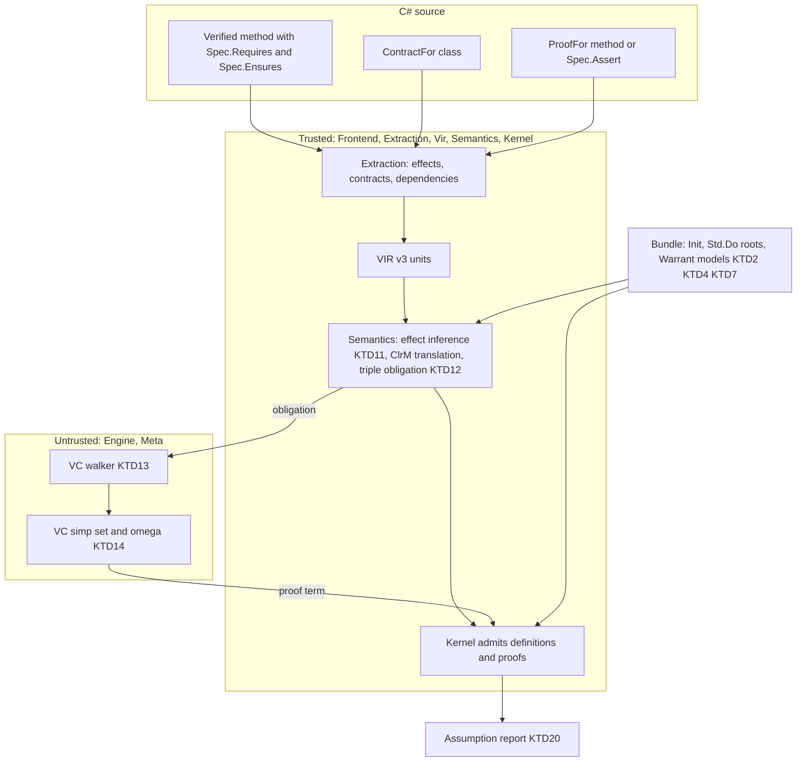
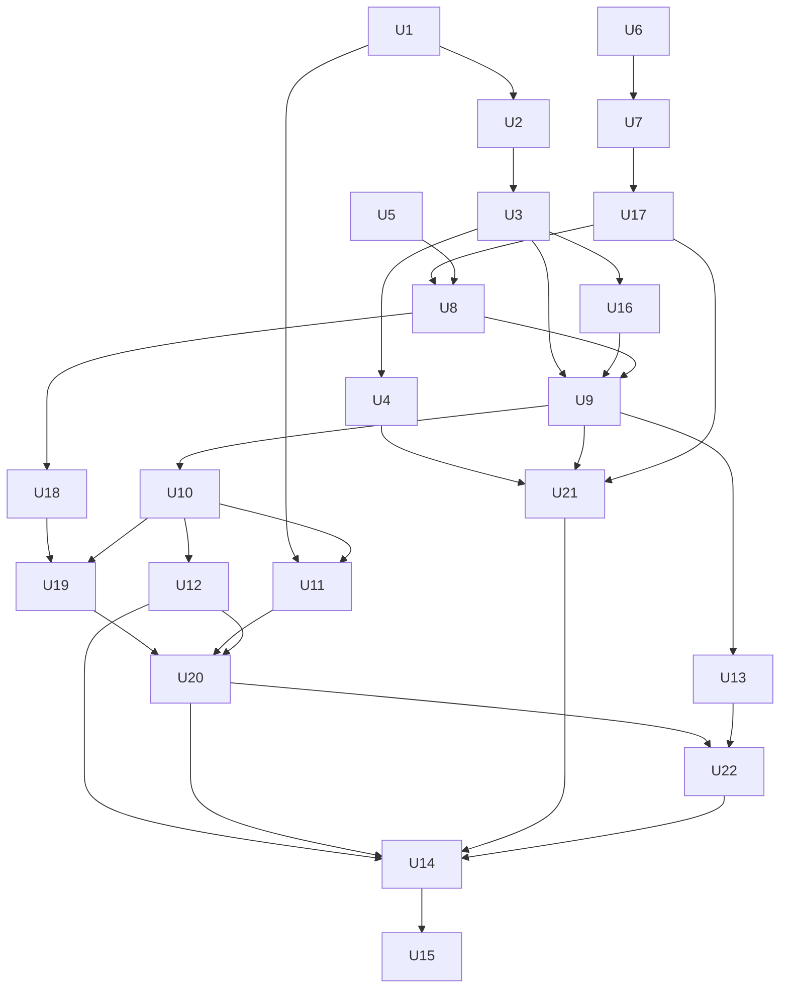

# M6 Contracts and Effects - Plan

The design will be explained chapter by chapter, literate-programming style, in `docs/m6/` (written by U15).
This plan owns the decisions (KTD1 to KTD26) and the work units (U1 to U22); the chapters will explain them and cite them by ID.
Ticket: git-bug `9002a2c` (GitHub #13). Related: #41 (in scope, U2), #47 and #48 (deferred, see Scope Boundaries).

---

## Goal Capsule

- **Objective:** A developer can verify C# business code that throws, divides, uses `int?` and `decimal`, and calls a database or service through an interface whose members take and return types Warrant models (`int`, `long`, `bool`, `decimal`, their nullable forms, records, enums and closed sets). They state what a method promises with `Spec.Requires`/`Spec.Ensures`, write down what each dependency is assumed to do in a contract class, and `dotnet build` either proves the method for every implementation of its dependencies that keeps those contracts, or fails at the line whose obligation could not be proved. The assumption report lists every contract the proof relied on.
- **Means:** the effectful code becomes a program in a C# effect monad defined over Lean's `Std.Do` (KTD4, KTD5). Contracts become `Std.Do` triples whose external operations are bound hypotheses (KTD9). An untrusted C# VC generator proves them with simp and omega (KTD13).
- **Authority:** this plan's Requirements win on behaviour and its KTDs on mechanism. The `docs/m6/` chapters explain and never override. `docs/design.md` governs anything this plan does not decide, except where U15 amends it (§6.1, §11, §12 Q1, Q5, Q8, Q11, Q14, Q17, Q18, Q19, Q20). The M4, M5a and M5b plans' KTDs still hold unless a KTD here replaces one by name.
- **Stop conditions:** stop and ask if:
  - the measured start time crosses KTD3's threshold, at U1 or again at U14 with the full M6 bundle;
  - U3's checkpoint obligation can't be closed by Warrant's simp and omega;
  - `Std.Do`'s `ULift Prop` assertions defeat the kernel or omega in a way the VC simp set cannot clear (KTD13; Alternative C becomes the fallback);
  - a trusted-code change (U6 to U10, U17 to U21) cannot be made without changing what an existing accepted corpus member means;
  - the payment example needs a construct this plan defers (Scope Boundaries);
  - a unit needs one of the owner's uncommitted files (see Dependencies).
- **Execution profile:** units in the Unit Index's phase order. Phase A puts the Lean models in the bundle and proves them against the CLR. Its U3 ends in the go/no-go checkpoint for KTD13 and KTD14: two hand-built obligations proved by Warrant's own `Apply`, simp and omega. Phase B (surface, VIR, extraction) may run in parallel with A. Phase C1 delivers contracts without dependencies, and the private-codebase check runs at its end. Phase C2 adds dependencies, async and decimal. Phase D closes the milestone. The owner re-plans at the two checkpoints the Unit Index names.
- **Finishing:** an implementer (`ce-work` or a person) builds the units; the repository owner reviews and merges, one pull request per unit group as the Unit Index lists.

---

## Product Contract

### Summary

Build milestone M6 as `docs/design.md` §11 and ticket `9002a2c` define it:
- method contracts (`Spec.Requires`, `Spec.Ensures`, `Spec.Assert`) and companion contract classes (`[ContractFor]`);
- an effect monad in the Warrant Lean library for exceptions, null, checked overflow, `/` and `%`, and `async` sequencing;
- VC generation with `Std.Do` triples, run by default as VC generation, then simp, then omega;
- contract assumptions in the assumption report;
- a minimal `decimal` model.

The milestone ends when the design's payment example verifies, with its store as a hypothesis, and its certificate passes Lean's kernel.

### Problem Frame

After M5b, Warrant verifies pure methods over `int`, `long`, `bool`, records, enums and closed sets. Almost no business method is pure in that sense.
The methods worth verifying throw on bad input, divide, read nullable values, use `decimal`, and call a repository or service.
Today each of those is WRT0002 or WRT0005 (`src/Warrant.Extraction/Walker.cs`), and there is no way to say what a method promises beyond a separate `[Theorem]`.
A private production codebase surveyed during M5a shows the cost. Its candidate methods need `throw`, `%`, `int?` and `Math.Min`/`Math.Max`, and its most valuable code calls injected services.

Design D9 already fixes how dependencies are treated: an external call is a hypothesis about every implementation that keeps its contract, never an axiom.
What is missing is the effect model, the contract surface, the statement shape, and a proof procedure that discharges contract obligations without a hand-written script.

### Requirements

**Effects and models**

- R1. A `[Verified]` method may `throw`, use checked arithmetic (in a `checked` block or a `CheckForOverflowUnderflow` project), divide and take remainders of `int` and `long`, and read nullable values, with each operation behaving as the CLR does, exception included.
- R2. `int?`, `long?` and nullable references to records and closed classes are accepted with `null`, `is null`, `is not null`, `== null`, `!= null`, `HasValue`, `Value`, `??` and `GetValueOrDefault()`.
- R3. `decimal` is accepted with literals, comparisons, numeric equality (`1.0m == 1.00m`, also inside records), `+` and `-` (throwing `OverflowException` on overflow), unary `-`, and `Math.Abs`.
- R4. `Math.Min`, `Math.Max` and `Math.Abs` on `int`, `long` and `decimal` are accepted as modelled members, with `Math.Abs(int.MinValue)` throwing as the CLR does.
- R5. Every new model operation agrees with the CLR on boundary and random inputs, including zero divisors, `MinValue / -1` and equal decimals with different scales.

**Contracts**

- R6. `Spec.Requires(bool)` and `Spec.Ensures(...)` at the start of a verified method's block body state what it assumes and promises. Each is proved for the method, and assumed at every verified call site after the caller proves the callee's precondition. Every verified method that can raise must also prove, under its `Requires`, that no implicit runtime exception happens (overflow, a zero divisor, a null read), with a missing `Requires` or `Ensures` meaning `True`. Explicit throws and exceptions propagated from dependencies stay allowed.
- R7. A `[ContractFor(typeof(I))]` class states what the members of interface `I` are assumed to do, with the same `Spec` calls. Nothing in it is verified.
- R8. A verified instance method may call members of a contracted interface through a `readonly` field or a never-assigned primary-constructor parameter. The proof then holds for every implementation of those members that satisfies their contracts.
- R9. `async` methods returning `Task`, `Task<T>`, `ValueTask` or `ValueTask<T>` are accepted when every `await` awaits an external call or a verified method, and every Task-returning call is awaited where it is made.
- R10. `Spec.Assert(bool, params Tactic[])` adds an intermediate fact to prove, optionally with a script. A `[ProofFor(nameof(M))]` method supplies a script for `M`'s contract obligation when the default procedure fails.

**Proving and reporting**

- R11. A contract obligation without a script is proved by the default procedure (VC generation, then simp, then omega) under the D14 budgets. A failure is WRT0001 at the source line of the obligation that failed, with its goal.
- R12. The assumption report lists, for each verified method, every external contract and every callee contract its proof used, each nullable-reference annotation it relied on, a non-null assumption for each dependency it calls through and each non-nullable reference a dependency returns, each `Requires` that unverified callers aren't checked against, and each explicit throw or propagated exception its contract allows, including those of its verified callees.
- R13. Every certificate Warrant admits for an M6 unit, the Std closure included, is accepted by Lean's kernel through `scripts/cross-check.sh`.

**Compatibility**

- R14. Every accepted M4 and M5a corpus member translates to the same declarations and proves as before, and every rejected member is still rejected, except the members whose construct this milestone now supports. Their new outcomes are listed in the M6 corpus README.

### Key Decisions

- **The units are re-sliced into smaller pull requests, with a dependency-free contract slice first.** Chosen over one pull request per phase, so each trusted change is reviewable and real-code value lands before the payment example. `Spec.Assert` and `[ProofFor]` stay in M6, as design §5.2 names them. (session-settled: user-approved — chosen over cutting `Spec.Assert` and `[ProofFor]` to a follow-up: the design names them and the tests rely on them.) Governs R10.
- **Partial operations in `Spec` expressions get well-definedness VCs (KTD26).** (session-settled: user-approved — chosen over rejecting them: rejecting would break design §5.2's own `r is null || r.Id == id`.) Governs R6, R7.
- **An unsatisfiable contract is an error at its `Spec` line (KTD25).** (session-settled: user-approved — chosen over a warning: a vacuous proof must not pass the build.) Governs R6, R7, R11.

### Success Criteria

- The pure parts of the payment example verify (design §5.2).
- `ProcessPayment` verifies with `IPaymentStore` as a hypothesis, and its certificate passes `scripts/cross-check.sh`.
- Differential tests with contract-satisfying mocked externals pass: CLR runs and model evaluation agree on results and on exceptions.
- CLR-agreement tests pass for every new model operation, with generators that include zero divisors, `MinValue / -1` and equal decimals with different scales.
- The private codebase's blocked candidates that need only R1 to R4 translate, and at least one of them verifies with a stated `Spec.Ensures` under the default procedure. This is checked by hand in the private repository and reported without naming its code.

### Scope Boundaries

**Out of M6 (later milestones, per design §11)**

- Heap model and field access beyond contract-typed dependencies, verified regions, loops with invariants, full `decimal` arithmetic and rounding, strings: M7.
- Live IDE feedback, `grind`, typed Mathlib handles: M8.

**Considered and not built**

- Porting `mvcgen`: it is deprecated in Lean 4.35 (`Std/Tactic/Do/Syntax.lean:440`), and its successor `vcgen` needs `Lean.Meta.Sym` and `grind` (about 42k lines). KTD13's generator is smaller and stays untrusted. Revisit if Lean stabilises `Std.WP` and Warrant ports `grind` (M8).
- A trace of external calls in the monad (design Q5, "`SavePayment` was called exactly once"): the exit criterion needs only per-call contracts. Revisit when a real contract needs a call count.
- `try`/`catch`: no requirement or exit criterion needs catching, and matching a catch against modelled, thrown and external exceptions needs the CLR exception hierarchy in the trusted translator. `try` stays WRT0002. Revisit when a surveyed method or contract needs to handle an exception.
- Spec sidecar files (design Q19): the contract surface lands in source first. Contracts put `Spec` calls in method bodies, so a team that can't reference `Warrant` pays that cost; see Open Questions.
- Lifted arithmetic and lifted comparisons on nullable values (`a + b`, `x > 0` with nullable operands): their null semantics differ from `Option` order, and neither the exit criterion nor the surveyed methods need them. Rejected with a named construct. Revisit on the first real use.
- Recursion with effects, contracts on recursive methods, and `[Theorem]` statements that call a raising method (KTD11): decrease obligations don't see through `bind`, and a recursive call can't use its own unproved triple. Each is rejected with a named construct. Revisit with M7's loops and invariants.
- Records and open enums from referenced projects in a dependency's signatures: the M5a type rule still applies (KTD9). Revisit with #32's referenced-source path.
- A non-exhaustive switch over an open enum, a default proof pipeline for `Prove.That`, and the store as the proof environment: the proving guide dates these to M6, but this plan doesn't build them; U15 re-dates them.
- Collections, `Guid` and strings (design Q14, Q18, Q20): the payment example needs none. Q18's point that the most valuable real specs need them stands, and it is recorded for M7 planning.
- A standard contract for logging calls (Q20): needs string interpolation, M7.

#### Deferred to Follow-Up Work

- #47: model a `[Closed]` class's throwing construction in the effect monad. Today it is rejected as WRT0009. Modelling it means a throwing type initializer, which is separate from method effects.
- #48: check a closed class's own `Equals` against identity at verification time.
- #39, #40, #42: tactic improvements, independent of contracts.
- An analyzer code fix that rewrites an expression-bodied member to a block body so it can take a contract (Q17).

### Dependencies

- Lean toolchain v4.35.0 and lean4export `5a9a355`, as pinned in `scripts/lib/lean-toolchain.sh`. `Std` ships with the toolchain, so `lean/lake-manifest.json` needs no new package.
- `WARRANT_INIT_EXPORT` for the opt-in full-Init tests, as in M5b.
- The owner's uncommitted files are never staged: `.gitignore`, `compose.yaml`, `.claude/`, and mode-only changes under `scripts/`.

---

## Planning Contract

### Key Technical Decisions

**Lean library and bundle**

- KTD1. **`Std.Do` is the statement and proof vocabulary, not `Std.WP`.** `Std.Do`'s definitions and lemmas are stable in v4.35. Only their tactic is deprecated, and Warrant doesn't use it. `Std.WP` is marked experimental and changed in 4.35. The walker's structural rules (`Spec.bind`, `Spec.pure`, `Spec.throw_ExceptT`, the consequence rule) are named in one place in the walker, so a later move to `Std.WP` swaps names, not structure. Model-operation specs come from the sidecar (KTD15), not from that list.
- KTD2. **Std enters through bundle roots, not as a whole module.** `scripts/export-semantics.sh` exports roots plus closure, so only the `Std.Do` constants Warrant's models and generator mention are added. All of `Std.Do` would add 1,443 constants over Init, with no new axiom, `extern` or `implemented_by` (research: framework dossier §3). `SemanticsBundle.AxiomProblem` (#26) therefore holds unchanged. The pin file and sidecar are regenerated with the bundle, as their tests already require.
- KTD3. **The bundle stays a verified load unless the measured start time crosses 5 seconds.** M5b KTD19 deferred the choice between a verified load and a trusted store base to M6. U1 measures server start (2.9 s in the M5b baseline) with the Std closure, and U14 measures it again with the full M6 bundle. Above 5 s at either point, the work stops and asks, because a trusted base widens the trusted computing base (design §9).
- KTD4. **The effect monad is an abbreviation over Lean's transformers that threads an opaque world: `ClrM σ α := ExceptT ClrExn (StateM σ) α`, and every obligation quantifies over `σ : Type`.** `Std.Do`'s `WP`, `WPMonad` and `@[spec]` lemmas then apply with no instance proofs of Warrant's own (framework dossier §1). Model operations leave the state unchanged. External operations may read and change it, so two calls to the same dependency are unrelated unless a contract relates them. Without the world, a dependency would be a pure function of its arguments, and a proof could rely on two calls agreeing, which real stateful implementations break. `ClrExn` is an inductive with one constructor per exception the models raise (`overflow`, `divideByZero`, `nullReference`, `invalidOperation`, and `assertFailed` for a failed `Spec.Assert`), plus `thrown` carrying the thrown type's key, and `external` for an exception propagated from a dependency.
- KTD5. **Null is a value, not an effect.** `T?` is `Option T`. Reading `Value` of a null `int?`/`long?` raises `ClrExn.invalidOperation`, as `Nullable<T>.Value` does, and dereferencing a null reference raises `ClrExn.nullReference`. An `OptionT` layer would make null and "threw" one barrel in `Std.Do`'s postconditions.
- KTD6. **Division and remainder test their two throwing cases before calling Lean's operation.** C# `/` truncates, and Lean's `Int32.div` is `BitVec.sdiv`, which also truncates but returns 0 on a zero divisor and wraps `MinValue / -1`. The model raises `divideByZero` first and `overflow` for `MinValue / -1` and `MinValue % -1`, which the CLR throws even in unchecked code. Init already has the `toInt` lemmas for `Int32`/`Int64` division and remainder. Warrant's omega reads neither `Int.tdiv`/`Int.tmod` nor `Int.sign`, so the omega bridges state the result with `Int.ediv`/`Int.emod` and `Int`-valued `if`s on the operands' signs (U2).
- KTD7. **`decimal` is `sign × mantissa × 10^-scale` with a 96-bit natural mantissa and scale 0 to 28.** Equality and order compare the rational values, so `1.0m == 1.00m`. Addition and subtraction compute the exact result. When its mantissa at the larger operand scale needs more than 96 bits, they round the exact value once, half to even, at the largest scale whose rounded mantissa fits in 96 bits, as the CLR does. They raise `overflow` only when the value rounded at scale 0 exceeds 2^96 - 1. Multiplication, division and explicit rounding (M7) are not modelled. A VIR literal carries sign, mantissa and scale exactly. The model's definitions are trusted. Its lemmas are proved in Lean and re-checked by the kernel (design §6.2).

**Surface and extraction**

- KTD8. **`Spec.Requires`/`Ensures` are `[Conditional("WARRANT_CONTRACTS")]` calls that must lead a block body.** This follows `Spec.Decreases` (`src/Warrant/Spec.cs`, `Walker.Scripts.cs`), so they cost nothing at run time. A block body may start with a prefix of `Spec` statements in a fixed order: `Spec.Decreases` if any, then `Spec.Requires`, then `Spec.Ensures`. An expression-bodied member takes no contract in M6 (design Q17). The analyzer says to use a block body, and the code fix is deferred. `Ensures<T>`'s `T` must be the return type, or the awaited type of a `Task<T>`/`ValueTask<T>`.
- KTD9. **An external dependency is a theorem parameter, and its contract is a hypothesis (design D9).** For each contracted member a method uses, the obligation quantifies over an operation of the member's type in `ClrM`. It also takes the member's contract as a hypothesis triple. Dependencies come from `readonly` fields and never-assigned primary-constructor parameters of interface types that have a `[ContractFor]` class (design Q20 extends the readonly-field rule). Each dependency field or parameter a method uses gets a `NonNull` assumption, since calling through a null dependency would throw, and so does each non-nullable reference a dependency member returns, the `Task` included. Any other field read is still WRT0002 until M7's heap model. The interface may come from any assembly, because it is never translated. Its `[ContractFor]` class must be in the verified method's own compilation, in the build and the analyzer alike. Records and open enums in its members' signatures follow the existing type rule, so ones from referenced projects stay rejected.
- KTD10. **A contract class must be `file`/`internal`, `abstract`, implement exactly the interface it names, and contain only members of that interface.** Each member's body is either `Spec` calls followed by `return default!`, `Spec` calls alone for a `void` member, or the expression body `=> default!`, which assumes nothing about the result, as design §5.2's `SavePayment` does. An `abstract` member also assumes nothing. The members of the named interface include those of the interfaces it inherits. A member whose signature uses an unmodelled type is allowed, and only a verified call to it is rejected. A second contract class for the same interface is rejected, naming both. Anything else is rejected with a named step, so a contract can't hide code that would run.
- KTD11. **A unit is translated into `ClrM` exactly when it can raise or calls something that can.** A unit can raise if it contains `throw`, checked arithmetic or narrowing, decimal `+` or `-` (which the CLR checks in any context), `/` or `%` whose divisor isn't a constant other than 0 and -1, a nullable read, a modelled member that throws, an external call, `await`, `Spec.Assert`, or a call to a unit that has a `Requires` (so the walker sees the call and its precondition). Every other unit keeps its M4 pure translation, so R14 holds by construction, and `year % 4` stays pure. The rule is one function over VIR in `Warrant.Vir`, per strongly connected component of the call graph, so extraction, the analyzer and translation all call it and can't disagree. Extraction reports the rejections below as WRT0002 next to the existing recursion rejections, naming the construct and callee that made the unit raising:
  - a raising unit in a recursive component ("recursion with effects"), because its recursive call sits inside a `bind` and the decrease obligations (M5a) don't see through it;
  - a `[Theorem]` whose statement calls a raising unit, with a message that says to state the property as a `Spec.Ensures` on the method instead;
  - a `Requires` or `Ensures` on a unit in a recursive component ("contract on a recursive method"), because its recursive call can't use its own unproved triple.

**Contracts and statements**

- KTD12. **A method's contract obligation is a `Std.Do` triple stated by the trusted translator.** Its precondition is the `Requires` conjunction. Its normal postcondition is the `Ensures` conjunction. Its exception postcondition allows only `ClrExn.thrown` (an explicit `throw`) and `ClrExn.external` (an exception propagated from a dependency). So the VCs must prove that no implicit runtime exception can happen: overflow, a zero divisor, a null dereference. For explicit throws and propagated exceptions this is partial correctness: `Ensures` holds on normal return, and a path that ends in such an exception satisfies it vacuously, so the report lists each such path (KTD20). The statement is the claim, so it lives in Semantics (trusted). Proving it is the engine's job (untrusted, design D11).
  - Every `[Verified]` unit gets an obligation if it has a contract, can raise (KTD11), or calls a unit that has a `Requires`. A missing `Requires` or `Ensures` defaults to `True`, so a contract-free method that divides still has to prove its divisor is never zero.
  - A pure unit's obligation is the triple over `pure (f params)`, so the walker and call sites use one shape.
  - A verified callee's proved triple is used at call sites as a lemma, and its precondition becomes a VC there.
- KTD13. **VC generation is a structural walker in C# (`Warrant.Engine`), not a port of `mvcgen`.** Warrant's translator emits a closed set of program shapes: `bind`, `pure`, `throw`, `ite`/`dite`, matchers on known VIR matchers, `let`, and calls to externals or verified units. The walker applies `Spec.bind`, `Spec.pure`, `Spec.throw_ExceptT` and the consequence rule along that structure, instantiating each external hypothesis at its call site with the current world. Branches use `Triple` rules for `ite` and `dite` that U3 proves, since `Std.Do` has none, and matchers case on the discriminant. At an explicit `throw` it first tries to prove the path unreachable. The kernel checks the resulting proof term, so the walker is untrusted. This copies the pattern of `PipelineScope.ProveDecrease`: Semantics builds the obligation, and the engine proves it.
- KTD14. **Leftover VCs go through a separate VC simp set, then omega.** The world makes every assertion `SPred [σ]`, so the set is `SPred.entails_1`, `SPred.apply_pure_cons`, `SPred.down_pure_nil`, `SPred.and_cons`/`and_nil` and `SPred.or_cons`/`or_nil`, plus `PredTrans.apply_*`, the model operations' equations and the M5a default set. `entails_nil` alone never matches a one-state assertion. It is kept apart from `Tactic.Simp()`'s default set, as omega-prep is (M5a KTD11, KTD13), so existing scripts don't change.
- KTD15. **`@[spec]` lemmas reach the engine through the sidecar, which is the only lookup for model-operation specs.** `tools/warrant-attrs/Main.lean` gains a `spec` kind (name, priority, triple or equation). `scripts/export-attributes.sh` imports `Std.Do`, and `src/Warrant.Meta/Attributes/Sidecar.cs` parses the kind. The sidecar format version goes to 2. The walker looks up model-operation specs by head constant. A DiscrTree is not needed, because the walker knows each node's head (KTD13).
- KTD16. **`Spec.Assert(c)` is a check node in the method's one triple: `if c then pure () else throw ClrExn.assertFailed`.** KTD12's exception postcondition doesn't allow `assertFailed`, so the triple forces `c` at that point, and the walker produces it as a VC at the node, proved by the Assert's script if it has one. The model differs from C# only on paths where the assertion fails, which the triple excludes. Stating the fact as a separate lemma would make the translator compose it with the main obligation, which is trusted work this avoids. `[ProofFor(nameof(M))]` replaces the default procedure for `M`'s whole obligation with its script. The script starts at the triple, so `Tactic.VcGen()` is added for scripts that want the walker first.

**Engine, reports, testing**

- KTD17. **#41 is fixed before any division VC is attempted.** Every `MinValue / -1` guard mentions the folded `int.MinValue` literal, which omega currently treats as an opaque atom, so no division obligation would close.
- KTD18. **Contract failures name their source line through VIR node IDs.** This reuses M5b KTD7: each VC carries the node ID of the operation or `Spec` call that produced it, so a cached outcome renders at the current lines.
- KTD19. **VIR goes to version 3, additively.** New fields are optional, as in M5a's `statement`, `script` and `budget`. New node kinds and enum members are additive. A unit that uses no version-3 form encodes as in version 2 apart from its `vir` field, as M5a KTD18 worded it. That field is in every unit's bytes, so every unit and closure hash changes once and every M5b cache entry is invalidated, which U1's new bundle SHA-256 does anyway.
- KTD20. **New assumption kinds:** `ExternalContract` (a dependency member's contract), `CalleeContract` (a verified callee's proved triple), `MayThrow` (an explicit `throw` or propagated external exception the triple allows, also at each call site of a verified callee that may throw, naming the callee's throw sites; a `throw` proved unreachable is not one), and `CallerPrecondition` (a method's own `Requires`, which nothing checks at run time or at unverified call sites), each with report text. The existing `NonNull` kind covers nullable-reference annotations, each dependency field or parameter a method calls through, and each non-nullable reference a dependency returns (KTD9). Design Q11 is decided: annotations remain assumptions in M6.
- KTD21. **Differential tests run contract-satisfying mocks on both sides, as reply tapes.** Each external member's world is the call index: the model returns the tape's entry at the current index and increments it, and a CLR class replays the same tape. Entries come from the return type's generator plus values built from the call's arguments, and are kept only when the member's `Ensures`, evaluated on the CLR, holds. Each `ClrExn` constructor maps to the CLR exception type it stands for, mocks throw a sentinel type that `external` must match, and both runs must agree on the result or that type. This extends `tests/Warrant.Engine.Tests/Differential/` (design §10.5).
- KTD22. **Async is sequencing.** `Task<T>` maps to `ClrM T`. `await` of an external call or a verified method is `bind`. Task and `ValueTask` map the same way, a non-generic one to `ClrM Unit`. A call returning any of them is accepted only as the direct operand of `await`: an async method's exception is captured in its Task, so a discarded, stored or returned Task would make the model throw where the CLR returns. Any other `await`, `ConfigureAwait` or `Task` combinator is WRT0002. Cancellation tokens are opaque parameters with no model.
- KTD23. **Modelled BCL members are a table in Extraction, mapped to Warrant library definitions in Semantics.** The table holds `Math.Min`, `Math.Max` and `Math.Abs` for `int`, `long` and `decimal`. It fills the WRT0005 branch whose message already says "verified or modelled members" (`Walker.cs`). Adding a member means a table row, a library definition, a CLR-agreement row and a corpus entry.
- KTD24. **The M6 corpus is the exit criterion, as in M5a.** `tests/corpus/m6/` has `accepted/`, `refuted/` and `rejected/` with `expected.json`, including the payment example. `M6ExitTests` has one test per Success Criterion except the private-codebase one, which is checked by hand and reported in the pull request without naming its code. `scripts/cross-check.sh` gains an M6 row.
- KTD25. **An unsatisfiable contract is an error at its `Spec` line.** A contradictory `Requires`, or a contract-class member whose `Requires` and `Ensures` admit no result, would make every obligation after it vacuous, with the same local effect as an axiom. For each method `Requires`, and each contract member's `Requires` conjoined with its `Ensures` over a universally bound result, the walker tries to prove `False` with the VC simp set and omega under a small budget. If it does, the method or contract fails with an error naming the `Spec` call.
- KTD26. **A partial operation inside a `Spec` expression gets a well-definedness VC.** `Spec` expressions translate as pure `Prop`s. Each operation in them that can raise (`/`, `%`, `.Value`, a nullable member access, checked or decimal arithmetic) adds a VC that it doesn't raise, under the guards of its enclosing `&&`, `||` and `?:`, proved by the default procedure and reported at the `Spec` line if it fails. So design §5.2's `r is null || r.Id == id` is well defined, and `Spec.Requires(a / b > 0)` without a `b != 0` guard fails. A call to a dependency member inside a `Spec` expression is rejected, since there is no world to evaluate it in.

### High-Level Technical Design

Where contracts flow, with the trusted base boxed:



The obligation for a method `f` with one dependency member `get`, in the D9 shape. This is directional, not exact syntax:

```text
∀ (σ : Type) (get : Int32 → ClrM σ (Option Payment)) (id : Int32),
  (∀ x, ⦃fun _ => ⌜True⌝⦄ get x ⦃post⟨fun r _ => ⌜r = none ∨ r.id = x⌝, allowed⟩⦄) →   -- ExternalContract, every world
  ⦃fun _ => ⌜Requires f id⌝⦄ f get id ⦃post⟨fun r _ => ⌜Ensures f id r⌝, allowed⟩⦄        -- KTD12
where allowed e := e is ClrExn.thrown _ ∨ e is ClrExn.external _
```

The walker's case split over program shapes:

| Shape at the head of `wp⟦e⟧` | Rule applied | New goals |
|---|---|---|
| `pure v` | `Spec.pure` | postcondition at `v` |
| `bind x k` | `Spec.bind` | triple for `x` with intermediate postcondition from `k` |
| `throw e` | `Spec.throw_ExceptT` | exception postcondition at `e` (closes for `thrown`, fails for implicit) |
| `ite c t f` / `dite` | U3's `Triple` rules for `ite`/`dite` | one goal per branch with `c` or `¬c` |
| known matcher | `Cases` on the discriminant, then iota | one goal per alternative |
| `throw (thrown k)` | first try to prove the path unreachable | none if unreachable, else `MayThrow` |
| `Spec.Assert` check node | the `ite` rule, `assertFailed` not allowed | the asserted fact as a VC |
| external `op args` | instantiate its hypothesis at the current world, consequence rule | precondition VC, postcondition entailment |
| verified callee | its proved triple, consequence rule | callee `Requires` VC |
| model operation | its `@[spec]` lemma from the sidecar | side conditions (divisor ≠ 0) |
| anything else | stop | leftover VC to simp and omega |

### Output Structure

```text
lean/Warrant/
  Effect.lean          ClrExn, ClrM, throw helpers, spec lemmas, ite/dite triple rules (U3)
  Checked.lean         checked Int32/Int64 ops, div/rem with their throws, omega bridges (U2, U3)
  Nullable.lean        Option helpers for nullable values (U16)
  Decimal.lean         the decimal model and its lemmas (U4)
  Math.lean            Math.Min/Max/Abs models (U16, U4)
src/Warrant.Vir/
  Effects.cs           raise-ability, KTD11 (U6)
src/Warrant/
  Spec.cs              Requires, Ensures, Assert (U5)
  Contracts.cs         ContractFor, ProofFor (U5)
src/Warrant.Engine/Contracts/
  VcWalker.cs          KTD13 (U11)
  VcSimpSet.cs         KTD14 (U11)
  SpecTable.cs         structural rule names, KTD1 (U11)
tests/corpus/m6/       accepted, refuted, rejected, expected.json, README.md (U14)
docs/m6/               chapters 01-08 and README (U15)
```

### Alternative Approaches Considered

- **Port `mvcgen` (about 4.8k lines of Lean meta code, plus `SPred` proof mode and matcher splitting).** Rejected: it is deprecated upstream, and Warrant's translator already knows every program shape it emits (KTD13).
- **Simp-only pipeline over `Std.Do`'s `@[simp]` `wp` equations (framework dossier option A).** It works for straight-line code, but simp can't apply an external hypothesis triple at a call site. KTD13 is that missing step, and simp stays for the leftovers.
- **Warrant's own `wp` calculus with plain `Prop`s, no `Std.Do` (option C).** It has the smallest trusted closure, but every library lemma would have to be re-proved, and the statements wouldn't read as standard Lean triples. It is the fallback if `ULift Prop` defeats omega (stop condition).
- **Monadic translation for every unit.** Rejected: it would change every M4 and M5a declaration and break R14 for no gain (KTD11).

### Risks

| Risk | Mitigation |
|---|---|
| `Std.Do`'s universe-polymorphic `SVal`/`SPred` recursion is new kernel work for the port | U1 admits the closure with the verified load and cross-checks it before anything depends on it |
| `ULift Prop` assertions leave VCs omega can't read | KTD14's `SPred` simp lemmas first; the stop condition and Alternative C if they fail |
| The decimal model disagrees with the CLR on scale after add/subtract | U4's agreement rows include equal values with different scales and every scale boundary |
| Effect inference makes a pure unit monadic and changes its declarations | KTD11 plus R14's corpus check: accepted M4 and M5a members must translate byte for byte, and rejected members change only as the M6 corpus README lists |
| `Warrant.Meta`'s `Apply` has never unified universe-polymorphic `PostCond`/`Assertion` terms, and doesn't synthesize instances | U3 adds instance synthesis, and its two checkpoint obligations exercise `Spec.bind`, `Spec.pure`, the `ite` rule and the consequence rule through `Apply` before Phase C |
| The decimal model's definitions are trusted, and only agreement rows guard them | U4's generator biases toward every rescaling boundary, and U22's contract-statement check runs proved decimal contracts on the CLR |
| Omega can't relate `a / b` to `a` and `b` for a symbolic `b` | A contract that needs it takes a `Spec.Assert` or `[ProofFor]` script; the private-codebase check reports which members needed one |
| `MinValue % -1` throwing is pinned on one runtime and architecture | The C# spec ties it to `x / y` throwing; the agreement rows pin it, and another platform that differs shows as a failing row there |
| Trusted extraction grows by several constructs at once | Four sequential extraction units (U7, U17, U8, U18), each with rejected-corpus members, analyzer parity and its M4 flips |
| The walker builds an ill-typed term on an unexpected shape | Anything unrecognised becomes a leftover VC, never a guessed rule; the kernel rejects a bad term as WRT0010 |
| Server start time grows past the baseline | KTD3's threshold and U14's baseline measurement |

### Open Questions

Deferred, not blocking. Each is the owner's call:
- Design Q14: which milestone takes collections, or whether they become a non-goal. Design §11's M7 row lists strings but not collections, and Q14 asks for a decision before M6. U15 records the owner's decision.
- Design Q19: whether spec sidecars come in a named milestone. An in-house translator already chose comments to avoid the `Warrant` dependency.

### Assumptions

Agent bets this plan was written under, not confirmed by the owner:
- Contracts are total about implicit runtime exceptions and partial about explicit `throw` and propagated external exceptions (KTD12). A method that throws explicitly on every path verifies against any `Ensures`, and the report lists each throwing path. Making explicit throws fail instead would reject ordinary argument validation.
- Design Q5 (an external-call trace) is out of M6. Q11 is decided as "nullable annotations remain assumptions". Q17 is decided as "block bodies only, code fix later". Q19 (sidecars) is out of M6.
- Collections, strings and `Guid` stay out of M6 despite Q18, because the exit criterion doesn't need them.
- Lifted nullable arithmetic is out of M6.
- 5 seconds of server start is the line between a verified load and a trusted Std base (KTD3).
- The real-code success criterion counts only candidates whose blockers are R1 to R4.

---

## Implementation Units

| U-ID | Phase | Title | Files touched (primary) | Depends on |
|---|---|---|---|---|
| U1 | A | Std.Do in the bundle, sidecar and pins | `lean/`, `scripts/export-*.sh`, `tools/warrant-attrs/Main.lean`, `src/Warrant.Meta/Attributes/Sidecar.cs`, `src/Warrant.Engine/PinnedDeclarations.ndjson.gz` | none |
| U2 | A | Omega and truncating division (#41) | `src/Warrant.Meta/Tactic/Omega/`, `lean/Warrant/Checked.lean` | U1 |
| U3 | A | Effect core and the go/no-go checkpoint | `lean/Warrant/Effect.lean`, `lean/Warrant/Checked.lean`, `src/Warrant.Meta/Tactic/Apply.cs` | U1, U2 |
| U16 | A | Nullable and `Math` models | `lean/Warrant/Nullable.lean`, `lean/Warrant/Math.lean`, `tests/Warrant.Semantics.Tests/ClrAgreementTests.cs` | U3 |
| U4 | A | Decimal model | `lean/Warrant/Decimal.lean`, `tests/Warrant.TestSupport/Generators.cs` | U3 |
| U5 | B | Contract surface in `Warrant` | `src/Warrant/Spec.cs`, `src/Warrant/Contracts.cs`, `src/Warrant/Tactic.cs` | none |
| U6 | B | VIR version 3 and shared effect inference | `src/Warrant.Vir/` | none |
| U7 | B | Extraction: throw, checked, `/`, `%` and `Math` | `src/Warrant.Extraction/Walker.cs`, `ModelledMembers.cs`, `tests/corpus/m4/expected.json` | U6 |
| U17 | B | Extraction: nullable values and `decimal` | `src/Warrant.Extraction/Walker.cs`, `tests/corpus/m4/expected.json` | U7 |
| U8 | B | Extraction: contracts without dependencies | `src/Warrant.Extraction/Walker.Scripts.cs`, `Extractor.cs`, `src/Warrant.Analyzers/` | U5, U17 |
| U18 | B | Extraction: dependencies, contract classes and async | `src/Warrant.Extraction/Extractor.cs`, `TypeChecks.cs`, `src/Warrant.Analyzers/` | U8 |
| U9 | C1 | Monadic translation | `src/Warrant.Semantics/` | U3, U16, U8 |
| U10 | C1 | Contract obligations without dependencies | `src/Warrant.Semantics/Contracts.cs`, `src/Warrant.Engine/PipelineScope.cs` | U9 |
| U11 | C1 | VC walker and default procedure | `src/Warrant.Engine/Contracts/`, `src/Warrant.Engine/TacticRunner.cs` | U1, U10 |
| U12 | C1 | Contract assumptions in the report | `src/Warrant.Engine/Reports/` | U10 |
| U19 | C2 | Dependency obligations | `src/Warrant.Semantics/Contracts.cs` | U18, U10 |
| U20 | C2 | External calls in the walker and the report | `src/Warrant.Engine/Contracts/`, `src/Warrant.Engine/Reports/` | U19, U11, U12 |
| U21 | C2 | Decimal translation | `src/Warrant.Semantics/Operators.cs` | U4, U9, U17 |
| U13 | D | Differential tests for effects | `tests/Warrant.Engine.Tests/Differential/` | U9 |
| U22 | D | Differential tests for contracts and dependencies | `tests/Warrant.Engine.Tests/Differential/` | U20, U13 |
| U14 | D | M6 corpus, cross-check and exit tests | `tests/corpus/m6/`, `scripts/cross-check.sh`, `tests/Warrant.Cli.Tests/M6ExitTests.cs` | U12, U20, U21, U22 |
| U15 | D | Documentation | `docs/design.md`, `docs/m6/`, `docs/proving/` | U14 |

Phase A builds and proves the Lean side, and U3 ends in the go/no-go checkpoint. Phase B may run in parallel with A, but its extraction units are sequential (U7, U17, U8, U18), because all four edit `Walker.cs` and the corpus expectations. Phase C1 is contracts without dependencies: it delivers throws, division, nullable values and `Requires`/`Ensures` end to end, which is what the private codebase's candidates need. Phase C2 adds dependencies, async and decimal for the payment example. Phase D closes the milestone.

**Owner checkpoints:** after U3 (does the `Std.Do` route work through Warrant's own `Apply`, simp and omega, or does the plan move to Alternative C), and after C1 (the private-codebase hand check, before C2 starts).

**Pull requests:** one per unit group, each with its own verification: U1; U2; U3; U16 with U4; U5 with U6; U7; U17; U8; U18; U9; U10; U11 with U12; U19 with U20; U21; U13 with U22; U14; U15. Phase A and Phase B pull requests are independent and may merge in either order.



### U1. Std.Do in the bundle, sidecar and pins

- **Goal:** the bundle contains the `Std.Do` constants M6 needs, admitted by the verified load, cross-checked, with their `@[spec]` attributes in the sidecar.
- **Requirements:** R13 (KTD1, KTD2, KTD3, KTD15).
- **Dependencies:** none.
- **Files:**
  - `lean/Warrant.lean`, `lean/Warrant/Effect.lean` (stub importing `Std.Do.Triple.Basic`, `Std.Do.WP.Monad`, `Std.Do.WP.SimpLemmas` and the spec lemmas used)
  - `lean/bundle-roots.txt` (a `Std.Do` section naming its KTD)
  - `scripts/export-attributes.sh` (module list adds `Std.Do`), `tools/warrant-attrs/Main.lean` (`spec` kind)
  - `src/Warrant.Meta/Attributes/Sidecar.cs` (format 2, `spec` entries)
  - `tests/data/warrant-semantics.ndjson.gz`, `tests/data/warrant-attributes.ndjson.gz`, `tests/data/README.md`, `src/Warrant.Engine/PinnedDeclarations.ndjson.gz` (regenerated)
  - `tests/Warrant.Engine.Tests/SemanticsBundleTests.cs`, `tests/Warrant.Meta.Tests/` (sidecar), `tests/Warrant.Lean4Export.Tests/ReaderCorpusTests.cs` (counts)
- **Approach:**
  1. Add the imports and roots. The roots name, besides the spec lemmas, the `WP` and `WPMonad` instances for `Id`, `StateT`, `StateM` and `ExceptT`, the `MonadExceptOf` instance for `ExceptT`, and KTD14's `SPred` simp lemmas, because nothing else in the translator's terms names them and the sidecar exports an attribute only for a bundle constant (about 269 constants with no new axiom, measured against today's roots).
  2. Run `scripts/export-semantics.sh`, then `scripts/pin-kernel-declarations.cs`, then the attributes export.
  3. Measure the added constants, bundle load time and server start with `scripts/measure-m5b.sh`. Record them in `tests/data/README.md`. Apply KTD3's threshold.
  4. Run the existing cross-check bundle step so Lean's kernel replays the new bundle.
- **Patterns to follow:** the M5a omega and simp root sections in `lean/bundle-roots.txt`. The sidecar's existing kinds and `getModuleEntries` loop in `tools/warrant-attrs/Main.lean`.
- **Test scenarios:**
  - `SemanticsBundle.Load` admits the new bundle, and `AxiomProblem` finds only the three standard axioms.
  - The embedded pin file equals `PinnedClosure` of the new bundle.
  - The sidecar parses with `spec` entries, each naming a bundle constant, and has instance entries for the four `WPMonad` instances. A format-1 sidecar is rejected with a message naming the version.
  - Every root in `bundle-roots.txt` is in the bundle (`BundleTests.EveryRootIsInTheBundle`).
  - All M4 and M5a corpus tests pass unchanged.
- **Verification:** the bundle's constant count, load time and start time are recorded, start time is under KTD3's threshold, and `scripts/cross-check.sh` agrees.

### U2. Omega and truncating division (#41)

- **Goal:** omega sees through the folded `int.MinValue` literal, and `toInt` of `Int32`/`Int64` division and remainder reaches omega in a form it can read.
- **Requirements:** R1, R11 (KTD6, KTD17).
- **Dependencies:** U1.
- **Files:**
  - `src/Warrant.Meta/Tactic/Omega/` (literal atom handling for #41)
  - `lean/Warrant/Checked.lean` (bridging lemmas), `lean/bundle-roots.txt` (omega-prep section)
  - `tests/Warrant.Meta.Tests/` (omega), `tests/corpus/m5a/` (an #41 regression member if one fits)
- **Approach:**
  1. Reproduce #41's goal and fix the literal so omega normalises it like any other numeral.
  2. Root Init's existing `Int32`/`Int64` `toInt_div_of_ne_left`, `toInt_div_of_ne_right` and `toInt_mod` lemmas instead of proving them again.
  3. In `lean/Warrant/Checked.lean`, prove bridges that state `toInt (a / b)` and `toInt (a % b)` with `Int.ediv`/`Int.emod` and `Int`-valued `if`s on the operands' signs, with no `Int.tdiv`, `Int.tmod`, `Int.sign` or `natAbs`, since Warrant's omega reads none of those (KTD6). Add them to the omega-prep set.
- **Patterns to follow:** M5a's `Int32`/`Int64` → `Int` bridging set and its root section. Omega's existing `ite` splitting (`IteDisjunction`).
- **Test scenarios:**
  - #41's original goal closes with omega.
  - `x / 2 <= x` for nonnegative `int x`, stated over the model, closes with simp then omega.
  - `x % 3` is in `-2..2` closes.
  - `-7 / 2 == -3`, stated over the model with a negative dividend, closes with simp then omega.
  - A goal that needs `MinValue / -1` to be excluded fails without the side condition and closes with it.
- **Verification:** #41's repro closes, and the M5a corpus proves as before.

### U3. Effect core and the go/no-go checkpoint

- **Goal:** `ClrM`, `ClrExn`, the checked, division and remainder models for `int`/`long`, and `Std.Do` triple rules for branches exist in the library and agree with the CLR, and one hand-built obligation shows the whole route works through Warrant's own tactics.
- **Requirements:** R1, R5 (KTD4, KTD6, KTD13, KTD14).
- **Dependencies:** U1, U2.
- **Files:**
  - `lean/Warrant/Effect.lean`, `lean/Warrant/Checked.lean`, `lean/bundle-roots.txt`
  - `src/Warrant.Meta/Tactic/Apply.cs` (instance synthesis)
  - `src/Warrant.Semantics/Init.cs` (new constants)
  - `tests/Warrant.Semantics.Tests/ClrAgreementTests.cs`, `tests/Warrant.Meta.Tests/`
- **Approach:**
  1. Define `ClrExn` and `ClrM`, and prove `@[spec]` lemmas for each model operation, stating when it throws, what it returns otherwise, and that it leaves the world unchanged. The operations are checked `+`, `-`, `*`, unary `-`, checked `long`→`int` narrowing, and `/` and `%` per KTD6.
  2. Prove `Triple` rules for `ite` and `dite`: from `c → Triple t P Q` and `¬c → Triple e P Q`, conclude `Triple (ite c t e) P Q`, and the dependent version. `Std.Do` has none. Root both and add them to KTD1's named list.
  3. Make `MetaM.Apply` synthesize the instance-implicit arguments that unification leaves unassigned with the existing `SynthInstance`, as Lean's `synthAppInstances` does. Today `Apply.cs` throws "instance synthesis is not available yet".
  4. Add agreement rows whose expected result is a value or an exception kind. Agreement runs the program from an arbitrary world and compares the `Except` component of the result.
  5. Checkpoint for KTD13 and KTD14. Build two obligations by hand as `Std.Do` triples:
     - U11's `Ratio`;
     - a guard, `if b == 0 then throw (thrown k) else pure (a / b)`.

     Apply `Spec.bind`, `Spec.pure`, the `ite` rule and the consequence rule through `Apply`. Close the leftovers with Warrant's simp (KTD14's lemma list) and omega. Admit both terms with the C# kernel. If this fails, stop (Goal Capsule): the owner decides whether the plan moves to Alternative C before Phase C.
- **Patterns to follow:** `ArithmeticRow` and `ComparisonRow` in `ClrAgreementTests.cs`. The `Warrant.Clr.*` files in `lean/Warrant/`.
- **Test scenarios:**
  - Checked `int` add, subtract, multiply and negate agree on every boundary pair, including `MaxValue + 1` throwing `overflow`.
  - `checked((int)x)` raises `overflow` outside `int`'s range and agrees with the CLR on boundary values.
  - `/` and `%` agree on every boundary pair: `x / 0` raises `divideByZero`, and `MinValue / -1` and `MinValue % -1` raise `overflow`.
  - Truncation agrees on negative operands: `-7 / 2 == -3`, `-7 % 2 == -1`.
  - `Apply` with a goal that leaves a `WPMonad` instance unassigned synthesizes it.
  - 150 random cases per row with the pinned seed.
  - Both checkpoint obligations are admitted by the C# kernel.
- **Verification:** every row passes under the kernel, `BundleTests` finds each new constant in the roots, and both checkpoint obligations are proved.

### U16. Nullable and `Math` models

- **Goal:** nullable reads and the `Math` members on `int`/`long` are modelled and agree with the CLR.
- **Requirements:** R2, R4, R5 (KTD5, KTD23).
- **Dependencies:** U3.
- **Files:**
  - `lean/Warrant/Nullable.lean`, `lean/Warrant/Math.lean`, `lean/bundle-roots.txt`, `src/Warrant.Semantics/Init.cs`
  - `tests/Warrant.Semantics.Tests/ClrAgreementTests.cs`
- **Approach:** model `Option` values for `int?`, `long?` and nullable references (KTD5): `Value`, `(int)x` from a nullable (which is `Value`), `??`, `GetValueOrDefault`, and member access through a nullable reference raising `nullReference`. Model `Math.Min`, `Math.Max` and `Math.Abs` on `int` and `long`. Each has a spec lemma as in U3.
- **Patterns to follow:** U3's rows and spec lemmas.
- **Test scenarios:**
  - `int?` `Value` and `(int)x` on null raise `invalidOperation`, and `??` and `GetValueOrDefault` agree.
  - `Math.Abs(int.MinValue)` raises `overflow`, and `Math.Min`/`Max` agree on random pairs.
  - 150 random cases per row with the pinned seed.
- **Verification:** every row passes under the kernel.

### U4. Decimal model

- **Goal:** the minimal `decimal` model exists and agrees with the CLR (Q1 decided for M6).
- **Requirements:** R3, R4, R5 (KTD7, KTD23).
- **Dependencies:** U3.
- **Files:**
  - `lean/Warrant/Decimal.lean`, `lean/Warrant/Math.lean` (`Math.Abs`, `Min`, `Max` on decimal), `lean/bundle-roots.txt`
  - `src/Warrant.Semantics/Init.cs`
  - `tests/Warrant.Semantics.Tests/ClrAgreementTests.cs`, `tests/Warrant.TestSupport/Generators.cs` (decimal generator)
- **Approach:**
  1. Define the representation, a literal constructor from sign, mantissa and scale, equality and order by value, unary minus, and add and subtract per KTD7.
  2. Define `Math.Min` as `if a < b then a else b` and `Math.Max` as `if a >= b then a else b`, comparing by value, which is the operand .NET returns on ties.
  3. Prove that equality is an equivalence, that order is total, and the lemmas the VC simp set needs (for example, `a - b < a` when `b > 0` and no overflow).
  4. Add a generator that biases toward scale boundaries, `decimal.MaxValue`, `MinValue`, negative zero and zero at several scales, and pairs equal by value with different scales.
- **Patterns to follow:** U3's rows. The literal encoder tests for `int`/`long`.
- **Test scenarios:**
  - `1.0m == 1.00m` is true in the model and on the CLR, and a record with a decimal field compares equal for two values equal in value but different in scale.
  - `decimal.MaxValue + 1m` raises `overflow`.
  - `9m + 0.0000000000000000000000000001m` and `decimal.MaxValue - 0.5m` round as the CLR does, with no exception.
  - `decimal.MaxValue + 0.4m` is `MaxValue`, and `decimal.MaxValue + 0.5m` raises `overflow`.
  - `79228162514264337593543950331m + 0.46m` rounds once to `...331`; `...330m + 0.5m` is `...330` and `...331m + 0.5m` is `...332` (ties go to even).
  - `0.1m + 0.2m == 0.3m`, and the result's scale matches the CLR's.
  - Unary `-` agrees, including on negative zero.
  - Comparisons agree on random pairs, including negative values and zeros with different scales.
  - `Math.Min(1.0m, 1.00m)` is `1.00m` and `Math.Max(1.0m, 1.00m)` is `1.0m`, compared by representation, and `Math.Abs` agrees on random values.
  - A literal round-trips through the encoder for every scale 0 to 28.
- **Verification:** every decimal row passes, and the model's lemmas are kernel-checked in the bundle.

### U5. Contract surface in `Warrant`

- **Goal:** the user API has `Spec.Requires`, `Spec.Ensures`, `Spec.Assert`, `[ContractFor]`, `[ProofFor]` and `Tactic.VcGen()`.
- **Requirements:** R6, R7, R10 (KTD8, KTD16).
- **Dependencies:** none.
- **Files:**
  - `src/Warrant/Spec.cs`, `src/Warrant/Contracts.cs`, `src/Warrant/Tactic.cs`
  - `tests/Warrant.Analyzers.Tests/` (API surface on Roslyn 4.8 too)
- **Approach:**
  1. Add the void members as `[Conditional("WARRANT_CONTRACTS")]`. `Ensures<T>(Func<T, bool>)` handles value returns, and `Ensures(Func<bool>)` handles `void`, `Task` and `ValueTask` returns.
  2. Add the attributes with XML docs that say which milestone runs them.
- **Patterns to follow:** `Spec.Decreases` and `[Theorem]`.
- **Test scenarios:**
  - A build without `WARRANT_CONTRACTS` emits no call to the `Spec` members (IL check).
  - The package still targets netstandard2.0 and builds under Roslyn 4.8.
- **Verification:** the API builds with warnings as errors, and the analyzer tests pass on both Roslyn versions.

### U6. VIR version 3 and shared effect inference

- **Goal:** VIR can carry M6's types, operations, effects and contracts, additively, and raise-ability is one function that extraction, the analyzer and translation all call.
- **Requirements:** R1 to R10 (KTD11, KTD19).
- **Dependencies:** none.
- **Files:**
  - `src/Warrant.Vir/` (types: decimal, nullable, task, and a unit type for `void`, `Task` and `ValueTask` returns; an expression-statement node for an awaited call whose result is discarded; an optional unit field `dependencies` (name, interface key, member keys used), kept apart from `params` so existing parameter indices don't change, with the external-call node naming a dependency index and member key; operators: `Div`, `Rem`, checked allowed, checked narrowing; nodes: `throw`, null literal and null tests, `await`, external call, modelled-member call, `requires`, `ensures`, `assert`; a contract unit kind; the KTD20 assumption kinds; decimal literals)
  - `src/Warrant.Vir/Effects.cs` (KTD11's raise-ability per call-graph component, with the construct and callee that caused it)
  - `src/Warrant.Vir/VirWriter.cs`, the reader, `VirHash.cs`
  - `tests/Warrant.Vir.Tests/`
- **Approach:**
  1. Add each form with optional fields, so a unit with no new form encodes as before apart from its `vir` field.
  2. Bump `VirUnit.CurrentVersion` to 3, update the golden `tests/Warrant.Vir.Tests/golden/payout.json`, and make `VirReader` reject a `vir` above `CurrentVersion`, naming it.
  3. Write `Effects.cs` as a pure function over VIR units, so the analyzer compiles it too.
  4. Extend the round-trip samples with one unit per new form.
- **Patterns to follow:** M5a's optional `statement`, `script` and `budget` fields. M5b's `ReferencedSource` assumption kind. `Graph.OnCycles` in Extraction.
- **Test scenarios:**
  - Every new node round-trips through writer and reader.
  - Every M4 and M5a corpus unit serialises byte-identically apart from its `vir` field.
  - A decimal literal with 28 digits of scale round-trips exactly.
  - A version-4 unit is rejected with a message naming the version.
  - Raise-ability: `x / 2` and `year % 4` are pure; `x / -1`, `x % -1`, `x / 0`, `x % 0`, decimal `+`, a call to a unit with `Requires`, and a call to a raising unit are raising, and the result names the construct.
- **Verification:** the VIR tests pass, and no M4 or M5a expectation changes.

### U7. Extraction: throw, checked, `/`, `%` and `Math`

- **Goal:** extraction accepts `throw`, checked arithmetic and narrowing, `/`, `%` and the modelled `Math` members on `int`/`long`, and still rejects the rest with a named construct.
- **Requirements:** R1, R4, R14 (KTD6, KTD23).
- **Dependencies:** U6.
- **Files:**
  - `src/Warrant.Extraction/Walker.cs`, `src/Warrant.Extraction/ExtractionResult.cs` (diagnostic texts)
  - `src/Warrant.Extraction/ModelledMembers.cs` (KTD23 table)
  - `tests/corpus/m4/expected.json`, `tests/corpus/m4/README.md` (flips)
  - `tests/Warrant.Extraction.Tests/`, `tests/Warrant.Analyzers.Tests/CorpusParityTests.cs`
- **Approach:**
  1. Replace the matching rejection sites (`Walker.cs` `Binary`, `Arithmetic`, the `throw` statement and expression sites, the checked conversion) with the VIR form. Keep the rest rejected.
  2. `throw` takes only `new T(...)` with constant or parameter arguments, where `T` is a `System` exception type or a user type whose used constructor has an empty body that chains to a `System` exception constructor with its parameters. The thrown type's key goes into the node for `ClrExn.thrown`. `try` stays rejected (Scope Boundaries).
  3. Update the M4 members this flips (`Arithmetic.Halve`, `Remainder`, `CheckedAdd`, `Statements.Throws`, `CallsUnverified`, `CheckedProject.Add`/`Negate`/`Narrow`) in `expected.json`, and record them in the M4 README's flip list.
- **Patterns to follow:** the M4 operator mapping in `Walker.Arithmetic`. The construct-string conventions in `ExtractionResult.cs`.
- **Test scenarios:**
  - Each newly accepted construct produces its VIR node: `checked(a + b)`, `checked((int)l)`, `a / b`, `a % b`, `throw new ArgumentException("x")`, `Math.Max(a, b)`.
  - `throw new MyException(x)` whose constructor divides is rejected, naming the type.
  - `try`/`catch`, `finally`, `throw;` and `Math.Round` are still rejected with their names.
  - A `CheckForOverflowUnderflow` project's `+` is accepted as checked.
  - Every accepted M4 and M5a member extracts identically, and analyzer parity holds for the new members.
- **Verification:** extraction and analyzer parity tests pass, every accepted M4 and M5a member extracts unchanged, and rejected members change only as the M4 README's flip list records (R14).

### U17. Extraction: nullable values and `decimal`

- **Goal:** extraction accepts `int?`, `long?`, nullable references to records and closed classes, and `decimal`, and rejects lifted operations.
- **Requirements:** R2, R3, R14 (KTD5, KTD7).
- **Dependencies:** U7.
- **Files:**
  - `src/Warrant.Extraction/Walker.cs`, `src/Warrant.Extraction/ExtractionResult.cs`
  - `tests/corpus/m4/expected.json`, `tests/corpus/m4/README.md`
  - `tests/Warrant.Extraction.Tests/`, `tests/Warrant.Analyzers.Tests/CorpusParityTests.cs`
- **Approach:**
  1. Map `T?` to the nullable VIR type (KTD5), with `null`, `is null`, `is not null`, `== null`, `!= null`, `HasValue`, `Value`, `(int)x`, `??` and `GetValueOrDefault()`.
  2. Map `decimal` literals exactly, comparisons, numeric equality, `+`, `-`, unary `-`, and `Math` members on `decimal`.
  3. Reject lifted arithmetic and lifted relational or equality operators on nullable values other than comparison with `null`, as "lifted comparison" or "lifted arithmetic".
  4. Update the flipped M4 members (`NullableParameter`, `ReturnsNull`, `Decimals`). `ComparesWithNull` on a non-annotated parameter stays rejected as "null", since its `NonNull` assumption would make the comparison constant.
- **Patterns to follow:** U7.
- **Test scenarios:**
  - `Task<Payment?>` and `payment is null` extract.
  - `x ?? 0`, `x.Value`, `(int)x` and `1.25m + d` produce their VIR nodes.
  - `x > 0` and `x == 5` on an `int?`, and `a + b` on two `int?`, are rejected with their names.
  - Analyzer parity holds for the new members.
- **Verification:** extraction and analyzer parity tests pass, and the flip list is complete.

### U8. Extraction: contracts without dependencies

- **Goal:** extraction reads `Spec.Requires`, `Ensures` and `Assert` and `[ProofFor]` methods on static and record methods, and reports KTD11's rejections with their cause, in the build and in the IDE.
- **Requirements:** R6, R10 (KTD8, KTD11, KTD16).
- **Dependencies:** U5, U17.
- **Files:**
  - `src/Warrant.Extraction/Walker.Scripts.cs` (contract calls), `src/Warrant.Extraction/Extractor.cs` (prefix rule, KTD11 rejections next to the existing recursion rejections)
  - `src/Warrant.Analyzers/` (same diagnostics as you type)
  - `tests/Warrant.Extraction.Tests/`, `tests/Warrant.Analyzers.Tests/`
- **Approach:**
  1. A block body may start with a prefix of `Spec` statements in a fixed order: `Spec.Decreases` if any, then `Spec.Requires`, then `Spec.Ensures` (KTD8). Anything out of order, or a `Requires`/`Ensures` on an expression-bodied member, is a WRT0002 that says what to do. `DecreasesNotFirst` now means "not first in that prefix".
  2. `Ensures<T>`'s `T` must equal the return type, or the awaited type for `Task<T>`/`ValueTask<T>`. `Ensures(Func<bool>)` is allowed only on `void`, `Task` and `ValueTask` methods. Anything else is WRT0002 naming the expected type.
  3. `[ProofFor(nameof(M))]` attaches its script to `M`'s obligation. `Spec.Assert` becomes a check node at its position (KTD16).
  4. Call U6's `Effects` and report KTD11's rejections as WRT0002, naming the construct and callee that made the unit raising.
- **Patterns to follow:** `IsDecreases`/`DecreasesNotFirst` in `Walker.Scripts.cs`. `ForAllExpr` for the lambda in `Ensures<T>(r => ...)`. The existing recursion rejections in `Extractor.cs`.
- **Test scenarios:**
  - `Spec.Decreases(n); Spec.Requires(n >= 0);` on a recursive method is rejected as a contract on a recursive method, and `Spec.Requires(...)` before `Spec.Decreases(...)` is rejected as out of order. M5a's `Countdown` rejection stays.
  - `Spec.Ensures` after another statement is rejected with "must lead the body".
  - `Spec.Ensures<long>` on an `int` method is rejected, naming `int`.
  - A theorem about `A` is rejected because `A` calls `B`, which throws, and the message names `B`'s throw.
  - `[ProofFor(nameof(Missing))]` is rejected, naming the missing method.
  - Analyzer parity holds for every new diagnostic.
- **Verification:** extraction and analyzer tests pass.

### U18. Extraction: dependencies, contract classes and async

- **Goal:** extraction reads `[ContractFor]` classes, dependencies of instance methods and `async` methods.
- **Requirements:** R7, R8, R9 (KTD9, KTD10, KTD22).
- **Dependencies:** U8.
- **Files:**
  - `src/Warrant.Extraction/Extractor.cs` (contract units, dependency discovery), `src/Warrant.Extraction/TypeChecks.cs` (contract class shape)
  - `src/Warrant.Analyzers/`
  - `tests/Warrant.Extraction.Tests/`, `tests/Warrant.Analyzers.Tests/`
- **Approach:**
  1. A `[ContractFor(typeof(I))]` class is checked against KTD10 and becomes one contract unit per member of `I` and the interfaces it inherits. Contract classes are found only in the compilation of the verified method, in the build and the analyzer alike.
  2. A dependency is an instance `readonly` field declared in the method's own class, or a primary-constructor parameter of that class that no syntax in any of its declarations (lambdas included) assigns or passes by `ref`/`out`, of an interface type with a contract class. The interface may come from any assembly. Inherited, static and generic-interface dependencies are rejected with named constructs. Each (field, member) pair gets its own operation binder and contract hypothesis. Every other member access on `this` stays rejected.
  3. `await` follows KTD22: a call returning `Task`, `Task<T>`, `ValueTask` or `ValueTask<T>` is accepted only as the direct operand of `await`.
- **Patterns to follow:** the closed-shape step reporting for KTD10.
- **Test scenarios:**
  - `ProcessPayment` from design §5.2 extracts with `store`'s two members as dependencies and the contract class's `Ensures` as their contracts.
  - An interface from a referenced project is accepted, and a referenced-project record in its signature is rejected with the existing message.
  - A contract class:
    - a member body that isn't `Spec` calls plus `return default!` is rejected, naming the step;
    - a `void` member with only `Spec` calls is accepted, and so is an `abstract` member;
    - an interface that inherits `IDisposable` is accepted with `Dispose` in the class;
    - a member with an unmodelled type is accepted until a verified call uses it;
    - a second contract class for the same interface is rejected, naming both;
    - a contract class that implements a second interface is rejected.
  - A mutable field of a contracted type is rejected. So is a primary-constructor parameter assigned inside a lambda.
  - `await Task.Delay(1)` is rejected. `await store.GetPayment(id)` is accepted. `store.SavePayment(p);` without `await`, and `var t = store.GetPayment(id); await t;`, are rejected.
- **Verification:** extraction and analyzer tests pass, and the payment example extracts with the expected units.

### U9. Monadic translation

- **Goal:** units that can raise translate to `ClrM` programs, and all other units translate exactly as before.
- **Requirements:** R1, R2, R4, R9, R14 (KTD4, KTD11, KTD22).
- **Dependencies:** U3, U16, U8.
- **Files:**
  - `src/Warrant.Semantics/BodyTranslator.cs`, `Statements.cs`, `Operators.cs`
  - `src/Warrant.Semantics/MonadicStatements.cs`
  - `tests/Warrant.Semantics.Tests/`
- **Approach:**
  1. Choose the pure or `ClrM` translation with U6's `Effects`.
  2. For a raising unit, a second statement translator emits `bind`, `pure` and `throw`, keeping join points (docs/m4/05's note on M6). Operands and call arguments are bound left to right, and an operator's own throwing check (KTD6, checked overflow) runs after both operands are bound. Eager logical operators keep both operands' effects in order, and short-circuit forms bind only the evaluated side. A non-variable discriminant of a `switch` is let-bound, so the walker can case on it.
  3. A pure value used in a monadic context is lifted with `pure`. A call to a raising unit or to a unit with `Requires` is a callee node the walker sees (KTD11).
  4. `Spec.Assert(c)` becomes `if c then pure () else throw ClrExn.assertFailed` (KTD16).
- **Patterns to follow:** the CPS rules and placement in `Statements.cs`. `LocalContext` closing with `MkLambda`/`MkPi`.
- **Test scenarios:**
  - A method with only `int` arithmetic translates to the same declaration as in M5a.
  - `a / b` translates to the KTD6 operation in `ClrM`, and the kernel evaluates it from an arbitrary world to an `Except.error divideByZero` component for `b = 0`.
  - When both operands of `/` raise, the left operand's exception is the result.
  - `x && F(y)` with a raising `F` doesn't evaluate `F` when `x` is false, and `x & F(y)` does.
  - A pure method calling a raising one becomes raising, and its declaration type is `ClrM`.
  - `throw new ArgumentException()` evaluates to `Except.error (thrown key)`.
  - `year % 4 == 0` stays a pure translation.
  - Every M4 and M5a translation is byte-identical.
- **Verification:** the Semantics tests and the M4 and M5a corpora pass unchanged.

### U10. Contract obligations without dependencies

- **Goal:** each verified unit that has a contract, can raise (KTD11), or calls a unit with a `Requires` gets a trusted triple obligation in the D9 shape (KTD12), and verified callees' triples become lemmas at call sites.
- **Requirements:** R6, R10, R11 (KTD12, KTD16, KTD25, KTD26).
- **Dependencies:** U9.
- **Files:**
  - `src/Warrant.Semantics/Contracts.cs` (statement construction), `src/Warrant.Semantics/LeanNames.cs` (`$contract`, `$contract_spec`)
  - `src/Warrant.Semantics/Translator.cs` (`TranslatedUnit` gains obligations)
  - `src/Warrant.Engine/PipelineScope.cs` (admission order and caching of obligations, like decrease proofs)
  - `tests/Warrant.Semantics.Tests/`, `tests/Warrant.Engine.Tests/`
- **Approach:**
  1. Build the triple from `Requires`, `Ensures` and the KTD12 exception postcondition.
  2. Translate each `Spec` expression as a pure `Prop`, with a well-definedness obligation for each partial operation in it under its guards (KTD26).
  3. State the vacuity obligations for KTD25.
  4. Admit a proved obligation as the unit's spec lemma, which call sites use (KTD12). A unit whose obligation fails is not usable as a lemma, and its callers report "depends on an unproved contract".
- **Patterns to follow:** `DecreaseObligation` and `TheoremShell` in `Recursion.cs`. `ProveDecrease` admission and caching in `PipelineScope.cs`.
- **Test scenarios:**
  - A method with `Requires` and no `Ensures` gets a triple with postcondition `True`, which still proves the absence of implicit exceptions.
  - A caller of a method with `Requires(x > 0)` gets a VC for `x > 0` at the call, even when the caller is pure and has no contract of its own.
  - A contract-free method with an unguarded `a / b` gets a `True`/`True` obligation that fails at the `/` line.
  - A pure method with `Ensures` gets a triple over `pure`, and a caller uses it as a lemma.
  - `Spec.Requires(a / b > 0)` fails at the `Spec` line without a `b != 0` guard, and proves with `b != 0 && a / b > 0`.
  - `Spec.Requires(x > 0 && x < 0)` is reported as unsatisfiable at its line.
  - `Spec.Assert(b != 0); return a / b;` with no `Requires` fails at the `Spec.Assert` line, and nothing after it is proved from the failed fact.
  - An obligation that fails makes its callers report the dependency, not a second goal.
- **Verification:** obligations are admitted and cached like decrease proofs, and a changed `Ensures` invalidates the cache entry.

### U11. VC walker and default procedure

- **Goal:** contract obligations without a script are proved by KTD13's walker, then the VC simp set, then omega, and every failing VC is reported at its source line with its kind.
- **Requirements:** R10, R11 (KTD13, KTD14, KTD15, KTD18, KTD25).
- **Dependencies:** U1, U10.
- **Files:**
  - `src/Warrant.Engine/Contracts/VcWalker.cs`, `src/Warrant.Engine/Contracts/VcSimpSet.cs`, `src/Warrant.Engine/Contracts/SpecTable.cs` (the structural rule names, the one place they are named, KTD1)
  - `src/Warrant.Engine/TacticRunner.cs` (`vcgen` handler), `src/Warrant.Engine/PipelineScope.cs` (default procedure)
  - `src/Warrant.Meta/Display/Notation.cs` (triples and `wp` in goal display)
  - `tests/Warrant.Engine.Tests/`
- **Approach:**
  1. Walk the program as the HLTD table lists, building the proof term with `Apply` and recording the node ID that produced each leftover VC. Matchers case on the discriminant with `Warrant.Meta`'s `Cases` and reduce with simp's iota.
  2. At each explicit `throw`, first try to prove the path unreachable (its path condition entails `False`) with the VC simp set and omega. A site shown unreachable is not a `MayThrow`.
  3. Run the VC simp set on each leftover, then omega. Budgets are the D14 ones per obligation. Run KTD25's vacuity check under a small budget.
  4. Report every failing VC of an obligation as WRT0001 at its node. Each message starts with the VC kind from the node (division by zero, overflow in a checked operation, null read, precondition of a callee at this call, postcondition of the method, `Spec.Assert`, well-definedness of a `Spec` expression), then the path conditions, then the goal after the VC simp set.
- **Patterns to follow:** `ProveDecrease`. `TacticM.LiftMetaTactic` for the `vcgen` handler.
- **Test scenarios:**
  - `int Ratio(int a, int b) { Spec.Requires(b != 0 && b != -1); return a / b; }` proves. With only `Spec.Requires(b != 0)` it fails at the `/` line as overflow (`MinValue / -1`). Without the `Requires` it fails at the `/` line as division by zero.
  - `checked(a + b)` with `Requires(a > -1000 && a < 1000 && b > -1000 && b < 1000)` proves no overflow, and with only the upper bounds it fails at the `+` line.
  - A division whose divisor may be zero proves when it is reached only if `Requires` is violated, and fails at its line otherwise.
  - `Requires(b != 0)` plus `if (b == 0) throw ...` produces no `MayThrow`. An explicit `throw` reachable on some path proves, and the report lists it as `MayThrow`.
  - A `null` dereference of a nullable value guarded by `is not null` proves, and an unguarded one fails at its line.
  - A method with three failing VCs reports all three, each with its kind.
  - A shape the walker doesn't know becomes a leftover VC, not an exception.
  - Running out of budget reports WRT0006.
- **Verification:** each scenario reports the right lines and kinds.

### U12. Contract assumptions in the report

- **Goal:** the assumption report has design §8.4's contract sections for methods without dependencies, in Markdown and JSON.
- **Requirements:** R12 (KTD20).
- **Dependencies:** U10.
- **Files:**
  - `src/Warrant.Engine/Reports/AssumptionReport.cs`, `MarkdownReport.cs`, `JsonReport.cs`
  - `tests/Warrant.Engine.Tests/ReportTests.cs`
- **Approach:**
  1. Render `CalleeContract`, `MayThrow` (propagated through verified callees) and `CallerPrecondition` with their text.
  2. Widen the global `BundleModels` text to the M6 models.
- **Patterns to follow:** the existing kinds' text table at `AssumptionReport.cs` and the JSON round trip.
- **Test scenarios:**
  - A method that throws `ArgumentException` lists the throw site, and a caller `F` of a throwing verified `G` lists the propagated throw with `G`'s site.
  - `Ratio`'s report says its `Requires` is not checked at run time or at unverified call sites.
  - Every new kind round-trips through JSON.
- **Verification:** report tests pass.

### U19. Dependency obligations

- **Goal:** obligations of methods with dependencies bind one operation and one contract hypothesis per (field, member) pair, over every world.
- **Requirements:** R7, R8 (KTD4, KTD9, KTD25).
- **Dependencies:** U18, U10.
- **Files:**
  - `src/Warrant.Semantics/Contracts.cs`, `src/Warrant.Semantics/MonadicStatements.cs` (external calls)
  - `tests/Warrant.Semantics.Tests/`
- **Approach:**
  1. Translate an external call to the bound operation, threading the world (KTD4).
  2. Add the hypotheses to the D9 statement, and the `NonNull` assumptions for each dependency and each non-nullable reference result (KTD20).
  3. State each contract-class member's vacuity obligation (KTD25).
- **Patterns to follow:** U10.
- **Test scenarios:**
  - `ProcessPayment`'s obligation has two operation binders, two hypotheses and the expected pre- and postcondition. This is compared with a hand-written statement in a test.
  - A method calling an external dependency twice threads the world, and the kernel evaluates it with a mock that returns a different value on each call.
  - A contract class member with `Ensures(r => r > 0 && r < 0)` is reported as unsatisfiable at its line.
- **Verification:** the Semantics tests pass.

### U20. External calls in the walker and the report

- **Goal:** the walker uses each external hypothesis at its call site, and the report lists external contracts.
- **Requirements:** R8, R11, R12 (KTD13, KTD20).
- **Dependencies:** U19, U11, U12.
- **Files:**
  - `src/Warrant.Engine/Contracts/VcWalker.cs`, `src/Warrant.Engine/Reports/`
  - `tests/Warrant.Engine.Tests/`
- **Approach:** add the HLTD table's external-call row: instantiate the hypothesis at the current world and arguments, then the consequence rule. Render `ExternalContract` and the dependency `NonNull` lines.
- **Patterns to follow:** U11's callee row.
- **Test scenarios:**
  - `var p = await store.GetPayment(id); return p is null || p.Id == id;` with that as its `Ensures` proves only through `GetPayment`'s contract.
  - The same `Ensures` with `GetPayment(id + 1)` fails, and so does one that relies on `SavePayment`'s `=> default!` contract for a property it doesn't give.
  - `ProcessPayment`'s obligation proves under the default procedure.
  - `ProcessPayment`'s report lists `IPaymentStore.GetPayment`'s and `SavePayment`'s contracts under "Assumed (contracts)", that `store` is not null, and that `GetPayment`'s `Task` result is not null.
- **Verification:** the payment example's report matches a checked-in expected file.

### U21. Decimal translation

- **Goal:** `decimal` literals, comparisons, equality and arithmetic translate to the U4 model.
- **Requirements:** R3, R4 (KTD7, KTD11).
- **Dependencies:** U4, U9, U17.
- **Files:**
  - `src/Warrant.Semantics/Operators.cs`, `src/Warrant.Semantics/TypeDeclarations.cs` (record `$eq` with decimal fields)
  - `tests/Warrant.Semantics.Tests/`
- **Approach:** map each decimal VIR node to its model operation. `+` and `-` are raising in any context (KTD11). A record's `$eq` compares a decimal field by value.
- **Patterns to follow:** U9's operator mapping.
- **Test scenarios:**
  - A method whose only operation is `a + b` on `decimal` translates to `ClrM`, and the kernel evaluates `decimal.MaxValue + 1m` to `Except.error overflow`.
  - `new P(1.0m) == new P(1.00m)` evaluates to true.
- **Verification:** the Semantics tests pass.

### U13. Differential tests for effects

- **Goal:** every accepted M6 function without dependencies agrees between the CLR and the model on results and exceptions.
- **Requirements:** R1 to R5 (KTD21).
- **Dependencies:** U9.
- **Files:**
  - `tests/Warrant.Engine.Tests/Differential/` (exception mapping), `tests/Warrant.Engine.Tests/Differential/README.md`
  - `tests/Warrant.TestSupport/Generators.cs`
- **Approach:** map each `ClrExn` constructor to the CLR exception type it must match: `overflow` to `OverflowException`, `divideByZero` to `DivideByZeroException`, `invalidOperation` to `InvalidOperationException`, `nullReference` to `NullReferenceException`, and `thrown k` to type `k`. Run the model from an arbitrary world and compare the `Except` component (KTD21).
- **Patterns to follow:** `AgreesOnEveryBoundaryCombination`, `AgreesOnRandomInputs` and `ModelCheck`.
- **Test scenarios:**
  - Every accepted M6 corpus function without dependencies agrees on every boundary combination.
  - A function that divides agrees on `divideByZero` for a zero argument.
  - 1,000 random inputs per function with the pinned seed.
- **Verification:** the differential suite passes.

### U22. Differential tests for contracts and dependencies

- **Goal:** functions with dependencies agree with the CLR under contract-satisfying mocks, and every proved `Ensures` holds on CLR runs.
- **Requirements:** R6, R8, R11 (KTD21).
- **Dependencies:** U20, U13.
- **Files:**
  - `tests/Warrant.Engine.Tests/Differential/` (mocks, contract-statement check), `tests/Warrant.Engine.Tests/Differential/README.md`
- **Approach:**
  1. Generate each external member as a reply tape (KTD21). On the CLR, mocks throw a dedicated sentinel exception that `external` must match. Async CLR runs use `GetAwaiter().GetResult()`.
  2. Check contract statements: for every accepted M6 method whose obligation is proved, run it on the CLR with contract-satisfying mocks, on generated inputs that satisfy its `Requires`. Assert that its `Ensures`, evaluated on the CLR from a rewritten copy of the compilation, holds on every normal return, and that every exception is an explicit throw or one raised by a mock. This is modelled on `TheoremStatementTests`.
- **Patterns to follow:** `TheoremStatementTests`, `ModelCheck`.
- **Test scenarios:**
  - `ProcessPayment` agrees for tapes that return `null`, a matching payment, one whose status isn't pending, and different payments on successive calls.
  - A mock that throws exercises the `external` path.
  - A member for which no reply passes its `Ensures` within the generator's budget fails the test.
  - Every proved accepted method's `Ensures` holds on its CLR runs.
- **Verification:** the differential suite passes, and its README's cost table includes the M6 corpus.

### U14. M6 corpus, cross-check and exit tests

- **Goal:** the M6 corpus, including the payment example, passes end to end, Lean's kernel accepts its certificates, and each Success Criterion is a test.
- **Requirements:** R11, R13, R14 and the Success Criteria (KTD3, KTD24).
- **Dependencies:** U12, U20, U21, U22.
- **Files:**
  - `tests/corpus/m6/accepted/`, `refuted/`, `rejected/`, `expected.json`, `README.md` (which collects the M4 flip lists)
  - `tests/Warrant.Extraction.Tests/CorpusTests.cs`, `tests/Warrant.Engine.Tests/CorpusTests.cs`, `tests/Warrant.Analyzers.Tests/CorpusParityTests.cs`, `tests/Warrant.TestSupport/CorpusCompilations.cs`
  - `scripts/cross-check.sh` (M6 row), `scripts/measure-m5b.sh` (start time and memory with the M6 bundle)
  - `tests/Warrant.Cli.Tests/M6ExitTests.cs`, `tests/Warrant.Build.Tests/` (a contract-bearing project)
- **Approach:**
  1. Write the corpus: the payment example and its pure parts in `accepted/`; contracts that are false in `refuted/`, with the failing line, kind and goal in `expected.json`; and deferred constructs in `rejected/`. It includes:
     - refuted:
       - a method that calls `GetPayment(id)` twice and ensures the results are equal, both under the default procedure and with a `[ProofFor]` script that cases on the call result and then uses simp;
       - a contract-free method with an unguarded `/`;
       - `int Neg(int x) { return x / -1; }`;
       - a caller that passes 0 to a method that requires a non-zero argument;
       - `Ratio` with only `Requires(b != 0)`;
       - a contract-free `checked(a + b)`, an unguarded `x.Value` on `int?`, and `Math.Abs(x)` on `int`;
       - a decimal `a + b` with no `Requires`;
       - a pure method with a false `Ensures`;
       - a contradictory `Requires`, and a contract class with an unsatisfiable `Ensures`;
     - accepted:
       - a method that throws on every path, with its expected `MayThrow` report;
       - `year % 4` in a pure method;
       - the external-contract member from U20;
     - rejected: `try`/`catch`, a `%`-based recursive `Gcd`, a `[Theorem]` that calls a raising method, `_ = M();` and `var t = M(); await t;` on a Task-returning `M`, and a user exception type whose constructor runs code;
     - for R10:
       - accepted: a method whose `Ensures` needs a `Spec.Assert` with a script, and one proved by a `[ProofFor]` script that starts with `Tactic.VcGen()`;
       - refuted: `Spec.Assert(b != 0); return a / b;` with no `Requires` (fails at the `Spec.Assert` line), and a `[ProofFor]` script aimed at a false `Ensures` (WRT0001 at the `Ensures` line).
  2. Add the cross-check row, which verifies with `--out`, has Lean replay it, and tampers with a proof so both kernels reject it. Members that need `checkOverflow` are verified with that compilation setting in the row.
  3. Add a build-integration test: a contract-bearing project verifies, and a refuted one fails at the right line, under `dotnet build`, VS 2026 and VS 2022 MSBuild.
  4. Record start time and memory against the M5b baseline, and apply KTD3's threshold again with the full M6 bundle.
- **Patterns to follow:** `tests/corpus/m5a/` and `M5bExitTests`.
- **Test scenarios:**
  - One `M6ExitTests` fact per Success Criterion, except the private-codebase one (KTD24).
  - Each refuted member reports WRT0001 at the expected line, with the expected kind and goal.
  - Each rejected member reports its construct.
  - The cross-check row ends with "all verdicts agree".
- **Verification:** `dotnet test --filter M6Exit`, the build-integration matrix and `scripts/cross-check.sh` pass, and the baselines are recorded.

### U15. Documentation

- **Goal:** the design, the M6 chapters and the proving guide describe what M6 built, and nothing promises what it didn't.
- **Requirements:** all (KTD1 to KTD26).
- **Dependencies:** U14.
- **Files:**
  - `docs/design.md` (§11 M6 row marked done with evidence; §12 Q1, Q5, Q8, Q11, Q14, Q17, Q18, Q19 and Q20 updated with what M6 decided or the owner decided; §6.1 type table)
  - `docs/m6/README.md` and chapters (Std closure and sidecar, effect monad and models, decimal, extraction, monadic translation, contract obligations, VC generation, reports and testing)
  - `docs/proving/reference.md`, `docs/proving/how-to.md`, `REPRODUCING.md`, `README.md` status line
- **Approach:**
  1. Write each chapter from the code and KTDs, citing IDs, as the M5b chapters do.
  2. Go through every "M6" mention in `docs/proving/reference.md` and `how-to.md`. Mark what M6 built as running, and re-date or remove each one it didn't, among them `try`/`catch`, an open-enum switch without `_`, a default pipeline for `Prove.That`, and the store as the proof environment.
  3. The how-to says a guard with an explicit `throw` is the way to protect a method that unverified code can call, since `Requires` isn't checked at run time (KTD20).
- **Test expectation:** none, documentation only. The Definition of Done's agreement check covers it.
- **Verification:** every KTD is cited by a chapter, the design's §11 row names the evidence, and no "M6" mention in `docs/proving/` describes something M6 didn't build.

---

## Verification Contract

| Gate | Command or check | Proves |
|---|---|---|
| Build | `dotnet build` | All projects build with warnings as errors, including netstandard2.0 `Warrant` and the analyzers. |
| Tests | `dotnet test` | Every unit's model, extraction, translation, engine and report tests, with no Lean toolchain installed. |
| CLR agreement | `dotnet test --filter ClrAgreement` | R5 (U3, U16, U4). |
| Differential | `dotnet test --filter Differential` | U13 and U22, with `WARRANT_PBT_SEED` pinned: R1 to R5, and R6, R8 and R11 through the contract-statement check. |
| Exit | `dotnet test --filter M6Exit` | The Success Criteria (U14). |
| Init store | `WARRANT_INIT_EXPORT=<path> dotnet test --filter "FullyQualifiedName~AcceptsFullInit\|FullyQualifiedName~PassesCheckStore"` | The full-Init tests still pass with the M6 bundle. |
| Build integration | `WARRANT_BUILD_INTEGRATION=1 dotnet test tests/Warrant.Build.Tests` | U14's contract-bearing project verifies, and its refuted twin fails at the right line, under `dotnet build`, VS 2026 and VS 2022 MSBuild. |
| Cross-check | `scripts/cross-check.sh` | R13: Lean's kernel accepts the M6 certificates and the bundle; ends with "all verdicts agree". |
| Bundle | `scripts/export-semantics.sh`, `scripts/pin-kernel-declarations.cs`, `scripts/export-attributes.sh` | The committed bundle, pins and sidecar are reproducible (U1). |
| Baselines | `scripts/measure-m5b.sh` | Start time and memory with the M6 bundle against KTD3's threshold. |

---

## Definition of Done

- Every unit's Verification holds, and every gate in the Verification Contract passes.
- Each Success Criterion holds, item by item. The private-codebase criterion is reported without naming its code.
- `docs/m6/`, the KTDs and the code agree, and design §11's M6 row is marked done with its evidence.
- Ticket `9002a2c` (#13) is updated with what was done and closed after the owner merges. #41 is closed by U2's merge.
- No server process is left running after the test suite.
- No experimental or abandoned code remains in the diff, and none of the owner's uncommitted changes (`.gitignore`, `compose.yaml`, `.claude/`, script mode bits) is committed.

---

## Appendix

### Sources and research

- Design: `docs/design.md` §4.1, §4.2, §5.2, §6.1–§6.3, §8.4, §9, §10.5, §11 and §12 Q1, Q5, Q8, Q11, Q14, Q17–Q20; the M4, M5a and M5b plans and chapters.
- Repository:
  - `src/Warrant/Spec.cs`: only `Implies`, `ForAll`, `Exists`, `Decreases`.
  - `src/Warrant.Vir/VirOperators.cs`: `VirOverflow.Checked` exists, unused.
  - `src/Warrant.Semantics/BodyTranslator.cs`: `RequireWrap` throws on checked, "needs exceptions (M6)".
  - `src/Warrant.Extraction/Walker.cs`: every M6 rejection site, and the WRT0005 branch already worded "verified or modelled members".
  - `src/Warrant.Engine/PipelineScope.cs` `ProveDecrease`: the obligation pattern KTD13 copies.
  - `src/Warrant.Engine/SemanticsBundle.cs` and `PinnedDeclarations.ndjson.gz` (#26).
  - `src/Warrant.Meta/Attributes/Sidecar.cs` and `tools/warrant-attrs/Main.lean`: seven attribute kinds, no `spec`.
  - `src/Warrant.Engine/Service/Cache/CacheKey.cs`: keys include the bundle and sidecar SHA-256, so U1 needs no cache change.
  - `lean/bundle-roots.txt`: 394 roots. `lean/Warrant/`: 115 lines.
  - `tests/Warrant.Semantics.Tests/ClrAgreementTests.cs`, `tests/Warrant.Engine.Tests/Differential/`, `tests/Warrant.Cli.Tests/M5bExitTests.cs`.
- Lean 4.35.0 toolchain sources:
  - `Std/Do/**`: `WP/Basic.lean` instances for `Id`, `StateT`, `ReaderT`, `ExceptT`, `OptionT`, `EStateM`; `Triple/SpecLemmas.lean`, 163 `@[spec]` lemmas; `WP/SimpLemmas.lean`.
  - `Lean/Elab/Tactic/Do/**`: `mvcgen`, 4,830 lines; `Attr.lean`, `specMap`.
  - `Std/Tactic/Do/Syntax.lean:440`: `mvcgen` deprecated since 2026-08-21.
  - `Lean/Elab/Tactic/VCGen/**`: `vcgen` on `Lean.Meta.Sym` and `grind`.
- Closure measured with `importModules`: Init 65,972 constants; `Std.Do` adds 1,443 (937 theorems); no new axioms; no `extern` or `implemented_by`.
- Lean release notes v4.22.0 (`Std.Do` introduced), v4.23.0 (universe-polymorphic assertions), v4.29.0 (local specs), v4.35.0 (`vcgen`, `mvcgen` deprecated): lean-lang.org/doc/reference.
